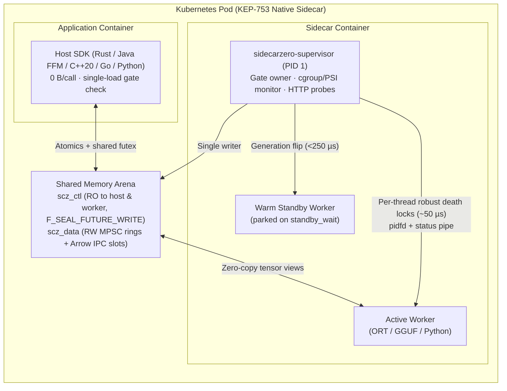

# SidecarZero

**SidecarZero** is a sub-millisecond, zero-copy machine-learning inference sidecar for Kubernetes pods. It moves untrusted or memory-intensive model runtimes (ONNX Runtime, llama.cpp / GGUF, CPython / NumPy) out of the host application process into an isolated sibling container while communicating over kernel-sealed shared memory (`memfd_create` + `FUTEX_WAIT_BITSET`) with pre-stamped Apache Arrow IPC frames.

Every client call (`infer`) is total and bounded by a caller-supplied deadline: if the model worker is unhealthy, reloading, overloaded, or crashes mid-inference, the SDK returns the caller's deterministic fallback within its budget without throwing an exception, leaking a shared-memory slot, or causing a Kubernetes `EndpointSlice` readiness flap.

---

## Architecture Overview



### Core Properties

- **Single-load admission gate:** The supervisor consolidates worker health, heartbeats, memory pressure, and reload state into one 64-bit atomic `gate` word in the read-only control segment (`scz_ctl`). Host admission reads a single cache line (`gate` and `supervisor_hb_mono_ns`) with no locks and no syscalls.
- **Kernel-enforced memory isolation:** The control segment is sealed with `F_SEAL_FUTURE_WRITE | F_SEAL_GROW | F_SEAL_SHRINK | F_SEAL_SEAL` after the supervisor maps it writable, so neither the host nor the worker can corrupt geometry, Arrow templates, or the admission gate. Pre-faulting (`MADV_POPULATE_WRITE`) pins the shared-memory page charge to the sidecar's cgroup.
- **Pre-stamped Arrow IPC data plane:** Request and response slots are pre-formatted as valid 64-byte-aligned Apache Arrow IPC `RecordBatch` messages. Hot-path calls write only the tensor values (plus 8-byte length patches when row counts change)—zero FlatBuffers serialization, zero Arrow library dependencies on the fast path, and zero copies into ONNX Runtime.
- **Sub-millisecond crash recovery:** Each worker consume thread holds a process-shared robust mutex (`PTHREAD_MUTEX_ROBUST`) in a private supervisor-worker segment (`scz_wrk`). When a worker crashes or receives `SIGKILL`, the kernel releases its robust locks before tearing down its page tables, waking the supervisor in ~50–120 µs to close the gate, sweep queued slots, repair the rings, and promote the warm standby in ~230 µs median—keeping Kubernetes `Ready` and `EndpointSlice` conditions untouched.
- **Zero-allocation SDKs across five languages:** Native implementations in Rust, Java 22+ (`java.lang.foreign`), C++20 (header-only), and Go 1.24 (no `cgo`), plus a Python 3.11+ `abi3` extension over the Rust core.

---

## Headline Benchmark Highlights

Summary from the 70-run chaos benchmark suite (`fraud.onnx`, 300 trees of depth 6, 256 `float32` features, 2 ms budget, `SIGKILL` every 2 s for 120 s = 59 kills/run at 5,000 RPS; full tables in [docs/benchmarks.md](docs/benchmarks.md)):

| System | Model Share Under Kill Loop | Fallbacks per Kill (median / max) | Fallback Window per Kill (median) | Errors / Timeouts | K8s `EndpointSlice` Flaps (Service Mode) |
| :--- | :---: | :---: | :---: | :---: | :---: |
| **A — SidecarZero (Rust host, warm standby)** | **99.964%** | **3.0 / 6** | **739.4 µs** | **0 / 0** | **0** |
| **A — SidecarZero (Java FFM host, warm standby)** | **99.877%** | **2.0 / 4** | **714.4 µs** | **0 / 0** | **0** |
| B — Triton 26.04 (gRPC + POSIX SHM, supervised) | 98.240% | 199.5 / 219 | 38.0 ms | 0 / 0 | — |
| C — Localhost HTTP/JSON (ORT, supervised) | 98.753% | 135.0 / 159 | 25.5 ms | 0 / 0 | 10 (unsupervised) |
| D — Unix Domain Socket Binary (ORT, supervised) | 98.590% | 147.5 / 267 | 28.0 ms | 0 / 0 | 9 (unsupervised) |
| E — In-process ONNX Runtime | Dies on first kill | — | — | 3,181 (K8s) | 9 |

Additional key measurements:
- **Loopback transport overhead (`scz-worker-echo`, pinned CPUs):** `0.46 µs` p50 (`0.58 µs` p99) for 16 B payloads; `0.88 µs` p50 (`1.12 µs` p99) for 1 KB payloads; `0.04 µs` (`40 ns`) disconnected fallback path.
- **1-hour high-frequency kill soak:** `36,835` `SIGKILL`s (one every `98 ms`), `29.9 billion` `infer` calls (`9.49 billion` model responses), `0` stuck slots, `0` hangs.
- **Zero-loss live model reload:** `314,191` continuous calls across same-schema model handovers with `0` fallbacks.
- **Hot-path heap allocation:** `0.0 B/call` across Rust, C++20, Go, and Java FFM (`0` GC collections).

---

## Repository Layout

| Path | Description |
| :--- | :--- |
| [`abi/`](abi/) | Normative ABI specification (`scz_abi.toml`) and independently generated golden arena dumps (`abi/golden/`). |
| [`crates/scz-abi-gen/`](crates/scz-abi-gen/) | Code generator emitting layout constants, `static_assert`s, and memory-ordered field accessors for Rust, C++, Go, and Java. |
| [`crates/scz-shm/`](crates/scz-shm/) | Core shared-memory library: arena creation/sealing, Vyukov MPMC rings, slot state machine, Arrow templates, futex waiting, and Loom concurrency models. |
| [`crates/scz-supervisor/`](crates/scz-supervisor/) | `sidecarzero-supervisor` (PID 1 daemon) and `sczctl` (admin CLI). |
| [`crates/scz-worker-core/`](crates/scz-worker-core/) | Shared worker runtime: startup, consume loop, opportunistic batching, `DRAIN`/`HANDOVER`/`TRIM`, heartbeat, and status page histograms. |
| [`crates/scz-worker-ort/`](crates/scz-worker-ort/) | `sidecarzero-worker`: production ONNX Runtime worker with zero-copy IO binding and memory profiles A and B. |
| [`crates/scz-worker-gguf/`](crates/scz-worker-gguf/) | `sidecarzero-worker-gguf`: GGUF / `llama.cpp` embedding worker with deadline abort callbacks and shared `mmap` weights. |
| [`crates/scz-ctl/`](crates/scz-ctl/) | `sczctl`: CLI utility for live status inspection, segment dumping, and model reload triggers. |
| [`crates/scz-worker-core/src/bin/scz-worker-echo.rs`](crates/scz-worker-core/src/bin/scz-worker-echo.rs) | Minimal loopback worker binary for transport microbenchmarks. |
| [`crates/scz-worker-core/src/bin/scz-worker-chaos.rs`](crates/scz-worker-core/src/bin/scz-worker-chaos.rs) | Scriptable fault-injection and memory-scribbling worker binary used by the conformance suite. |
| [`sdks/rust/`](sdks/rust/) | Reference Rust SDK (`sidecarzero` crate) and conformance agent (`scz-agent-rust`). |
| [`sdks/java-ffm/`](sdks/java-ffm/) | Pure-Java JDK 22+ Foreign Function & Memory SDK (`io.sidecarzero`). |
| [`sdks/cpp20/`](sdks/cpp20/) | Header-only C++20 SDK (`include/scz/sidecarzero.hpp`) and CMake `sidecarzero::sidecarzero` package. |
| [`sdks/go/`](sdks/go/) | Pure-Go 1.24 SDK (zero `cgo`, standard library only). |
| [`sdks/python/`](sdks/python/) | Python 3.11+ `abi3` PyO3 client SDK and `python -m sidecarzero.worker` model runner. |
| [`conformance/`](conformance/) | Cross-language conformance runner (`scz-conformance`) and 56 declarative scenarios (46 functional + 10 crash-point scenarios). |
| [`spec/`](spec/) | PlusCal / TLA+ formal specifications (`SlotsRing.tla`, `Consumers.tla`) and 13 seeded mutant checks. |
| [`fuzz/`](fuzz/) | `cargo-fuzz` targets covering handshake, admin socket, HTTP, registry verification, Arrow frames, ring dequeue, and supervisor sweep/repair. |
| [`deploy/`](deploy/) | Distroless container images (`deploy/docker`), KEP-753 Helm library chart (`deploy/helm-kep753`), Prometheus alerts, Grafana dashboard, and 16 Kind E2E tests. |
| [`bench/`](bench/) | Chaos benchmark harness (`make -C bench chaos-bench`), baselines (Triton, HTTP/JSON, UDS binary, in-process ORT), and report generator. |
| [`spikes/`](spikes/) | Standalone kernel and runtime empirical validation suites (`s1`–`s7`). |
| [`docs/`](docs/) | System architecture, benchmark reference, setup guides, and 15 component specifications. |

---

## Quickstart

All Linux builds, tests, formal checks, and conformance suites run inside a hermetic Linux development container via `./scripts/dev`:

```bash
# Run the full verification gate (ABI check, fmt, clippy, fuzz build, Helm lint,
# unit/integration tests, all 5 SDK test & allocation gates, 56 conformance scenarios, and Loom):
./scripts/check

# Run transport loopback latency microbenchmarks:
./scripts/phase1-latency

# Run the TLA+ model checker and mutant suite:
./scripts/tla-check
./scripts/tla-mutants

# Run the 16 Kubernetes Kind end-to-end tests:
./scripts/kind-e2e

# Run the quick chaos benchmark suite:
make -C bench chaos-bench-quick
```

---

## Documentation Index

- **[High-Level Design & Architecture](docs/high-level-design.md)** — System architecture, request lifecycle, design decisions and rationale, security model, observability, and configuration reference.
- **[Benchmarks & Empirical Results](docs/benchmarks.md)** — Complete benchmark tables: 70-run chaos suite, loopback transport microbenchmarks, 1-hour kill soak, ORT / GGUF / Python worker benchmarks, Kind version matrix, OOM shield matrix, and kernel/runtime mechanics.
- **Component Specifications:**
  1. [01 — Shared-Memory ABI (`crates/scz-shm`)](docs/components/01-shm-abi.md)
  2. [02 — Signaling: Adaptive Spin-Then-Wake](docs/components/02-signaling.md)
  3. [03 — Arrow Data Plane](docs/components/03-arrow-data-plane.md)
  4. [04 — Supervisor (`crates/scz-supervisor`)](docs/components/04-supervisor.md)
  5. [05 — Worker (`scz-worker-core`, ORT, GGUF, Python)](docs/components/05-worker.md)
  6. [06 — SDK Contract](docs/components/06-sdk-contract.md)
  7. [07 — Java FFM SDK (`sdks/java-ffm`)](docs/components/07-sdk-java-ffm.md)
  8. [08 — C++20 SDK (`sdks/cpp20`)](docs/components/08-sdk-cpp20.md)
  9. [09 — Go SDK (`sdks/go`)](docs/components/09-sdk-go.md)
  10. [10 — Rust SDK (`sdks/rust`)](docs/components/10-sdk-rust.md)
  11. [11 — Python SDK & Worker Runner (`sdks/python`)](docs/components/11-sdk-python.md)
  12. [12 — Kubernetes Deployment (`deploy/`)](docs/components/12-kubernetes-deploy.md)
  13. [13 — Chaos Benchmark (`bench/`)](docs/components/13-chaos-benchmark.md)
  14. [14 — Testing and Verification](docs/components/14-testing-verification.md)
  15. [15 — Failure Modes and Recovery](docs/components/15-failure-modes.md)
- **Infrastructure Setup Guides:**
  - [Google Cloud Bare-Metal & GKE Setup](docs/setup/gcp.md)
  - [AWS EKS & Bare-Metal Setup](docs/setup/aws.md)
