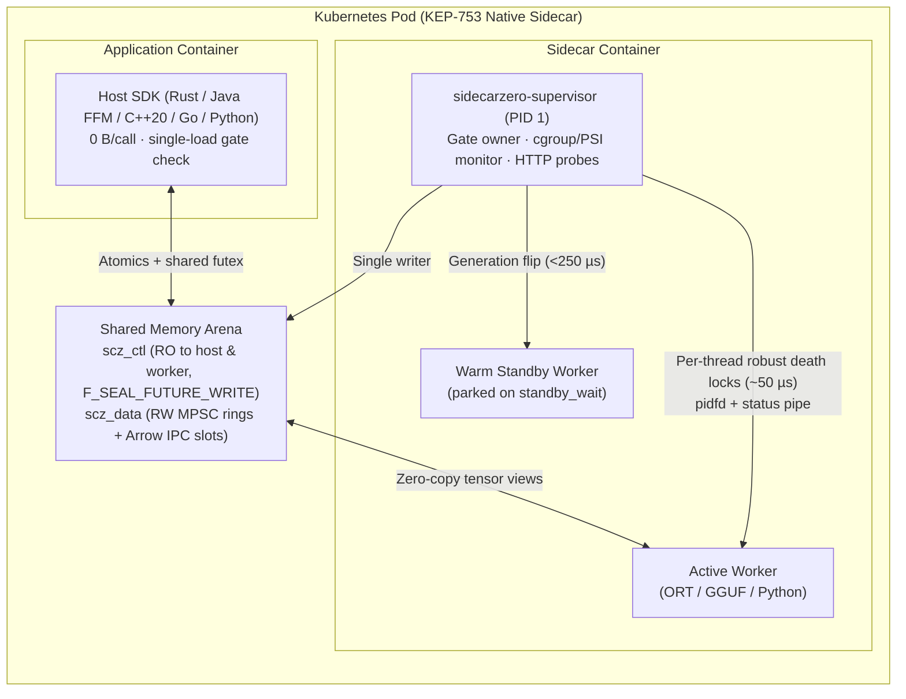

# SidecarZero

**SidecarZero** is a sub-millisecond, zero-copy machine-learning inference sidecar for Kubernetes pods. It moves untrusted or memory-intensive model runtimes (ONNX Runtime, llama.cpp / GGUF, CPython / NumPy) out of the host application process into an isolated sibling container while communicating over kernel-sealed shared memory (`memfd_create` + `FUTEX_WAIT_BITSET`) with pre-stamped Apache Arrow IPC frames.

Every client call (`infer`) is total and bounded by a caller-supplied deadline: if the model worker is unhealthy, reloading, overloaded, or crashes mid-inference, the SDK returns the caller's deterministic fallback within its budget without throwing an exception, leaking a shared-memory slot, or causing a Kubernetes `EndpointSlice` readiness flap.

---

## Architecture Overview



### Core Properties

- **Single-load admission gate:** The supervisor consolidates worker health, heartbeats, memory pressure, and reload state into one 64-bit atomic `gate` word in the read-only control segment (`scz_ctl`). Host admission reads a single cache line (`gate` and `supervisor_hb_mono_ns`) with no locks and no syscalls.
- **Kernel-enforced memory isolation:** The control segment is sealed with `F_SEAL_FUTURE_WRITE | F_SEAL_GROW | F_SEAL_SHRINK | F_SEAL_SEAL` after the supervisor maps it writable, so neither the host nor the worker can corrupt geometry, Arrow templates, or the admission gate. Pre-faulting (`MADV_POPULATE_WRITE`) pins the shared-memory page charge to the sidecar's cgroup.
- **Pre-stamped Arrow IPC data plane:** Request and response slots are pre-formatted as valid 64-byte-aligned Apache Arrow IPC `RecordBatch` messages. Hot-path calls write only the tensor values (plus 8-byte length patches when row counts change)—zero FlatBuffers serialization, zero Arrow library dependencies on the fast path, and zero copies into ONNX Runtime.
- **Sub-millisecond crash recovery:** Each worker consume thread holds a process-shared robust mutex (`PTHREAD_MUTEX_ROBUST`) in a private supervisor-worker segment (`scz_wrk`). When a worker crashes or receives `SIGKILL`, the kernel releases its robust locks before tearing down its page tables, waking the supervisor in ~50–120 µs to close the gate, sweep queued slots, repair the rings, and promote the warm standby in ~230 µs median—keeping Kubernetes `Ready` and `EndpointSlice` conditions untouched.
- **Zero-allocation SDKs across five languages:** Native implementations in Rust, Java 22+ (`java.lang.foreign`), C++20 (header-only), and Go 1.24 (no `cgo`), plus a Python 3.11+ `abi3` extension over the Rust core.

---

## Headline Benchmark Highlights

Summary from the 70-run chaos benchmark suite (`fraud.onnx`, 300 trees of depth 6, 256 `float32` features, 2 ms budget, `SIGKILL` every 2 s for 120 s = 59 kills/run at 5,000 RPS; full tables in [docs/benchmarks.md](docs/benchmarks.md)):

| System | Model Share Under Kill Loop | Fallbacks per Kill (median / max) | Fallback Window per Kill (median) | Errors / Timeouts | K8s `EndpointSlice` Flaps (Service Mode) |
| :--- | :---: | :---: | :---: | :---: | :---: |
| **A — SidecarZero (Rust host, warm standby)** | **99.964%** | **3.0 / 6** | **739.4 µs** | **0 / 0** | **0** |
| **A — SidecarZero (Java FFM host, warm standby)** | **99.877%** | **2.0 / 4** | **714.4 µs** | **0 / 0** | **0** |
| B — Triton 26.04 (gRPC + POSIX SHM, supervised) | 98.240% | 199.5 / 219 | 38.0 ms | 0 / 0 | — |
| C — Localhost HTTP/JSON (ORT, supervised) | 98.753% | 135.0 / 159 | 25.5 ms | 0 / 0 | 10 (unsupervised) |
| D — Unix Domain Socket Binary (ORT, supervised) | 98.590% | 147.5 / 267 | 28.0 ms | 0 / 0 | 9 (unsupervised) |
| E — In-process ONNX Runtime | Dies on first kill | — | — | 3,181 (K8s) | 9 |

Additional key measurements:
- **Loopback transport overhead (`scz-worker-echo`, pinned CPUs):** `0.46 µs` p50 (`0.58 µs` p99) for 16 B payloads; `0.88 µs` p50 (`1.12 µs` p99) for 1 KB payloads; `0.04 µs` (`40 ns`) disconnected fallback path.
- **1-hour high-frequency kill soak:** `36,835` `SIGKILL`s (one every `98 ms`), `29.9 billion` `infer` calls (`9.49 billion` model responses), `0` stuck slots, `0` hangs.
- **Zero-loss live model reload:** `314,191` continuous calls across same-schema model handovers with `0` fallbacks.
- **Hot-path heap allocation:** `0.0 B/call` across Rust, C++20, Go, and Java FFM (`0` GC collections).

---

## Integrating SidecarZero into Application Code

SidecarZero ships native, zero-allocation host SDKs for **Rust**, **Java 22+ (FFM)**, **C++20**, **Go 1.24+**, and **Python 3.11+**. All five SDKs implement the same normative behavioral contract ([`docs/components/06-sdk-contract.md`](docs/components/06-sdk-contract.md)) and pass the same 56-scenario cross-language conformance and crash-point suite.

- [Shared Integration Model & Best Practices](#shared-integration-model--best-practices)
- [1. Rust (`sdks/rust`)](#1-rust-sdksrust)
- [2. Java 22+ Foreign Function & Memory (`sdks/java-ffm`)](#2-java-22-foreign-function--memory-sdksjava-ffm)
- [3. C++20 Header-Only (`sdks/cpp20`)](#3-c20-header-only-sdkscpp20)
- [4. Go 1.24+ Pure-Go (`sdks/go`)](#4-go-124-pure-go-sdksgo)
- [5. Python 3.11+ Client & Worker Runner (`sdks/python`)](#5-python-311-client--worker-runner-sdkspython)
- [Configuring the Sidecar & Model](#configuring-the-sidecar--model)

### Shared Integration Model & Best Practices

1. **One `Client` per model, shared across threads:** Construct a single `Client` at process startup and share it across all worker threads, virtual threads, or goroutines. Construction never blocks on I/O: a single background thread manages the Unix `SOCK_SEQPACKET` handshake, verifies `memfd` seals (`F_SEAL_FUTURE_WRITE`), maps the shared-memory segments, and automatically reconnects if the sidecar restarts.
2. **Endpoint resolution:** Read the socket path from `SIDECARZERO_SOCKET` (injected automatically by the Helm library chart) and default to `/run/sidecarzero/scz.sock`. Prefixing a name with `@` (for example `@sidecarzero`) selects the Linux abstract socket namespace instead of a filesystem path.
3. **Mandatory deterministic fallback:** No `Client` can be constructed without a fallback function `fn(input, reason) → output`. Because the fallback executes inline on calling threads whenever the sidecar is disconnected, reloading, overloaded, or exceeds the caller's deadline, it must be **deterministic, pure, non-blocking, allocation-free, non-throwing (`noexcept` in C++), and fast (target < 400 ns)**. It must also handle any input passed to `infer`, including malformed inputs rejected by the codec (`CODEC_ERROR`).
4. **Total, deadline-bounded `infer(input, budget)`:** `infer` never throws an exception or returns an error on sidecar or transport faults. Every call finishes within `min(budget, max_deadline_ns) − fallback_reserve` (plus fallback execution time) and returns an `Outcome` carrying:
   - `value`: the prediction from the model or the fallback.
   - `source`: `Model` or `Fallback`.
   - `reason`: when `Fallback`, one of the 21 standardized `FallbackReason` codes (`NOT_CONNECTED`, `ABI_MISMATCH`, `SCHEMA_MISMATCH`, `REBINDING`, `GATE_INIT`, `GATE_SHEDDING`, `GATE_RELOADING`, `GATE_DEAD`, `GATE_DRAINING`, `STALE_HEARTBEAT`, `CLOCK_FAULT`, `OVERLOADED`, `TOO_LARGE`, `NO_SLOT`, `CODEC_ERROR`, `RING_FULL`, `DEADLINE`, `WORKER_FAILED`, `MODEL_ERROR`, `BAD_REQUEST`, `RESOURCE_EXHAUSTED`).
   - `model_gen`: when `Model`, the active worker generation that served the call.
5. **Strict schema binding:** Frame codecs compute an xxHash3-64 fingerprint over the declared input/output column names, physical element types (`I8`..`I64`, `U8`..`U64`, `F16`, `F32`, `F64`, `FIXED_BINARY`), list widths, and nullability. If a deployed model's Arrow registry does not match the codec's schema, calls safely return your fallback with `SCHEMA_MISMATCH` instead of reading mis-typed tensor bytes.
6. **Warm startup vs immediate startup:** By default, calls made before the sidecar finishes loading return your fallback (`NOT_CONNECTED` or `GATE_INIT`). Call `await_bound(timeout)` / `awaitBound(timeout)` / `AwaitBound(timeout)` during startup only if your service prefers to block readiness until the first model worker is `HEALTHY`.
7. **Decouple host readiness from model health:** **Never** fail your application container's Kubernetes `readinessProbe` when the sidecar gate is closed—your service remains ready through its fallback, preventing `EndpointSlice` churn during worker restarts or model reloads. Export client metrics via `prometheus_text()` / `prometheusText()` / `PrometheusText()` (or a custom `MetricsSink`) to scrape `scz_client_calls_total`, `scz_client_latency_seconds`, `scz_client_breaker_open`, and `scz_client_state`.

---

### 1. Rust (`sdks/rust`)

The reference Rust SDK (`sidecarzero` crate) is compiled with `#![forbid(unsafe_code)]`, enforces mandatory fallbacks at compile time via a typestate builder (`NoFallback` → `WithFallback<F>`), and monomorphizes both the codec and fallback so the hot path performs zero dynamic dispatch and zero heap allocations.

#### Requirements & Dependencies

- **Target OS:** Linux (`x86_64` or `aarch64`), Rust 2021 edition.
- Add `sidecarzero` to your application's `Cargo.toml`:

```toml
[dependencies]
sidecarzero = { path = "../sidecar-zero/sdks/rust" }
# Optional: needed only if referencing `scz_shm::abi::elem_type::*` constants in custom schemas
scz-shm = { path = "../sidecar-zero/crates/scz-shm" }
```

#### Single-Row & Batch Scoring

Prebuilt codecs cover dense `float32` models with input `features: float32[rows, N]` and output `score: float32[rows, 1]` (column names are customizable on the struct):
- `FeatureScore<N>`: `[f32; N]` → `f32` (single row, class-0 small slot).
- `FeatureBatch<N, R>`: `[[f32; N]; R]` → `[f32; R]` (`R` rows per call; enable batch slots on the supervisor with `--batch-slots`).
- `F32Echo<N>` and `BytesEcho`: opaque-byte codecs for echo/diagnostic workers.

```rust
use sidecarzero::{
    Client, Endpoint, FallbackReason, FeatureBatch, FeatureScore, Options, Source,
};
use std::sync::Arc;
use std::time::Duration;

fn main() {
    let sock = std::env::var("SIDECARZERO_SOCKET")
        .unwrap_or_else(|_| "/run/sidecarzero/scz.sock".into());

    // Typestate builder: `.build()` does not exist until `.fallback(...)` is provided.
    let client = Arc::new(
        Client::builder(Endpoint::parse(&sock), FeatureScore::<256>::default())
            .fallback(|features: &[f32; 256], _reason: FallbackReason| {
                // Pure, deterministic, allocation-free heuristic (< 400 ns)
                if features[17] > 0.8 { 0.9 } else { 0.1 }
            })
            .options(Options {
                fallback_reserve: Duration::from_micros(20),
                callers: 256,      // max concurrent in-flight calls
                sample_every: 64,  // sample 1-in-64 calls per thread for histograms
                ..Options::default()
            })
            .build(),
    );

    // Optional: wait up to 5 s at startup for the arena to map and the gate to reach HEALTHY.
    let _warm = client.await_bound(Duration::from_secs(5));

    // Share `Arc<Client<_, _>>` freely across OS threads or request workers.
    let features = [0.25_f32; 256];
    let out = client.infer(&features, Duration::from_millis(2));

    match out.source {
        Source::Model { model_gen } => {
            println!("model (gen {model_gen}) score = {}", out.value);
        }
        Source::Fallback { reason } => {
            println!("fallback ({reason}) score = {}", out.value);
        }
    }

    // Batch inference (32 rows × 256 features in a single shared-memory slot):
    let batch_client = Client::builder(Endpoint::parse(&sock), FeatureBatch::<256, 32>::default())
        .fallback(|_rows: &[[f32; 256]; 32], _reason| [0.1_f32; 32])
        .build();
    let batch_input = [[0.25_f32; 256]; 32];
    let batch_out = batch_client.infer(&batch_input, Duration::from_millis(5));
    let _scores: [f32; 32] = batch_out.value;

    // Scrape client metrics in Prometheus text exposition format:
    let metrics_body: String = client.prometheus_text();
    let _ = metrics_body;
} // Dropping `Client` (or calling `client.close()`) drains in-flight calls, unmaps SHM, and closes the socket.
```

#### Custom Model Schemas (Embeddings & Multi-Column Inputs)

Implement [`Codec`](sdks/rust/src/codec.rs) when your model exposes custom column names, multiple tensor inputs, or vector outputs (such as a 768-d embedding):

```rust
use sidecarzero::{Codec, CodecError, Column, FrameReader, FrameWriter, Schema};

// Physical element type codes from abi/scz_abi.toml (`scz_shm::abi::elem_type::F32 == 10`)
const ELEM_F32: u32 = 10;

pub struct TextEmbeddingCodec;

impl Codec for TextEmbeddingCodec {
    type In = [f32; 128];
    type Out = [f32; 768];

    fn schema(&self) -> Option<Schema> {
        Some(Schema {
            request: vec![Column::new("token_features", ELEM_F32, 128)],
            response: vec![Column::new("embedding", ELEM_F32, 768)],
        })
    }

    fn encode_frame(&self, input: &Self::In, w: &mut FrameWriter<'_>) -> Result<(), CodecError> {
        w.write_f32(0, input) // column 0
    }

    fn decode_frame(&self, r: &FrameReader<'_>) -> Result<Self::Out, CodecError> {
        let mut emb = [0.0_f32; 768];
        r.read_f32(0, &mut emb)?;
        Ok(emb)
    }
}
```

#### Rust Integration Notes

- **Async runtimes (Tokio):** With sub-millisecond budgets (e.g., `500 µs`–`2 ms`) and adaptive spinning, calling `client.infer(...)` inline on Tokio worker threads avoids cross-thread channel overhead. If you configure larger budgets (e.g., `> 5 ms`) where threads may park in `futex` and want zero Tokio worker blocking, set `Options { spin_ceiling: Some(Duration::ZERO), ..Default::default() }` or invoke from dedicated worker threads.
- **Fork safety:** `scz-shm` installs a `pthread_atfork` handler that clears inherited arena snapshots and closes the inherited session socket in forked children without allocating.

---

### 2. Java 22+ Foreign Function & Memory (`sdks/java-ffm`)

The Java SDK (`io.sidecarzero`) is pure Java built on `java.lang.foreign` (JEP 454). It requires **zero JNI**, **zero native `.so` libraries**, and **zero third-party Maven/Gradle dependencies**, and performs `0 B/call` of heap allocation across both platform threads and virtual threads.

#### Requirements, Building & Mandatory JVM Flag

- **JDK:** JDK 22+ (tested in CI on JDK 25 LTS).
- **Build `sidecarzero.jar`:**
  ```bash
  ./scripts/dev bash -c 'sdks/java-ffm/build.sh'
  # Produces: target/sdk/java-ffm/sidecarzero.jar
  ```
  (Or compile `sdks/java-ffm/src/main/java/**/*.java` directly with `javac --release 22` or `--release 25`.)
- **JVM launch flag (mandatory on Linux):** You **must** pass `--enable-native-access=ALL-UNNAMED` (or your module name) when starting the JVM:
  ```bash
  java --enable-native-access=ALL-UNNAMED -cp sidecarzero.jar:my-app.jar com.example.Main
  ```
  `build()` checks `Module.isNativeAccessEnabled()` eagerly on Linux and throws an `IllegalStateException` naming the missing flag rather than failing later on the background connection thread.
- **macOS / Windows development:** Off Linux, `Client` builds cleanly without linking native symbols and every call returns your fallback with `FallbackReason.NOT_CONNECTED`.

#### Zero-Allocation Primitive Scoring (`ScoreClient` & `BatchScoreClient`)

To avoid boxing a `Float` into a generic `Outcome<Float>` wrapper on every request, `ScoreClient.scoreOutcome` packs the 32-bit `float` score, the `fromModel` bit, and the `FallbackReason` ordinal into a single primitive `long` decoded via static methods on `ScoreOutcome`:

```java
import io.sidecarzero.*;
import java.time.Duration;

public final class FraudScorer implements AutoCloseable {
    private final ScoreClient scorer;
    private final BatchScoreClient batchScorer;

    public FraudScorer() {
        String sock = System.getenv().getOrDefault("SIDECARZERO_SOCKET", "/run/sidecarzero/scz.sock");

        Options opts = Options.defaults()
                .fallbackReserve(Duration.ofNanos(20_000))
                .callers(256)
                .sampleEvery(64);

        // Staged builder: .build() is only reachable after .fallback(...)
        this.scorer = SidecarZero.connect(sock)
                .score(new DenseCodec(256, "features", "score")) // shorthand: .score(256)
                .fallback((features, reason) -> features.length > 17 && features[17] > 0.8f ? 0.9f : 0.1f)
                .options(opts)
                .build();

        this.batchScorer = SidecarZero.connect(sock)
                .batch(new DenseCodec(256))
                .fallback((features, rows, scoresOut, reason) -> {
                    for (int r = 0; r < rows; r++) {
                        scoresOut[r] = features[r * 256 + 17] > 0.8f ? 0.9f : 0.1f;
                    }
                })
                .options(opts)
                .build();
    }

    public float scoreOne(float[] features) {
        // 2 ms budget (2_000_000 ns) — zero heap allocations
        long packed = scorer.scoreOutcome(features, 2_000_000L);
        if (!ScoreOutcome.fromModel(packed)) {
            FallbackReason reason = ScoreOutcome.reason(packed);
            // Counters are already tracked automatically in scorer.stats() / prometheusText()
        }
        return ScoreOutcome.score(packed);
    }

    public boolean scoreBatch(float[] rowMajorFeatures, int rows, float[] scoresOut) {
        // Writes directly into caller-supplied scoresOut[0..rows) with zero allocations
        long packed = batchScorer.scoreInto(rowMajorFeatures, rows, scoresOut, 5_000_000L);
        return ScoreOutcome.fromModel(packed);
    }

    public String scrapeMetrics() {
        return scorer.prometheusText();
    }

    @Override
    public void close() {
        scorer.close();
        batchScorer.close();
    }
}
```

#### Generic Client & Custom Arrow Frame Codecs (`Client<I, O>`)

For models with custom input/output schemas (such as multi-column inputs or embedding vectors), implement `Codec<I, O>` and build via `SidecarZero.connect(sock).codec(...).fallback(...).build()`:

```java
import io.sidecarzero.*;
import java.time.Duration;
import java.util.List;

public final class EmbeddingCodec implements Codec<float[], float[]> {
    @Override
    public Schema schema() {
        return new Schema(
                List.of(new Column("token_features", ElemType.F32, 128)),
                List.of(new Column("embedding", ElemType.F32, 768)));
    }

    @Override
    public int rows(float[] in) {
        if (in.length != 128) throw CodecException.SHAPE; // preallocated, stackless exception
        return 1;
    }

    @Override
    public void encodeFrame(float[] in, FrameWriter w) {
        w.writeF32(0, in, 0);
    }

    @Override
    public float[] decodeFrame(FrameReader r) {
        float[] out = new float[768];
        r.readF32(0, out, 0);
        return out;
    }
}

// Usage:
Client<float[], float[]> embClient = SidecarZero.connect("/run/sidecarzero/scz.sock")
        .codec(new EmbeddingCodec())
        .fallback((in, reason) -> new float[768])
        .build();
Outcome<float[]> out = embClient.infer(inputVec, Duration.ofMillis(2));
```

#### Java Virtual Threads & Carrier-Pinning Protection

Virtual threads executing native `futex` syscalls pin their carrier thread. `Engine` automatically caps simultaneous `futex`-parked callers at `availableProcessors - 1`; any additional virtual threads seamlessly switch to unmounted `LockSupport.parkNanos` polling (`2 µs` → `200 µs`) so `ForkJoinPool` carriers never starve. Pass `Options.defaults().virtualPolling(true)` if you want virtual threads to always unmount instead of parking in `futex`.

---

### 3. C++20 Header-Only (`sdks/cpp20`)

The C++20 SDK (`scz::Client` in `#include <scz/sidecarzero.hpp>`) is a header-only library with zero external dependencies beyond `libc`, `pthread`, and the C++20 standard library. It compiles cleanly under `-fno-exceptions -fno-rtti`, enforces `noexcept` fallbacks via C++20 concepts, and embeds all symbols inside `namespace scz { inline namespace v1 { ... } }`.

#### CMake Integration

Either vendor `sdks/cpp20` directly or install its CMake package:

```cmake
cmake_minimum_required(VERSION 3.20)
project(my_service LANGUAGES CXX)

set(CMAKE_CXX_STANDARD 20)
set(CMAKE_CXX_STANDARD_REQUIRED ON)

# Option A: Vendored subdirectory
add_subdirectory(external/sidecar-zero/sdks/cpp20)

# Option B: Pre-installed (`cmake -S sdks/cpp20 -B build && cmake --install build --prefix /opt/scz`)
# find_package(sidecarzero 0.1 REQUIRED)

add_executable(my_service main.cpp)
target_link_libraries(my_service PRIVATE sidecarzero::sidecarzero)
```

If building without CMake, add `-Isdks/cpp20/include -std=c++20 -pthread`. Off Linux, the headers still compile cleanly and all calls fall back with `scz::FallbackReason::NotConnected`.

#### Single-Row & Batch Scoring

Prebuilt codecs in `scz::codecs` include `DenseF32ToScore<N>`, `DenseF32Batch<N, MaxRows>` (returning `scz::codecs::Scores<MaxRows>` by value with zero heap allocation), and `F32Echo<N>`. Reference fallbacks in `scz::fallbacks` (`Constant<In, Out>`, `Threshold<N>`, `Linear<N>`) are ready to use out of the box.

```cpp
#include <scz/sidecarzero.hpp>

#include <array>
#include <chrono>
#include <cstdlib>
#include <iostream>
#include <span>
#include <string>

int main() {
    const char* env_sock = std::getenv("SIDECARZERO_SOCKET");
    const scz::Endpoint endpoint = scz::Endpoint::parse(
        env_sock != nullptr ? env_sock : "/run/sidecarzero/scz.sock");

    scz::Options opts{};
    opts.fallback_reserve = std::chrono::microseconds(20);
    opts.callers = 256;
    opts.sample_every = 64;

    // Fallback MUST be marked `noexcept` — omitting `noexcept` fails the `scz::FallbackPolicy`
    // concept check at compile time.
    scz::Client client{
        endpoint,
        scz::codecs::DenseF32ToScore<256>{},
        [](const std::array<float, 256>& x, scz::FallbackReason) noexcept -> float {
            return x[17] > 0.8f ? 0.9f : 0.1f;
        },
        opts};

    // Optional warm-start wait:
    (void)client.await_bound(std::chrono::milliseconds(5000));

    std::array<float, 256> features{};
    features[17] = 0.95f;

    // `infer` is [[nodiscard]] and `noexcept`; zero heap allocations on any outcome path.
    const scz::Outcome<float> out = client.infer(features, std::chrono::milliseconds(2));
    if (out.is_model()) {
        std::cout << "model (gen " << out.model_gen << "): " << out.value << "\n";
    } else {
        std::cout << "fallback (" << scz::reason_name(out.reason) << "): " << out.value << "\n";
    }

    // Batch scoring (up to 64 rows per call, zero heap allocations):
    scz::Client batch_client{
        endpoint,
        scz::codecs::DenseF32Batch<256, 64>{},
        [](std::span<const std::array<float, 256>> rows, scz::FallbackReason) noexcept {
            scz::codecs::Scores<64> res{};
            res.n = static_cast<std::uint32_t>(std::min<std::size_t>(rows.size(), 64));
            for (std::uint32_t i = 0; i < res.n; ++i) {
                res.v[i] = rows[i][17] > 0.8f ? 0.9f : 0.1f;
            }
            return res;
        }};

    std::array<std::array<float, 256>, 8> batch_rows{};
    const auto batch_out = batch_client.infer(batch_rows, std::chrono::milliseconds(5));
    (void)batch_out;

    // Export Prometheus text metrics:
    std::string metrics = client.prometheus_text();
    (void)metrics;

    client.close(); // Idempotent; also invoked automatically by ~Client()
    return 0;
}
```

#### Custom `FrameCodec` in C++20

Satisfy the `scz::FrameCodec` concept (`schema()`, `rows(in)`, `encode(in, FrameWriter&)`, `decode(const FrameReader&, out)` — all `noexcept`, returning `false` on shape/bounds errors):

```cpp
struct EmbeddingCodec {
    using input_type = std::array<float, 128>;
    using output_type = std::array<float, 768>;

    static constexpr std::array<scz::Column, 1> kReq{{{"token_features", scz::Elem::F32, 128, false}}};
    static constexpr std::array<scz::Column, 1> kResp{{{"embedding", scz::Elem::F32, 768, false}}};

    [[nodiscard]] scz::Schema schema() const noexcept {
        return {kReq.data(), kReq.size(), kResp.data(), kResp.size()};
    }
    [[nodiscard]] std::uint32_t rows(const input_type&) const noexcept { return 1; }
    [[nodiscard]] bool encode(const input_type& in, scz::FrameWriter& w) const noexcept {
        return w.write_f32(0, in);
    }
    [[nodiscard]] bool decode(const scz::FrameReader& r, output_type& out) const noexcept {
        return r.read_f32(0, out);
    }
};
static_assert(scz::FrameCodec<EmbeddingCodec>);
```

#### C++20 Lifecycle Notes

- `scz::Client` owns `mmap` regions and a background `pthread` (`scz-conn`) with all signals masked, so `Client` is non-copyable and non-movable; wrap in `std::shared_ptr` or construct as a long-lived service member.
- A process-wide `pthread_atfork` child handler marks inherited `Client` instances orphaned and closes inherited sockets so `fork()` never deadlocks or leaks mappings.

---

### 4. Go 1.24+ Pure-Go (`sdks/go`)

The Go SDK (`github.com/PromptCultivator/sidecar-zero/sdks/go`, package `sidecarzero`) is **100% pure Go (`CGO_ENABLED=0`)** using only the Go standard library (`net.UnixConn`, `syscall`, `sync/atomic`). It cross-compiles cleanly to any OS/architecture and performs `0` heap allocations per `Infer` call.

#### Installation & Build

- **Go version:** Go 1.24+. No C toolchain or `cgo` required (`CGO_ENABLED=0 go build` works out of the box).
- Add the module to your `go.mod`:

```bash
go get github.com/PromptCultivator/sidecar-zero/sdks/go
# Or when consuming from a local checkout / monorepo:
# go mod edit -replace github.com/PromptCultivator/sidecar-zero/sdks/go=../sidecar-zero/sdks/go
```

Off Linux (e.g., `GOOS=darwin` or `GOOS=windows`), the package compiles cleanly via `conn_other.go` and every call invokes your fallback with `sidecarzero.NotConnected`.

#### Single-Row, Batch & Dedicated `Session` Usage

```go
package main

import (
	"fmt"
	"log"
	"os"
	"time"

	sidecarzero "github.com/PromptCultivator/sidecar-zero/sdks/go"
)

func main() {
	sock := os.Getenv("SIDECARZERO_SOCKET")
	if sock == "" {
		sock = "/run/sidecarzero/scz.sock"
	}
	// Use sidecarzero.AbstractName("name") for `@name` abstract sockets, or UnixPath(sock):
	endpoint := sidecarzero.UnixPath(sock)

	// Reference fallbacks include ConstantFallback, ThresholdFallback, and LinearFallback,
	// or pass any pure `func(in []float32, reason sidecarzero.FallbackReason) float32`.
	client, err := sidecarzero.New(
		endpoint,
		sidecarzero.NewDenseF32Score(256),
		sidecarzero.ThresholdFallback(17, 0.8, 0.9, 0.1),
		sidecarzero.WithFallbackReserve(20*time.Microsecond),
		sidecarzero.WithCallers(1024),
		sidecarzero.WithSampleEvery(64),
	)
	if err != nil {
		log.Fatal(err)
	}
	defer client.Close()

	// Optional warm-start wait:
	_ = client.AwaitBound(5 * time.Second)

	// 1. Goroutine-per-request HTTP/gRPC handlers: call client.Infer directly (0 allocs/call).
	features := make([]float32, 256)
	features[17] = 0.95
	out := client.Infer(features, 2*time.Millisecond) // or client.InferUntil(features, deadline)
	if out.IsModel() {
		fmt.Printf("model (gen %d): %f\n", out.ModelGen, out.Value)
	} else {
		fmt.Printf("fallback (%s): %f\n", out.Reason, out.Value)
	}

	// 2. Fixed worker-pool goroutines: reserve a dedicated caller entry via client.Session()
	//    to skip per-call entry CAS claiming entirely.
	sess := client.Session()
	defer sess.Close()
	sessOut := sess.Infer(features, 2*time.Millisecond)
	_ = sessOut

	// 3. Zero-allocation batch scoring (caller supplies output slice in F32Batch.Scores):
	batchClient, err := sidecarzero.New(
		endpoint,
		sidecarzero.NewDenseF32Batch(256),
		func(in sidecarzero.F32Batch, _ sidecarzero.FallbackReason) []float32 {
			rows := min(len(in.Features)/256, len(in.Scores))
			for r := range rows {
				in.Scores[r] = 0.1
			}
			return in.Scores[:rows]
		},
	)
	if err != nil {
		log.Fatal(err)
	}
	defer batchClient.Close()

	batchBuf := sidecarzero.F32Batch{
		Features: make([]float32, 8*256), // 8 rows × 256 features
		Scores:   make([]float32, 8),     // filled in place by Decode
	}
	batchOut := batchClient.Infer(batchBuf, 5*time.Millisecond)
	_ = batchOut.Value

	// Expose Prometheus text metrics on your /metrics endpoint:
	metricsBody := client.PrometheusText()
	_ = metricsBody
}
```

#### Custom `Codec[In, Out]` & Unit Testing Without a Sidecar

- **Custom Arrow frame codecs:** Implement `Codec[In, Out]` (`SchemaFingerprint() uint64` computed once via `sidecarzero.Fingerprint(sidecarzero.Schema{...})`, `Size(in In) int` returning row count, `Encode(in In, w SlotWriter) error` using `w.WriteF32` / `w.WriteColumnBytes`, and `Decode(in In, r SlotReader) (Out, error)` decoding into caller-provided buffers). Return pre-allocated `sidecarzero.ErrShape` or `sidecarzero.ErrOverflow` on invalid shapes to stay zero-allocation.
- **OS-thread bounding (`WithParkedCap`):** Goroutines parked in `futex` hold an OS thread `M`. The SDK caps parked `futex` callers at `max(4 × GOMAXPROCS, 16)` (customizable via `WithParkedCap(n)`); excess waiting goroutines automatically poll via the Go runtime timer wheel so a hung model can never trigger OS-thread exhaustion.
- **Cross-platform unit testing (`NewInProcess`):** Exercise the real shared-memory ring and slot state machine in unit tests on Linux, macOS, or Windows without launching a sidecar binary:
  ```go
  client, ip, err := sidecarzero.NewInProcess(
      sidecarzero.Raw{},
      func(in sidecarzero.RawCall, _ sidecarzero.FallbackReason) []byte { return []byte("fallback") },
      func(req, resp []byte) (int, sidecarzero.Status) {
          return copy(resp, req), sidecarzero.StatusOK
      },
  )
  defer ip.Close()
  defer client.Close()
  ip.SetHealthy(false) // Deterministically test GATE_DEAD fallback handling
  ```

---

### 5. Python 3.11+ Client & Worker Runner (`sdks/python`)

The `sidecarzero` Python package is a single `PyO3` `cp311-abi3` native extension (`sidecarzero._core`, compatible with CPython 3.11+) that provides **both**:
1. **Host Client SDK (`sidecarzero.Client`):** Wraps the Rust client, pins inputs via the CPython buffer protocol (`numpy.ndarray`, `array.array`, `memoryview`, `bytes`), and **releases the GIL** across slot claim, shared-memory copy, ring enqueue, spin, and `futex` wait.
2. **Sidecar Worker Runner (`python -m sidecarzero.worker`):** Hosts Python models (NumPy, PyTorch, scikit-learn) inside the sidecar sandbox behind the same lock-free shared-memory arena and death locks as native ONNX/GGUF workers.

#### Building & Installing the Wheel

```bash
# Build the portable cp311-abi3 wheel inside the Linux dev container:
./scripts/dev bash -c 'sdks/python/build.sh && sdks/python/wheel.sh'
# Output: target/sdk/python/dist/sidecarzero-0.1.1-cp311-abi3-linux_<arch>.whl

# Install into your Python 3.11+ environment (include [numpy] for DenseF32ToScore or worker runner):
pip install "target/sdk/python/dist/sidecarzero-0.1.1-cp311-abi3-linux_x86_64.whl[numpy]"
```

Full PEP 484 type stubs (`_core.pyi`) and `py.typed` are bundled so `mypy` and `pyright` statically reject `Client(...)` calls missing `fallback=...`.

#### Host Application Client Usage

Prefer **native Rust fallbacks** from `sidecarzero.fallbacks` (`constant`, `threshold`, `linear`, `lookup`) whenever possible: they execute inside Rust with the GIL still released (~300 ns total fallback latency), whereas Python callables re-acquire the GIL after the slot is released.

```python
import os
import numpy as np
from sidecarzero import Client, FallbackReason, Outcome, Source, fallbacks
from sidecarzero.codecs import DenseF32ToScore

sock = os.environ.get("SIDECARZERO_SOCKET", "/run/sidecarzero/scz.sock")

# Native fallback evaluated entirely in Rust without re-acquiring the GIL:
fast_fallback = fallbacks.threshold(feature=17, gt=0.8, then=0.9, otherwise=0.1)
# Other native fallbacks:
#   fallbacks.constant(0.1)
#   fallbacks.linear(weights=[...], bias=-1.2, link="sigmoid")   # link: "identity" | "sigmoid"
#   fallbacks.lookup(feature=3, table=[0.1, 0.4, 0.8], otherwise=0.0)
# Or pass any Python callable: `fallback=lambda x, reason: 0.1`

with Client(
    sock,
    codec=DenseF32ToScore(256, input="features", output="score"),
    fallback=fast_fallback,       # required keyword-only argument
    fallback_reserve_ms=0.02,
    callers=256,
    sample_every=64,
) as client:
    client.await_bound(timeout=5.0)  # optional warm-start gate

    # 1D input of shape (256,) returns a Python `float`:
    row = np.zeros(256, dtype=np.float32)
    row[17] = 0.95
    out: Outcome[float] = client.infer(row, budget_ms=2.0)
    if out.is_model:
        print(f"model (gen {out.model_gen}): {out.value}")
    else:
        print(f"fallback ({out.reason}): {out.value}")

    # 2D input of shape (rows, 256) automatically uses batch framing and returns a float32 ndarray:
    batch = np.zeros((16, 256), dtype=np.float32)
    batch_out = client.infer(batch, budget_ms=5.0)
    scores: np.ndarray = batch_out.value

    # Prometheus exposition text:
    metrics_body: str = client.prometheus_text()
```

#### Unit Testing Without a Sidecar (`sidecarzero.testing`)

`InProcessClient` runs on Linux, macOS, and Windows without a sidecar process while exercising the exact Rust codec shape/dtype checks and supporting deterministic fault injection:

```python
import numpy as np
from sidecarzero import Source, fallbacks
from sidecarzero.codecs import DenseF32ToScore
from sidecarzero.testing import Fault, InProcessClient

with InProcessClient(
    DenseF32ToScore(256),
    model=lambda x: x.sum(axis=1),  # receives (rows, 256) float32 ndarray
    fallback=fallbacks.constant(0.0),
) as test_client:
    x = np.ones(256, dtype=np.float32)
    assert test_client.infer(x, budget_ms=1.0).source is Source.MODEL

    test_client.inject(Fault.GATE_DEAD)
    fb = test_client.infer(x, budget_ms=1.0)
    assert fb.source is Source.FALLBACK
    test_client.inject(None)  # clear injected fault
```

#### Python Web Servers (`gunicorn` / `uvicorn`) & Process Model

- **Single host process per sidecar:** `sidecarzero-supervisor` binds one active client session at a time and rejects additional processes with `BUSY` (`NOT_CONNECTED` fallback). Because `client.infer(...)` releases the GIL across the entire shared-memory call path, run **one** multi-threaded or async Python server process per pod (for example `gunicorn -w 1 --threads 8` or `uvicorn --workers 1`) rather than multiple forked worker processes (`-w N`).
- **Fork safety:** If your process forks after constructing a `Client`, the `pthread_atfork` child handler safely resets the child's inherited snapshot to `DISCONNECTED` and closes its inherited socket descriptor without allocating or deadlocking.

#### Writing a Python Model Worker (`python -m sidecarzero.worker`)

If your model itself is written in Python (NumPy, PyTorch, LightGBM, scikit-learn), expose `load`, `signature`, and `predict` in a Python module and run it under `sidecarzero-supervisor` (or the `sidecarzero-python` container image):

```python
# my_model.py
import numpy as np
from sidecarzero.worker import Signature, tensor

def load(model_path: str):
    # `model_path` is `/proc/self/fd/<fd>` — the exact descriptor hashed by the supervisor
    return np.load(model_path)

def signature(weights) -> Signature:
    return Signature(
        inputs={"features": tensor("float32", [256])},
        outputs={"score": tensor("float32", [])},
    )

def predict(weights, batch: dict[str, np.ndarray]) -> np.ndarray:
    # `batch["features"]` is a read-only zero-copy (rows, 256) NumPy view over slot memory
    return (batch["features"] @ weights).astype(np.float32)
```

---

## Configuring the Sidecar & Model

SidecarZero separates **process & arena management** (`sidecarzero-supervisor`, running as PID 1) from **model execution** (a disposable, kernel-sandboxed worker binary selected per model format). Configuring a deployment consists of:
1. [Preparing & Configuring the Model Backend](#1-preparing--configuring-the-model-backend) (ONNX Runtime, GGUF / `llama.cpp`, or Python)
2. [Model Delivery, Integrity Pinning & Live Reloads](#2-model-delivery-integrity-pinning--live-reloads)
3. [Supervisor CLI Reference & Arena Sizing](#3-supervisor-cli-reference--arena-sizing)
4. [Kubernetes Configuration via Helm (`deploy/helm-kep753`)](#4-kubernetes-configuration-via-helm-deployhelm-kep753)
5. [Live Inspection & Administration (`sczctl` & HTTP Probes)](#5-live-inspection--administration-sczctl--http-probes)

---

### 1. Preparing & Configuring the Model Backend

Select the worker binary (and container image from [`deploy/docker/Dockerfile`](deploy/docker/Dockerfile)) that matches your model runtime:

| Model Format | Worker Binary | Container Image | Typical Workloads |
| :--- | :--- | :--- | :--- |
| **ONNX / `.ort`** | `sidecarzero-worker` | `sidecarzero-ort` | Tabular GBDTs (LightGBM, XGBoost, CatBoost via ONNX-ML), MLPs, sequence/ranking networks |
| **GGUF (`llama.cpp`)** | `sidecarzero-worker-gguf` | `sidecarzero-gguf` | Dense CPU text embeddings (BERT, BGE, Nomic, E5 in `f16` or quantized `Q4_0`/`Q8_0`) |
| **Python (`.npy`, `.pt`, `.pkl`)** | `python3 -m sidecarzero.worker` | `sidecarzero-python` | Custom NumPy, PyTorch, or scikit-learn inference modules |

#### A. ONNX Runtime Models (`sidecarzero-worker`)

1. **Tensor shape & schema rules:**
   - Every model input and output must be a fixed-width numeric tensor (`float32`, `float16`, `float64`, `int8`..`int64`, or `uint8`..`uint64`) whose **first dimension `dims[0]` is the batch dimension**.
   - `dims[0]` may be symbolic (e.g., `"rows"` or `-1`, recommended so single-row and batch slots share the same model) or a fixed positive integer (e.g., `1`), and must match across all inputs and outputs.
   - All trailing dimensions `dims[1..]` must be positive fixed integers. Their product defines the Arrow column's `list_size` (`[rows, 256]` → `FixedSizeList<float32>[256]`; `[rows, 1]` or `[rows]` → scalar `float32` column with `list_size = 1`; `[rows, 4, 64]` → `list_size = 256`).
   - Tensor names in the ONNX graph map 1-to-1 to the column names declared in your host SDK `Codec` (for example, the prebuilt dense score codecs expect input `"features"` and output `"score"`).
2. **Pre-optimizing `.onnx` into `.ort` format (recommended):**
   `sidecarzero-worker` accepts both `.onnx` and `.ort` files, but converting to ONNX Runtime's FlatBuffer `.ort` format bakes graph optimizations ahead of time and lets the worker execute directly over the read-only memory-mapped file without duplicating model bytes:
   ```bash
   python3 -m onnxruntime.tools.convert_onnx_models_to_ort \
     ./models_onnx/ \
     --output_dir ./models_ort/ \
     --optimization_style Fixed
   ```
3. **Worker runtime tuning (environment variables inherited from the supervisor):**

   | Environment Variable | Default | Description |
   | :--- | :---: | :--- |
   | `SCZ_ORT_PROFILE` | `A` | `A`: disables ORT's internal CPU memory arena so activations return to the OS via `malloc_trim(0)` (lowest RSS). `B`: enables ORT's BFC arena capped at `SCZ_ORT_ARENA_MAX_MB` and shrinks it on `TRIM`. |
   | `SCZ_ORT_ARENA_MAX_MB` | `128` | Hard memory cap (in MiB) per worker when `SCZ_ORT_PROFILE=B`; oversize requests fail cleanly with `RESOURCE_EXHAUSTED` instead of OOM-killing the worker. |
   | `SCZ_ORT_PREPACK` | `1` | `1` prepacks matrix weights into private SIMD-aligned pages for maximum speed. Set to `0` (`model.prepack: false` in Helm) so active and warm-standby workers share 100% of weight pages from the mapped `.ort` file. |
   | `SCZ_MAX_BATCH_ROWS` | `0` | Opportunistic batch coalescing limit (`0` disables; also configurable via `--worker-arg=--max-batch-rows=M`). When `> 1` and multiple single-row requests are already queued in the ring, the worker coalesces up to `M` rows into one ORT `Run` call with zero batch-wait delay. |

   ```bash
   SCZ_ORT_PROFILE=A SCZ_ORT_PREPACK=1 sidecarzero-supervisor \
     --socket=/tmp/scz.sock \
     --worker=sidecarzero-worker \
     --model=./models_ort/fraud.ort \
     --standby=warm \
     --batch-slots=64 --batch-slot-size=131072
   ```

#### B. GGUF Embedding Models (`sidecarzero-worker-gguf`)

`sidecarzero-worker-gguf` statically links `llama.cpp` to compute pooled embeddings on CPU with cooperative per-request deadline cancellation (aborts at the next graph node if a caller's deadline expires).

1. **Arrow schema & tokenization convention:**
   - **Request column:** `tokens` (`ElemType::I32`, `list_size = L`, where `L` is `--max-tokens`). Fill each row with the model's token IDs (including special tokens such as `[CLS] ... [SEP]`) and pad unused trailing positions with `-1`. Empty sequences or out-of-vocabulary IDs return `BAD_REQUEST` without crashing the worker.
   - **Response column:** `embedding` (`ElemType::F32`, `list_size = D`, where `D` is read automatically from the GGUF file's `n_embd`, e.g., `384` for `bge-small-en-v1.5`).
2. **GGUF worker flags (passed via `--worker-arg=...` on the supervisor or `extraArgs` in Helm):**

   | Worker Flag (via `--worker-arg=`) | Default | Description |
   | :--- | :---: | :--- |
   | `--max-tokens=L` | `min(n_ctx_train, 128)` | Fixed width `L` of the `tokens` input column (must not exceed the model's training context). |
   | `--threads=N` | `2` | `ggml` compute threads per ring consume thread. |
   | `--normalize=l2\|none` | `l2` | L2-normalizes pooled output embeddings (`none` returns raw pooled activations). |
   | `--repack=on\|off` | `on` | `on` repacks quantized weights (`Q4_0`, etc.) into faster CPU layouts (~1.8× faster); `off` keeps 100% of weights in shared `mmap` pages across active and standby workers. |
   | `--max-infer-ms=N` | `max_deadline_ms` | Aborts graph evaluation if an inference runs longer than `N` ms. |
   | `--log=warn\|info\|error\|none` | `warn` | Minimum `llama.cpp` log level written to `stderr`. |

   > **Landlock note:** Because `llama.cpp` reopens `/proc/self/fd/5` by path to `mmap` the GGUF file, always pass `--worker-read=<model_directory>` so Landlock allows opening newly swapped GGUF files in that directory during live reloads.

   ```bash
   sidecarzero-supervisor \
     --socket=/tmp/scz.sock \
     --worker=sidecarzero-worker-gguf \
     --worker-arg=--max-tokens=128 \
     --worker-arg=--threads=2 \
     --worker-arg=--normalize=l2 \
     --worker-read=/models \
     --model=/models/bge-small-f16.gguf \
     --standby=warm
   ```

#### C. Custom Python Models (`python3 -m sidecarzero.worker`)

For models implemented in Python (NumPy, PyTorch, LightGBM, scikit-learn), point the supervisor at your Python interpreter with `-m sidecarzero.worker <module_or_file.py>`:

1. **Model module contract:** Export `load(model_path)`, `signature(model)`, and `predict(model, batch)`:
   - `load(model_path: str)` receives `/proc/self/fd/<N>` (the exact descriptor verified by the supervisor; alternatively call `sidecarzero.worker.model_bytes()` for a read-only `memoryview` without reopening the path).
   - `signature(model)` returns `Signature(inputs={name: tensor(dtype, shape)}, outputs={...}, fixed_batch=None)`. Supported dtypes are `int8`..`int64`, `uint8`..`uint64`, `float16`, `float32`, and `float64`. Use `shape=()` (or `[]`) for one scalar per row and `shape=[N]` for `N` elements per row.
   - `predict(model, batch)` receives a `dict[str, np.ndarray]` where each array has shape `(rows, *shape)` (read-only zero-copy view over slot memory for floats; private copy for integers) and returns either a single `np.ndarray` (when one output is declared) or a `dict[str, np.ndarray]`.
2. **Required sandbox flags:** Grant Landlock read access (`--worker-read`) to your Python installation, model code directory, and model weights directory, and pass `--worker-socketpair` so Python's `asyncio` / `multiprocessing` internal self-pipes are permitted while network sockets remain blocked by seccomp-BPF:

   ```bash
   PYTHONDONTWRITEBYTECODE=1 OPENBLAS_NUM_THREADS=1 sidecarzero-supervisor \
     --socket=/tmp/scz.sock \
     --model=/models/weights.npy \
     --worker=/opt/venv/bin/python3 \
     --worker-arg=-B --worker-arg=-m --worker-arg=sidecarzero.worker \
     --worker-arg=/app/my_model.py \
     --worker-read=/opt/venv --worker-read=/app --worker-read=/models \
     --worker-socketpair \
     --worker-rlimit-data-mb=2048
   ```
   *(In the prebuilt `sidecarzero-python` container image, `--worker=/usr/bin/python3.13 --worker-arg=-B --worker-arg=-m --worker-arg=sidecarzero.worker --worker-socketpair` is already baked into `ENTRYPOINT`; you only append `--worker-arg=/app/my_model.py --worker-read=/app --worker-read=/models --model=/models/weights.npy`.)*

---

### 2. Model Delivery, Integrity Pinning & Live Reloads

- **Delivery options:** Bake the model into a tiny derived image (`FROM sidecarzero-ort` + `COPY fraud.ort /models/fraud.ort`), mount a Kubernetes OCI `image` volume or read-only PVC at `/models`, or populate an `emptyDir` from an `initContainer` listed *before* `sidecarzero` in `spec.initContainers`.
- **SHA-256 integrity pinning:** Pass `--model-sha256=<64-hex-chars>` (`model.sha256` in Helm). An isolated sandboxed helper process hashes the opened file descriptor before activation and rejects any mismatched file without blocking the supervisor's 1 ms watchdog loop.
- **Atomic model updates (never overwrite in place):** Always publish updated models by writing to a temporary file in the same directory and atomically `rename()`-ing it over the target path, or by atomically flipping a symlink (standard Kubernetes `ConfigMap` / CSI behavior). Overwriting a mapped model file in place is detected via `(dev, ino, size, mtime)` verification and rejected with `MODEL_MODIFIED`. If external tooling must overwrite files in place, set `--model-copy=memfd` (`model.copy: memfd`) so the supervisor copies the model into a write-sealed anonymous `memfd` before hashing and spawning workers.
- **Zero-loss live reloads & automatic rollback:**
  - **Triggers:** Automatic via `inotify` on the model's parent directory (with a 1 s `stat` fallback), `kill -HUP <supervisor_pid>`, or `sczctl --admin=... reload`.
  - **Same-schema handover:** A new worker loads and warms the updated model in the spare beat slot while the active worker continues serving. Once `WARM` and verified, the supervisor executes a `HANDOVER` generation flip with **zero gate closure and zero dropped requests**.
  - **Schema-changing handover:** If the new model's Arrow schema fingerprint differs, the supervisor briefly holds the gate at `RELOADING`, drains the old worker, publishes the new registry under `registry_epoch + 1`, and activates the new worker (connected SDKs automatically rebind).
  - **Automatic rollback (`--rollback=true`, `--rollback-window-ms=60000`):** The supervisor retains the previous model's open file descriptor until the new model has served healthily for 60 s. If the new worker dies 3 times during that trial window, the supervisor automatically rolls back to the previous model descriptor and marks the bad inode rejected until a new file is published (or `sczctl reload --force` is run).

---

### 3. Supervisor CLI Reference & Arena Sizing

#### Key `sidecarzero-supervisor` Flags

| Category | Flag | Default | Purpose |
| :--- | :--- | :---: | :--- |
| **Endpoints** | `--socket=PATH\|@NAME` | *(required)* | Client handshake Unix socket (`/run/sidecarzero/scz.sock` or `@abstract`). |
| | `--admin=PATH` | *(none)* | Sidecar-only admin socket for `sczctl` (e.g., `/run/sidecarzero-admin/admin.sock`). |
| | `--http=ADDR:PORT` | *(none)* | HTTP listener for `/startupz`, `/readyz`, `/livez`, `/modelz`, and `/metrics` (e.g., `0.0.0.0:9464`). |
| | `--allow-uid=UID` | *(any peer)* | Restrict `SO_PEERCRED` client handshakes to a specific host container UID. |
| **Worker & Model** | `--worker=PATH` | *(required)* | Worker executable (`sidecarzero-worker`, `sidecarzero-worker-gguf`, or `python3`). |
| | `--worker-arg=ARG` | *(repeatable)* | Extra argument passed to the worker before protocol descriptor flags. |
| | `--model=PATH` | *(none)* | Path to the model file (omit only for model-less workers like `scz-worker-echo`). |
| | `--model-sha256=HEX` | *(none)* | Expected 64-character hex SHA-256 digest of the model file. |
| | `--model-copy=none\|memfd` | `none` | `memfd` copies the model into a sealed anonymous `memfd` before hashing/mapping. |
| | `--standby=warm\|none` | `warm` | Keep a pre-warmed standby worker ready for sub-millisecond crash promotion. |
| | `--load-timeout-ms=MS` | `300000` | Maximum time allowed for a worker to load, warm up, and report `WARM`. |
| | `--wait-for-model` | `false` | Hold `/startupz` at `503` (and delay socket bind) until the first worker reaches `HEALTHY`. |
| | `--fail-open=true\|false` | `true` | Start degraded (`/startupz` `200`, `/modelz` `503`) if the model is missing or node features lack support. |
| | `--rollback=true\|false` | `true` | Roll back to the prior model fd if a newly reloaded model crashes 3 times inside `--rollback-window-ms` (`60000`). |
| **Arena & Slots** | `--rings=N` | `1` | Number of MPSC rings and consume threads per worker (`1..16`). |
| | `--ring-capacity=N` | `4096` | Power-of-two descriptor capacity per ring. |
| | `--slots=N` | `1024` | Number of class-0 (small / single-row) request-response slots. |
| | `--slot-size=BYTES` | `4096` | Total byte size per class-0 slot (`--resp-cap=BYTES` optionally overrides response split). |
| | `--batch-slots=N` | `0` | Number of class-1 (batch) slots (`0` disables class 1; set e.g. `64` to enable batching). |
| | `--batch-slot-size=BYTES` | `131072` | Total byte size per class-1 batch slot (`--batch-resp-cap=BYTES` overrides response split). |
| | `--hugepages` | `false` | Attempt `MFD_HUGETLB` (2 MiB huge pages) for `scz_data`, falling back cleanly if unavailable. |
| **Timing & Spin** | `--spin-us=US` | `50` | Adaptive spin budget in microseconds before parking on `futex` (`0` parks immediately). |
| | `--max-deadline-ms=MS` | `100` | Arena ceiling clamping caller budgets (`scz_client_budget_clamped_total`) and driving hung-worker detection (`2 × max_deadline_ms`). |
| | `--hb-interval-ms` / `--hb-stale-ms` | `5` / `15` | Supervisor/worker heartbeat interval and staleness threshold in milliseconds. |
| | `--session-grace-ms=MS` | `20000` | How long the supervisor continues serving an attached host after receiving `SIGTERM`. |
| **Memory & Sandbox** | `--pressure-shed` / `--pressure-recover` / `--pressure-hard` | `0.85` / `0.75` / `0.95` | Cgroup working-set fractions triggering standby retirement/handover (`shed`), recovery, and immediate kill-recycle (`hard`). |
| | `--oom-shield=MODE` | `auto` | Kernel OOM shield: `auto`, `singleProcess`, `nestedCgroup`, `oomScoreAdj`, or `none`. |
| | `--worker-rlimit-data-mb=MB` | *(unlimited)* | Per-worker `RLIMIT_DATA` ceiling so runaway single-request allocations fail in-process. |
| | `--worker-read=PATH` | *(repeatable)* | Additional read-only path allowed by the worker's Landlock ruleset. |
| | `--worker-socketpair` | `false` | Allow local `AF_UNIX` `socketpair()` inside seccomp (required for Python runner). |

#### Sizing Arena Slots, Memory & CPU

- **Slot sizing:** Each Arrow IPC template adds ~320–512 B of 64-byte-aligned header framing per direction. Ensure `--slot-size` (split between request and response, or tuned via `--resp-cap`) comfortably fits `1` row of inputs + outputs (default `4096` B easily holds `float32[256]` → `float32[1]`, which needs ~1.5 KB total). For batch calls of `R` rows, enable `--batch-slots=64` and size `--batch-slot-size` to hold `R × (input_row_bytes + output_row_bytes) + 2 KB`.
- **Memory sizing (`requests.memory == limits.memory`):**
  100% of shared-memory `memfd` pages are pre-faulted by the supervisor and charged to the **sidecar** container (0 B charged to your app container). Size the sidecar's memory limit so normal operation stays comfortably below the 85% `pressure.shed` threshold:
  ```text
  sidecar memory limit ≥ arena size
                       + (worker private RSS × 2 when standby=warm, else × 1)
                       + mapped model file size (counted once across both workers)
                       + 10 MiB supervisor RSS
                       + 20% headroom
  ```
  *(If the container limit fits one worker below 85% but not two, the supervisor automatically suppresses the warm standby and exports `scz_standby_suppressed = 1` rather than thrashing.)*
- **CPU sizing:** Request ≥ `1` core per `--rings` consume thread (`worker.threads` in Helm). **Never combine a fractional `limits.cpu` (CFS quota) with `--spin-us > 0`**—spinning rapidly burns fractional CFS slices and causes multi-millisecond throttling stalls. Either omit `limits.cpu` (**Shared CPU profile**, default), allocate whole integer cores with `requests == limits` under Kubelet `cpuManagerPolicy: static` (**Dedicated CPU profile**), or set `--spin-us=0` (`worker.spinMicros: 0`) if organizational policy mandates fractional CPU limits.

---

### 4. Kubernetes Configuration via Helm (`deploy/helm-kep753`)

Add [`deploy/helm-kep753`](deploy/helm-kep753) as a dependency in your service's `Chart.yaml` (complete runnable chart in [`deploy/helm-kep753/examples/fraud-scorer`](deploy/helm-kep753/examples/fraud-scorer)):

```yaml
# Chart.yaml
dependencies:
  - name: sidecarzero
    version: 0.1.1
    repository: "file://../../deploy/helm-kep753"
```

Wire the named templates into your `Deployment` manifest:

```yaml
spec:
  terminationGracePeriodSeconds: 30 # must exceed sidecarzero.shutdown.sessionGraceSeconds (20s)
  securityContext:
    fsGroup: {{ include "sidecarzero.fsGroup" . }}
  nodeSelector: { kubernetes.io/os: linux }
  initContainers:
    {{- include "sidecarzero.sidecar" . | nindent 4 }}          # KEP-753 native sidecar (restartPolicy: Always)
  containers:
    - name: app
      image: my-service:latest
      env:
        {{- include "sidecarzero.appEnv" . | nindent 8 }}          # injects SIDECARZERO_SOCKET
      volumeMounts:
        {{- include "sidecarzero.appVolumeMounts" . | nindent 8 }} # mounts /run/sidecarzero
      readinessProbe:
        httpGet: { path: /healthz, port: http }                    # never gate on model state
  volumes:
    {{- include "sidecarzero.volumes" . | nindent 4 }}
```

Configure the sidecar and model under the `sidecarzero:` key in your application's `values.yaml`:

```yaml
# values.yaml — Example 1: ONNX Runtime model from a read-only PVC with batch slots enabled
sidecarzero:
  sidecar:
    mode: native                     # "native" (K8s 1.29+ KEP-753) or "classic" (K8s < 1.29)
  image:
    repository: ghcr.io/sidecarzero/sidecarzero-ort
    tag: "0.1.1"
  model:
    path: /models/fraud.ort
    sha256: "e3b0c44298fc1c149afbf4c8996fb92427ae41e4649b934ca495991b7852b855" # optional pin
    prepack: true                    # false sets SCZ_ORT_PREPACK=0 to share weight pages
    copy: none                       # "memfd" if external writers mutate files in place
    mountPath: /models
    volume:
      persistentVolumeClaim:
        claimName: ml-models-pvc
        readOnly: true
  arena:
    small: { slots: 1024, slotSizeKi: 4 }
    batch: { slots: 64, slotSizeKi: 128 }
    ringCapacity: 4096
  worker:
    threads: 2                       # 2 MPSC rings + 2 consume threads
    standby: warm
    spinMicros: 50
    maxDeadlineMillis: 100
  oomShield:
    mode: auto                       # auto | singleProcess | nestedCgroup | oomScoreAdj | none
  startup:
    waitForModel: false              # true gates app container start until first model is HEALTHY
    failOpen: true
  resources:
    requests: { cpu: "2", memory: 1Gi }
    limits:   { memory: 1Gi }        # omit limits.cpu when spinMicros > 0
  podMonitor:
    enabled: true
```

To switch the same chart to **GGUF** or **Python** models, change only `image`, `model.path`, and `extraArgs`:

```yaml
# values.yaml — Example 2: GGUF embedding worker
sidecarzero:
  image: { repository: ghcr.io/sidecarzero/sidecarzero-gguf, tag: "0.1.1" }
  model: { path: /models/bge-small-f16.gguf }
  extraArgs:
    - --worker-read=/models
    - --worker-arg=--max-tokens=128
    - --worker-arg=--normalize=l2

# values.yaml — Example 3: Python worker image (derived image with /app/my_model.py)
sidecarzero:
  image: { repository: my-registry/my-python-sidecar, tag: "0.1.1" }
  model: { path: /models/weights.npy }
  worker: { rlimitDataMi: 2048 }
  extraArgs:
    - --worker-arg=/app/my_model.py
    - --worker-read=/app
    - --worker-read=/models
```

---

### 5. Live Inspection & Administration (`sczctl` & HTTP Probes)

#### HTTP Probe & Progressive-Delivery Endpoints (Port `9464`)

| Endpoint | HTTP `200 OK` Condition | Intended Consumer |
| :--- | :--- | :--- |
| `/startupz` | Arena & session socket are live (or first model is `HEALTHY` when `--wait-for-model` is set) | Kubelet `startupProbe` (gates app container start in KEP-753 mode) |
| `/readyz` | Supervisor event loop is responsive (**decoupled** from worker crashes/reloads) | Kubelet `readinessProbe` (prevents `EndpointSlice` flaps) |
| `/livez` | Supervisor event loop is not wedged | Kubelet `livenessProbe` |
| `/modelz` | `gate == HEALTHY` and `scz_degraded == 0` (returns `503` JSON diagnostics otherwise) | Argo Rollouts, Flagger, CI/CD smoke gates |
| `/metrics` | Always | Prometheus (`PodMonitor` + alerts/Grafana dashboard in [`deploy/helm-kep753/examples/monitoring`](deploy/helm-kep753/examples/monitoring)) |

#### Admin CLI (`sczctl`)

`sczctl` ships inside every sidecar image and talks to `/run/sidecarzero-admin/admin.sock` (mounted exclusively in the sidecar container, unreachable from the host container):

```bash
# Inspect live gate state, active/standby generations, schema_fingerprint, model_sha256, ring depths, and slot counts:
kubectl exec <pod> -c sidecarzero -- sczctl --admin=/run/sidecarzero-admin/admin.sock status

# Trigger an immediate model reload (add --force to retry a previously rolled-back model inode):
kubectl exec <pod> -c sidecarzero -- sczctl --admin=/run/sidecarzero-admin/admin.sock reload

# Request a cooperative client session & arena reset:
kubectl exec <pod> -c sidecarzero -- sczctl --admin=/run/sidecarzero-admin/admin.sock reset

# Receive read-only SCM_RIGHTS memfd descriptors, verify all arena invariants, and print worker zero-copy stats:
kubectl exec <pod> -c sidecarzero -- sczctl --admin=/run/sidecarzero-admin/admin.sock dump
```

See [04 — Supervisor](docs/components/04-supervisor.md), [05 — Worker](docs/components/05-worker.md), and [12 — Kubernetes Deployment](docs/components/12-kubernetes-deploy.md) for deep-dive internals.

---

## Repository Layout

| Path | Description |
| :--- | :--- |
| [`abi/`](abi/) | Normative ABI specification (`scz_abi.toml`) and independently generated golden arena dumps (`abi/golden/`). |
| [`crates/scz-abi-gen/`](crates/scz-abi-gen/) | Code generator emitting layout constants, `static_assert`s, and memory-ordered field accessors for Rust, C++, Go, and Java. |
| [`crates/scz-shm/`](crates/scz-shm/) | Core shared-memory library: arena creation/sealing, Vyukov MPMC rings, slot state machine, Arrow templates, futex waiting, and Loom concurrency models. |
| [`crates/scz-supervisor/`](crates/scz-supervisor/) | `sidecarzero-supervisor` (PID 1 daemon) and `sczctl` (admin CLI). |
| [`crates/scz-worker-core/`](crates/scz-worker-core/) | Shared worker runtime: startup, consume loop, opportunistic batching, `DRAIN`/`HANDOVER`/`TRIM`, heartbeat, and status page histograms. |
| [`crates/scz-worker-ort/`](crates/scz-worker-ort/) | `sidecarzero-worker`: production ONNX Runtime worker with zero-copy IO binding and memory profiles A and B. |
| [`crates/scz-worker-gguf/`](crates/scz-worker-gguf/) | `sidecarzero-worker-gguf`: GGUF / `llama.cpp` embedding worker with deadline abort callbacks and shared `mmap` weights. |
| [`crates/scz-ctl/`](crates/scz-ctl/) | `sczctl`: CLI utility for live status inspection, segment dumping, and model reload triggers. |
| [`crates/scz-worker-core/src/bin/scz-worker-echo.rs`](crates/scz-worker-core/src/bin/scz-worker-echo.rs) | Minimal loopback worker binary for transport microbenchmarks. |
| [`crates/scz-worker-core/src/bin/scz-worker-chaos.rs`](crates/scz-worker-core/src/bin/scz-worker-chaos.rs) | Scriptable fault-injection and memory-scribbling worker binary used by the conformance suite. |
| [`sdks/rust/`](sdks/rust/) | Reference Rust SDK (`sidecarzero` crate) and conformance agent (`scz-agent-rust`). |
| [`sdks/java-ffm/`](sdks/java-ffm/) | Pure-Java JDK 22+ Foreign Function & Memory SDK (`io.sidecarzero`). |
| [`sdks/cpp20/`](sdks/cpp20/) | Header-only C++20 SDK (`include/scz/sidecarzero.hpp`) and CMake `sidecarzero::sidecarzero` package. |
| [`sdks/go/`](sdks/go/) | Pure-Go 1.24 SDK (zero `cgo`, standard library only). |
| [`sdks/python/`](sdks/python/) | Python 3.11+ `abi3` PyO3 client SDK and `python -m sidecarzero.worker` model runner. |
| [`conformance/`](conformance/) | Cross-language conformance runner (`scz-conformance`) and 56 declarative scenarios (46 functional + 10 crash-point scenarios). |
| [`spec/`](spec/) | PlusCal / TLA+ formal specifications (`SlotsRing.tla`, `Consumers.tla`) and 13 seeded mutant checks. |
| [`fuzz/`](fuzz/) | `cargo-fuzz` targets covering handshake, admin socket, HTTP, registry verification, Arrow frames, ring dequeue, and supervisor sweep/repair. |
| [`deploy/`](deploy/) | Distroless container images (`deploy/docker`), KEP-753 Helm library chart (`deploy/helm-kep753`), Prometheus alerts, Grafana dashboard, and 16 Kind E2E tests. |
| [`bench/`](bench/) | Chaos benchmark harness (`make -C bench chaos-bench`), baselines (Triton, HTTP/JSON, UDS binary, in-process ORT), and report generator. |
| [`spikes/`](spikes/) | Standalone kernel and runtime empirical validation suites (`s1`–`s7`). |
| [`docs/`](docs/) | System architecture, benchmark reference, setup guides, and 15 component specifications. |

---

## Quickstart

All Linux builds, tests, formal checks, and conformance suites run inside a hermetic Linux development container via `./scripts/dev`:

```bash
# Run the full verification gate (ABI check, fmt, clippy, fuzz build, Helm lint,
# unit/integration tests, all 5 SDK test & allocation gates, 56 conformance scenarios, and Loom):
./scripts/check

# Run transport loopback latency microbenchmarks:
./scripts/phase1-latency

# Run the TLA+ model checker and mutant suite:
./scripts/tla-check
./scripts/tla-mutants

# Run the 16 Kubernetes Kind end-to-end tests:
./scripts/kind-e2e

# Run the quick chaos benchmark suite:
make -C bench chaos-bench-quick
```

---

## Documentation Index

- **[High-Level Design & Architecture](docs/high-level-design.md)** — System architecture, request lifecycle, design decisions and rationale, security model, observability, and configuration reference.
- **[Benchmarks & Empirical Results](docs/benchmarks.md)** — Complete benchmark tables: 70-run chaos suite, loopback transport microbenchmarks, 1-hour kill soak, ORT / GGUF / Python worker benchmarks, Kind version matrix, OOM shield matrix, and kernel/runtime mechanics.
- **Component Specifications:**
  1. [01 — Shared-Memory ABI (`crates/scz-shm`)](docs/components/01-shm-abi.md)
  2. [02 — Signaling: Adaptive Spin-Then-Wake](docs/components/02-signaling.md)
  3. [03 — Arrow Data Plane](docs/components/03-arrow-data-plane.md)
  4. [04 — Supervisor (`crates/scz-supervisor`)](docs/components/04-supervisor.md)
  5. [05 — Worker (`scz-worker-core`, ORT, GGUF, Python)](docs/components/05-worker.md)
  6. [06 — SDK Contract](docs/components/06-sdk-contract.md)
  7. [07 — Java FFM SDK (`sdks/java-ffm`)](docs/components/07-sdk-java-ffm.md)
  8. [08 — C++20 SDK (`sdks/cpp20`)](docs/components/08-sdk-cpp20.md)
  9. [09 — Go SDK (`sdks/go`)](docs/components/09-sdk-go.md)
  10. [10 — Rust SDK (`sdks/rust`)](docs/components/10-sdk-rust.md)
  11. [11 — Python SDK & Worker Runner (`sdks/python`)](docs/components/11-sdk-python.md)
  12. [12 — Kubernetes Deployment (`deploy/`)](docs/components/12-kubernetes-deploy.md)
  13. [13 — Chaos Benchmark (`bench/`)](docs/components/13-chaos-benchmark.md)
  14. [14 — Testing and Verification](docs/components/14-testing-verification.md)
  15. [15 — Failure Modes and Recovery](docs/components/15-failure-modes.md)
- **Infrastructure Setup Guides:**
  - [Google Cloud Bare-Metal & GKE Setup](docs/setup/gcp.md)
  - [AWS EKS & Bare-Metal Setup](docs/setup/aws.md)
