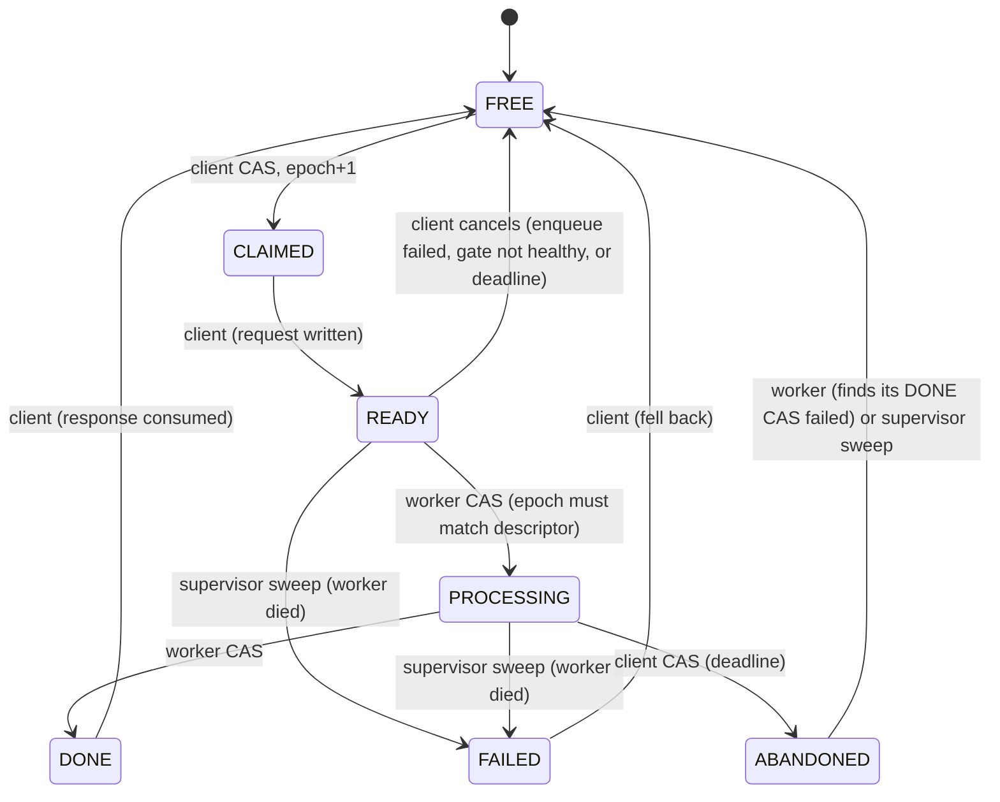

# 01 — Shared-Memory ABI (`crates/scz-shm`)

[← High-level design](../high-level-design.md)

The shared-memory arena is the core protocol surface of SidecarZero. Every other component is a participant in the protocol defined here. This document specifies the ABI 1.0 byte layout, the atomic protocols that run over it, and the invariants that hold when any participant dies at any instruction.

The machine-readable normative definition lives in [`abi/scz_abi.toml`](../../abi/scz_abi.toml); this document explains its layout, access rules, and state machines.

---

## 1. Ground rules

| Rule | Reason |
|---|---|
| Little-endian, 64-bit only (`x86_64`, `aarch64`) | Lets a 64-bit atomic double as a 32-bit futex word at the same address; avoids byte-swapping on the hot path |
| Every multi-byte field is naturally aligned; every independently written group starts on a 64-byte boundary | Atomic access requires alignment; cache-line separation prevents false sharing between writers |
| All references are **segment-relative offsets**, never pointers. Offsets into the data segment are `u64`; offsets into the control segment, which is small, are `u32` | Each process maps the segments at different virtual addresses |
| Each field has exactly **one writing role** (supervisor, worker, or client), except words explicitly defined as CAS-contended | Makes crash recovery tractable: the survivor always knows who could have left a field half-written |
| **Supervisor state is read-only to everyone else**, enforced by the kernel | The gate, the geometry, and the templates are what every other process bases decisions on. A stray write must not be able to change them ([§2](#2-arena-map)) |
| Zero means "not ready" | Gate state `0` is `INIT`, slot state `0` is `FREE`, a zeroed beat slot is `EMPTY`. Rings are the exception: an empty ring has `cells[i].seq = i`, so rings are initialized before the segments are shared, and no client touches a ring while the gate is `INIT` |
| Nothing read from the data segment is trusted | Copy to a local, bounds-check once, use the local. The copy must be an atomic or volatile load: a compiler may turn one plain read in the source into two reads of memory, and another process could change the value between them. Geometry (offsets, capacities, strides) is taken only from the control segment's directory |
| **Every loop over shared words is bounded** | A peer that corrupts a word, or keeps changing one, must not be able to hold a caller, a worker, or the supervisor in a loop. Each loop has an attempt limit or a deadline and treats running out as failure ([§4.3](#43-enqueue-producer), [§6.1](#61-transition-rules)) |
| Reserved bytes are written as zero and ignored on read | Lets a minor version give them meaning |
| **One client process per arena**, with any number of threads | Session reset ([§4.5](#45-crash-consistency)) re-initializes the rings and slot table, which is only safe when no other process is using them. Multiple host processes are isolated by giving each session its own arena ([§11.1](#111-multi-session-layout)) |

Both segments are mapped at page-aligned addresses in every process, so "64-byte aligned relative to the segment base" is also absolutely 64-byte aligned everywhere.

---

## 2. Arena map

The arena is **two `memfd` segments**, handed over together over the control socket. "The arena" across the codebase refers to this pair. A third, private segment per worker never leaves the sidecar ([below](#the-worker-segment)).

```
Control segment (memfd "scz_ctl")      supervisor: read-write · worker, client: read-only
0x0000 ┌──────────────────────────────────────────────┐
       │ Zone 1: Control header (4096 bytes)          │
0x1000 ├──────────────────────────────────────────────┤
       │ Registry block (schemas, frame templates)    │
       └──────────────────────────────────────────────┘ ctl_len

Data segment (memfd "scz_data")        everyone: read-write
0x0000 ┌──────────────────────────────────────────────┐
       │ Status page (4096 bytes): worker beats, stats│
0x1000 ├──────────────────────────────────────────────┤
       │ Registry staging: 2 × staging_len            │
       ├──────────────────────────────────────────────┤
       │ Zone 2: Descriptor rings                     │
       │   ring[0]: 256-byte header + capacity × 64 B │
       │   ring[1]: …                                 │
       ├──────────────────────────────────────────────┤  page-aligned
       │ Zone 3: Slab pool                            │
       │   slot table: slot_count × 64-byte records   │
       │   slot data:  slot_count × slot_size         │  page-aligned
       └──────────────────────────────────────────────┘ data_len
```

### Why two segments

With a single writable file, "the supervisor is the only writer of the gate" is merely a convention. A wild write from native code in the host, or from the worker (the least trusted process, running third-party C++ model runtimes), could forge `HEALTHY`, corrupt a ring's capacity, or alter a template offset that another process then trusts.

The control segment is sealed with `F_SEAL_FUTURE_WRITE` after the supervisor has mapped it. The supervisor keeps its existing writable mapping; every later `mmap` of that file can only be read-only (`PROT_READ`), and `mprotect` cannot add write access. The single-writer rule for supervisor state is therefore enforced by the kernel.

What this does and does not protect:

- **Protected:** everything a client or worker reads to make a decision — the gate, the supervisor heartbeat, the model identity, the configuration, the directory, and the Arrow templates.
- **Not protected:** the data segment. A buggy client can still forge a worker heartbeat or scribble on a slot record. The backstops for that are the worker's death lock, `pidfd`, and status pipe, which no shared memory can fake, and the per-call deadline.

The cost is one extra file descriptor in the handshake and one extra mapping per process.

### The worker segment

Each worker also receives a 4 KB `memfd` of its own (`scz_wrk`), shared with the supervisor and with nobody else. It is never sent to the host, so it is not part of the host-facing ABI: the supervisor and the worker ship together.

```
Worker segment (memfd "scz_wrk", 4096 bytes)     supervisor and that one worker: read-write · host: never mapped
0x000   death_lock[8]   one 64-byte cell per consume thread, indexed by ring
                        word 0 (u32): a futex word under the kernel's robust-futex protocol:
                                      owner thread id | FUTEX_WAITERS | FUTEX_OWNER_DIED
                        the rest of the cell belongs to the worker's C library mutex
```

It carries the early death signal ([supervisor §5.2](04-supervisor.md#early-death-signal)). It is kept out of the data segment so that the host cannot forge a death, and out of the other worker's segment so that a standby cannot fake the active worker's death.

The supervisor touches only word 0: it sets the `FUTEX_WAITERS` bit (`0x8000_0000`) with a compare-and-swap and sleeps on the word. It never takes the lock. The protocol on that word is the kernel's robust futex protocol (`FUTEX_OWNER_DIED = 0x4000_0000`), not a C library's internal structure, which lets a supervisor built against one C library watch a lock acquired through another.

### Default sizing

For the reference workload (256 `float32` features, single-row requests):

| Segment | Contents | Size |
|---|---|---|
| Control | 4 KB header + 64 KB registry | 68 KB |
| Data | 4 KB status page, 2 × 64 KB staging, 1 ring of 4,096 cells (256 KB + header), a small class of 1,024 slots of 4 KB (4 MB data + 64 KB table) | ~4.6 MB in an 8 MB segment. Enabling the batch class (64 slots of 128 KB) adds 8 MB for a 16 MB segment |

---

## 3. Zone 1 — Control header

4,096 bytes at the start of the control segment, laid out as 64 cache lines. The supervisor is the only writer of every field in this segment.

```
Offset  Size  Field                    Notes
──────────────────────────────────────────────────────────────────────────────
IDENT — immutable after the segments are sealed
0x000   8     magic                    ASCII "SCZARENA"
0x008   2     abi_major                1
0x00A   2     abi_minor                0
0x00C   4     header_len               4096
0x010   8     data_len                 size of the data segment
0x018   8     arena_id                 random nonce per arena creation; echoed in the data segment
0x020   4     layout_crc32c            over IDENT + CONFIG + DIRECTORY, computed with this field as zero
0x024   4     ctl_len                  size of the control segment
0x028   4     page_size
0x02C   2     ring_count
0x02E   2     slab_class_count
0x030   8     feature_flags
0x038   8     created_mono_ns

GATE — the only cache line a client reads on every call
0x040   8     gate            (atomic) see below
0x048   8     supervisor_hb_mono_ns (a) refreshed every hb_interval_ns
0x050   8     gate_changed_mono_ns (a)
0x058   8     session_epoch   (atomic) bumps when the client session is reset

CONTROL — supervisor → worker
0x080   4     ctl_req         (atomic) bitset: TRIM, DRAIN, HANDOVER, DUMP_STATS; obeyed by the active worker only
0x084   4     standby_wait    (atomic) event counter a warm or paused worker waits on; bumped on every change
0x088   8     spin_ceiling_ns (atomic) current cap on the worker's spin budget; starts at spin_ns

MODEL — seqlock-protected
0x100   8     model_seq       (atomic) odd = update in progress
0x108   32    model_sha256
0x128   4     model_gen
0x12C   4     registry_epoch           increases whenever the registry's contents change
0x130   8     schema_fingerprint
0x138   4     registry_off             within the control segment
0x13C   4     registry_len

CONFIG — immutable per arena
0x200   8     hb_interval_ns           default 5,000,000; applies to the supervisor and worker heartbeats
0x208   8     hb_stale_ns              default 15,000,000 (three missed beats)
0x210   8     spin_ns                  default 50,000
0x218   8     default_deadline_ns      default 2,000,000; used when a caller gives no budget
0x220   8     max_deadline_ns          default 100,000,000; every call's budget is capped at this

DIRECTORY — immutable per arena; all offsets are into the data segment
0x400   8×32  ring_dir[8]              { ring_off u64, capacity u32, kind u32, cell_stride u32, reserved[12] }
0x500   8×64  slab_dir[8]              { table_off u64, data_off u64, slot_size u32, slot_count u32,
                                         req_cap u32, resp_cap u32, req_template u16,
                                         resp_template u16, record_stride u16, reserved[26] }
0x700   32    data_map                 { status_off u64, staging_off u64, staging_len u32, reserved[12] }

STATS — observability only, no protocol meaning
0x800   2048  supervisor counters
```

`session_epoch` has two readers: the worker, which re-reads each ring's `head` and discards any local batch state when it changes, and the SDK, which records it at connect for diagnostics.

### The gate word

```
 63            32 31            16 15      8 7       0
┌────────────────┬────────────────┬─────────┬─────────┐
│   worker_gen   │ shed_permille  │ reason  │  state  │
└────────────────┴────────────────┴─────────┴─────────┘
```

| State | Value | Meaning | Client behavior |
|---|---|---|---|
| `INIT` | 0 | Arena created, no worker ready yet | Fallback |
| `HEALTHY` | 1 | Active worker is alive and within its heartbeat | Enqueue |
| `PSI_SHEDDING` | 2 | Memory pressure; supervisor is shedding | Fallback (`shed_permille` reserved for partial shedding) |
| `RELOADING` | 3 | Model swap or worker restart in progress | Fallback |
| `DEAD` | 4 | Worker dead or in crash-loop backoff | Fallback |
| `DRAINING` | 5 | Pod is terminating | Fallback |

`INIT` has value `0` so that zeroed memory is never treated as healthy. Any state value a reader does not recognize is treated as not healthy.

`reason` records why the gate is in its state for metrics, `/modelz`, and `sczctl`. A client reports the state and never branches on the reason:

| Reason | Seen with | Meaning |
|---|---|---|
| `WORKER_EXIT`, `WORKER_STALE`, `WORKER_HUNG`, `BAD_RESPONSES` | `DEAD`, `RELOADING` | Why the worker was lost or condemned |
| `MEMORY`, `DOES_NOT_FIT` | `PSI_SHEDDING` | Shedding under pressure; a model too large for the memory limit |
| `RELOAD`, `ROLLBACK` | `RELOADING` | A model change in progress, forwards or back |
| `SESSION_RESET` | `RELOADING` | The session is being reset, because the host disconnected or because the supervisor requested a reset |
| `NO_MODEL` | `INIT` | Waiting for a model file to appear |

The word is written by a single function in the supervisor from the ranked set of active gate holds. No recovery path stores `HEALTHY` directly ([supervisor §5.7](04-supervisor.md#57-who-writes-the-gate)).

The supervisor folds everything it knows (death lock, `pidfd` exit, worker heartbeat staleness, memory pressure, reload) into this one word, so the SDK's health check is a single 64-bit load and an 8-bit compare. `worker_gen` identifies which worker process is authoritative; a worker whose generation does not match must not consume.

### What a client reads per call

Exactly one cache line: `gate` and `supervisor_hb_mono_ns`, both at `0x040`.

- The supervisor heartbeat covers the one failure mode the supervisor cannot report through the gate: its own death. Without it the gate would remain frozen at `HEALTHY`.
- **Clients do not read worker heartbeats.** The supervisor checks them on every tick against the same threshold and reports the result through the gate, so a client-side check would detect a frozen worker at most one tick earlier while pulling a second, frequently written cache line into every call.
- The supervisor writes its heartbeat every `hb_interval_ns` (5 ms), not on every 1 ms watchdog tick. Each write invalidates this cache line across client cores, so the write rate is kept at the minimum that still provides three beats per 15 ms staleness window.

### The model seqlock

`model_sha256`, `model_gen`, `registry_epoch`, `schema_fingerprint`, and the registry location change together and span several words, so they are guarded by `model_seq`:

```
writer (supervisor):  seq += 1 (now odd) → write fields and registry → seq += 1 (now even)
reader:               s1 = load(seq); if odd, retry
                      copy fields
                      s2 = load(seq); if s1 != s2, retry
```

Readers consult this when they bind, and again whenever the worker generation in the gate word differs from the one their binding was last confirmed under. They never consult it per call.

**The supervisor writes this block before the gate shows a new worker generation as `HEALTHY`.** Clients rely on that order: a client that sees the new generation is guaranteed to find the registry that goes with it, so it can detect a schema change before encoding a request ([arrow-data-plane §9](03-arrow-data-plane.md#9-schema-binding-and-evolution)).

Two rules for readers:

- Read the guarded fields with atomic or volatile loads. A plain read that races the writer is undefined behavior in C++ and Rust even if the result is later discarded.
- Bound the retries (spin briefly, then back off for milliseconds). A reader that gives up stays unbound and tries again later; it never blocks a request thread.

### Status page (data segment)

The first 4,096 bytes of the data segment hold the state that workers write and two counters that clients write. It lives in the data segment because workers cannot write to the control segment.

```
Offset  Size  Field                    Writer       Notes
──────────────────────────────────────────────────────────────────────────────
BIND — written once by the supervisor before the segments are shared
0x000   8     magic                    supervisor   ASCII "SCZDATA\0"
0x008   8     arena_id                 supervisor   must equal the control header's

BEAT[0] — the worker holding beat slot 0
0x040   8     hb_mono_ns      (atomic) worker       refreshed every hb_interval_ns by a dedicated thread
0x048   4     pid                      worker
0x04C   4     gen                      worker       generation this worker was started as
0x050   4     state           (atomic) worker       0 EMPTY, 1 LOADING, 2 WARM, 3 ACTIVE, 4 DRAINING, 5 RELEASED
0x054   4     ctl_ack         (atomic) worker       bits of ctl_req this worker has acted on
0x058   4     staged_len               worker       bytes of registry candidate in staging[0]; set before WARM

BEAT[1] — the worker holding beat slot 1
0x080   …     same layout

CLIENT — the two fields on this page that clients write
0x0C0   8     client_rejects      (atomic) clients  responses an SDK refused; fetch-add, only on a refusal
0x0C8   8     client_ring_faults  (atomic) clients  enqueue or CAS loops that hit their attempt limit

WORKER STATS — observability only
0x800   2048  counters and latency histogram buckets, half per beat slot
```

- **Two beat slots, one per live worker.** At most two workers exist at a time (an active one and a warm or loading standby). Each is started with a beat slot index (`0` or `1`) and writes only there. A single shared heartbeat field would let a healthy standby mask a frozen active worker.
- The supervisor zeroes a beat slot before spawning a worker into it. That is the only time it writes to the status page after creation.
- **Control requests are a four-phase handshake** between `ctl_req` in the control header and the active worker's `ctl_ack`. The supervisor sets a bit; the worker acts and sets the same bit in `ctl_ack`; the supervisor clears its bit; the worker clears its acknowledgement. A request is *pending* for the worker whenever the two words differ, which is the condition its consume threads test before sleeping. The supervisor does not raise a bit again until its acknowledgement has cleared, and it wakes the worker's parked threads after every change to `ctl_req`.
- **`standby_wait` and `spin_ceiling_ns`** are described in [signaling §3.3](02-signaling.md#33-warm-or-paused-worker-waiting-on-standby_wait) and [§4](02-signaling.md#4-adaptive-spin-budget): the first is an event counter that lets a worker wait on memory it cannot write, and the second is how the supervisor tells a throttled worker to spin less.
- **`state` is a mirror, not a signal.** The supervisor learns of a worker's state changes from that worker's status pipe ([supervisor §5.1](04-supervisor.md#51-spawning)), which the client cannot write to and which wakes the supervisor immediately. The field here exists for `sczctl` and diagnostics.
- **The two client counters** are a client's only channel to the supervisor. `client_rejects` counts responses it had to refuse: a `DONE` slot whose response fails its checks, or an out-of-range length. The supervisor condemns a worker under which that climbs fast enough ([supervisor §5.2](04-supervisor.md#52-watching)). `client_ring_faults` counts enqueue and compare-and-swap loops that reached their attempt limit. That points at the ring rather than the worker, so it makes the supervisor check the ring's consistency immediately without condemning a healthy worker.
- **Registry staging.** A worker cannot write the registry in the control segment, so it writes its candidate (schemas and rendered templates) into `staging[beat_slot]` and sets `staged_len`. The supervisor validates every offset and length in the candidate, then copies it into the control segment under the model seqlock.

---

## 4. Zone 2 — Descriptor rings

A ring is a bounded queue with a sequence word in every cell (the Vyukov bounded MPMC design specialized to a single consumer). It needs no locks and tolerates any number of concurrent producers.

### 4.1 Ring header (256 bytes)

```
+0x00  line 0               ring_id u32 (diagnostic echo); rest reserved
+0x40  line 1 (producers)   tail  (atomic u64)
+0x80  line 2 (consumer)    head  (atomic u64)
+0xC0  line 3 (wake)        consumer_wait (atomic u32)   0 = AWAKE, 1 = PARKED, 2 = WAKING
+0x100 cells[capacity]
```

Capacity, kind, and cell stride come from `ring_dir` in the control segment, never from the data segment. `mask` is `capacity − 1`; capacity is a power of two.

There is one ring per worker inference thread. Each client thread starts at a ring chosen by thread hash and advances to the next ring on every call, skipping any ring that is full. Round-robin costs no shared writes and spreads requests evenly across the worker's threads regardless of how few threads the host has.

**Ring kinds.** `kind = 1` is `MPSC`: any host thread may enqueue, one worker thread dequeues. `kind = 2` (`SPSC`) is reserved. A single-producer ring requires one ring per producer thread, whereas this architecture uses one ring per consumer thread (up to 8) so a single worker thread never has to poll multiple rings behind a shared wake word.

### 4.2 Descriptor cell (64 bytes)

```
+0x00  seq               atomic u64   cell turn counter
+0x08  request_id        u64          echo of the slot record, for tracing
+0x10  reserved          u64          zero
+0x18  reserved          u32          zero
+0x1C  slot_index        u32
+0x20  deadline_mono_ns  u64          absolute CLOCK_MONOTONIC; the moment the caller stops waiting
+0x28  slot_epoch        u32          epoch of the slot when enqueued
+0x2C  slab_class        u16
+0x2E  reserved          u16          zero
+0x30  enqueue_mono_ns   u64          echo of the slot record's t_enqueue_ns, for tracing
+0x38  flags             u32          bit 0 ASYNC (reserved); bit 1 VOID: the producer could not
                                      fill this cell, and the consumer skips it without reading the rest
+0x3C  route             u32          reserved for multi-model routing; 0
```

Initial state: `cells[i].seq = i`.

**The slot record is authoritative.** A worker uses four descriptor fields: `slab_class`, `slot_index`, `slot_epoch`, and `deadline_mono_ns` (plus `flags` to check `VOID`). It bounds-checks the first two against `slab_dir`, computes the slot's addresses itself, and reads `req_len` and `req_stamp` from the slot record after its claim succeeds. The fields marked *echo* exist only for `sczctl` and tracing; no process acts on them.

### 4.3 Enqueue (producer)

```
repeat at most ENQUEUE_ATTEMPTS times (64):
    pos  = tail.load(Relaxed)
    cell = &cells[pos & mask]
    seq  = cell.seq.load(Acquire)
    if seq == pos:
        if tail.compare_exchange_weak(pos, pos + 1): goto claimed
    else if seq < pos:
        return FULL
    // else another producer advanced; go round again
return FULL                             // attempts used up; see below

claimed:
write cell fields 0x08..0x3F
cell.seq.store(pos + 1, SeqCst)        // publish; SeqCst gives the store-load fence the checks below need
if consumer_wait.load(SeqCst) != AWAKE: wake consumer (see signaling doc)
```

The `SeqCst` publish acts as a store-load fence for two subsequent loads: the producer's check of `consumer_wait`, and the client's re-check of the gate ([§6.3](#63-supervisor-sweep)).

**What `SeqCst` means in this document.** Wherever a store is followed by a load that must not be reordered ahead of it (publish then check the waiter, announce then re-check, store the gate then sweep), the requirement is a full store-load barrier between the two. A sequentially consistent store followed by a sequentially consistent load provides it. So does a release store, an explicit full fence, and an acquire load, at the same cost. Java's `setVolatile`, Go's atomics, and C++'s `seq_cst` use the first form. `scz-shm` uses the second because `loom` models explicit fences rather than sequentially consistent accesses ([testing §2.2](14-testing-verification.md#22-model-checking-the-rust-implementation-loom)).

**The loop is bounded.** In a consistent ring the only reason to retry is that another producer claimed the cell first, and every such loss means a request was published. Because the ring's words live in the data segment where a worker can write, a worker bug that left a sequence number ahead of `tail` could otherwise make every caller retry forever inside a call that promises to return by its deadline. After 64 attempts the producer increments `client_ring_faults`, treats the ring as full, and falls back.

**A claimed cell is always published.** Between the tail CAS and the publish a producer performs only register-to-memory stores that cannot fail. Where a language runtime can unwind there anyway (e.g. a panic in Rust), the scope guard that releases the slot first publishes the cell with `VOID` set, and the worker skips it. The guard then applies the waker rule just as a normal publish does; otherwise a consumer that had just announced it was parking could sleep with a published void cell at its head until the next heartbeat ([spec/](../../spec/README.md)). For a thread killed outright by the kernel, no guard runs; the supervisor's check for an unpublished head cell covers that case ([§4.5](#45-crash-consistency)).

### 4.4 Dequeue (single consumer)

```
pos  = head (consumer-local copy, mirrored to the header)
cell = &cells[pos & mask]
if cell.seq.load(Acquire) != pos + 1: return EMPTY
copy cell fields to locals
cell.seq.store(pos + capacity, Release)     // step A: cell is free for the next lap
head.store(pos + 1, Release)                // step B
```

**One consumer at a time, across worker generations.** A ring changes hands only when its consumer has *released* it or *exited*; [§4.6](#46-changing-consumers) defines both. Two workers never dequeue from the same ring, whether the transition is a crash, a promotion, or a model reload.

### 4.5 Crash consistency

| Who dies | Where | State left behind | Recovery |
|---|---|---|---|
| Worker | Before step A | Cell still published, `head` unchanged | The successor re-reads the cell. Its claim fails because the sweep has already failed the slot |
| Worker | Between A and B | Cell freed, `head` not advanced | **Repair rule**, below. Run by the supervisor before activating a successor |
| Worker | After step B, before claiming the slot | Descriptor consumed, slot still `READY`, nothing refers to it | The sweep fails every `READY` slot when a worker dies ([§6.3](#63-supervisor-sweep)) |
| Client thread | Between tail CAS and publish | A claimed but unpublished cell blocks the consumer at that position | If the thread is merely preempted, the stall lasts one scheduler quantum and calls behind it fall back on deadline. If it unwinds, its scope guard publishes the cell as void ([§4.3](#43-enqueue-producer)). If it was killed, the supervisor sees a head cell claimed and unpublished for 2× max deadline and requests a session reset ([supervisor §4](04-supervisor.md#reset-requested-by-the-supervisor)). If the host process died, the supervisor resets the session (next row) |
| Host process | Anywhere | Arbitrary client-side state | Supervisor sees the session socket close, drains the worker, re-initializes rings and slot table, bumps `session_epoch` |

**Repair rule.** Let `s = cells[head & mask].seq`. If `s` is `head + capacity` or `head + capacity + 1`, advance `head` by one. Any other value outside the four a consistent ring can show is a stray write, not a crash: the repair leaves it, and the supervisor's consistency check requests a session reset ([supervisor §5.2](04-supervisor.md#52-watching)). Arithmetic on these words wraps, so no value in them can make the supervisor panic.

In a consistent ring `s` is either `head` (empty, or claimed but not yet published) or `head + 1` (published). After a death between A and B there are two possibilities, and both mean the dead worker had already consumed position `head`:

| `s` | What happened |
|---|---|
| `head + capacity` | Step A freed the cell and nobody has reused it |
| `head + capacity + 1` | The ring was full, and a producer refilled the freed cell before the gate flipped |

Testing only for equality with `head + capacity` would miss the second case and leave the successor reading the ring as empty forever while producers read it as full.

**Session reset assumes the client is gone.** It runs on socket EOF, which the supervisor treats as proof that no process still maps the arena. That holds because each arena serves one client process, the SDK keeps the session socket open for as long as the arena is mapped, and forking while keeping the parent's session is prevented by an `madvise(MADV_DONTFORK)` / `pthread_atfork` guard. The same proof serves a reset requested by the supervisor: it closes its sending side (`shutdown(SHUT_WR)`) and waits for the client to close its own after all in-flight calls drain.

### 4.6 Changing consumers

The supervisor moves a ring from one worker to the next by changing `gate.worker_gen`. It does so only after one of two events:

| Event | How the supervisor knows | State of the ring | Queued requests |
|---|---|---|---|
| **Release** (planned: a same-schema model reload) | The old worker reports `RELEASED` on its status pipe | Clean | Carried over; the successor serves them |
| **Exit** (crash, kill, condemned worker) | The old worker's `pidfd` | Possibly mid-dequeue; needs the repair rule | Failed by the sweep ([§6.3](#63-supervisor-sweep)) |

**Release.** On `HANDOVER` in `ctl_req`, each consume thread stops at the top of its loop, before its next dequeue. At that point the thread holds no slot, and every descriptor it ever dequeued has been either claimed and completed, or rejected. When all of its consume threads have stopped, the worker reports `RELEASED`. That is a promise never to touch a ring or a slot again. The worker then exits in its own time.

Because a release happens at a loop boundary, no `READY` slot can be missing its descriptor. That is why queued requests survive a release without loss, whereas on an unplanned exit the worker may have died between dequeuing a descriptor and claiming its slot.

The successor reads each ring's `head` from the header and continues from there. The gate's state does not change during a same-schema release, so clients see zero fallbacks. Requests that arrive between the old worker's last dequeue and the successor's first wait in the ring.

**Why not wait for the old worker to exit.** The kernel reports a process's exit via `pidfd` only after it has torn down the process's address space, so the time to that report grows linearly with the worker's RSS. Releasing at a loop boundary decouples the handover from address-space teardown.

**A release is trusted only as far as a worker is trusted.** A buggy worker that reports `RELEASED` and keeps consuming would put two consumers on a ring. The damage is bounded like any other worker bug: calls resolve at their deadlines, the supervisor kills a released worker that has not exited within a grace period, and the `OWNER` field ([§5.2](#52-slot-record-64-bytes-in-the-slot-table)) lets the sweep reclaim anything it was still holding.

---

## 5. Zone 3 — Slab pool

### 5.1 Slab classes

Up to eight classes, each a fixed slot size and count described in `slab_dir`. Two classes are standard: a small class for single-row requests (enabled by default: 1,024 slots of 4 KB) and a batch class enabled when a deployment serves multi-row batches (64 slots of 128 KB). Each class has its own request and response template ([arrow-data-plane §4](03-arrow-data-plane.md#4-registry-block)). Each slot's data region is split at a fixed 64-byte-aligned boundary into a **request region** (`req_cap` bytes) and a **response region** (`resp_cap` bytes), so the worker writes its answer next to the question and no second allocation is needed.

### 5.2 Slot record (64 bytes, in the slot table)

```
Offset  Field         Type         Writer      Notes
+0x00   word          atomic u64   contended   [ epoch:32 | reserved:21 | OWNER:2 | WAITER:1 | state:8 ]
+0x08   request_id    u64          client
+0x10   req_len       u32          client
+0x14   resp_len      u32          worker
+0x18   status        u32          worker      result code
+0x1C   model_gen     u32          worker      which model produced the response
+0x20   t_enqueue_ns  u64          client
+0x28   t_dequeue_ns  u64          worker
+0x30   t_done_ns     u64          worker
+0x38   req_stamp     u32          client      (registry_epoch low 16 bits << 16) | template id stamped into the request region; 0 = none
+0x3C   resp_stamp    u32          worker      the same, for the response region
```

The client writes its fields while the slot is `CLAIMED`; the worker writes its fields while the slot is `PROCESSING`. Each side reads the other's fields only after the state transition that hands the slot over.

The low 32 bits of `word` (state, `WAITER`, and `OWNER`) are what a client parks on with `futex`. The high 32 bits are the 32-bit epoch. Packing both into one 64-bit atomic ensures every ownership change is a single compare-and-swap that simultaneously validates the epoch.

`OWNER` records which worker holds the slot: `0` none, `1` the worker in beat slot 0, `2` the worker in beat slot 1. The worker writes it in the same CAS that claims the slot, so ownership and state never disagree. It lets the sweep fail exactly the slots an exited worker held, even while another worker is active.

### 5.3 Allocation

There is no free list. A slot is free when its state is `FREE`, and a client claims it with `CAS(word: (e, FREE) → (e + 1, CLAIMED))`.

- Each client thread caches, per slot class, the index of the slot it used last. A synchronous caller gets the same slot back on nearly every call: one CAS on a cache line it already owns in L1/L2.
- On a miss, the thread probes a bounded number of other slots (16 by default), starting at a hash of its thread ID.
- If none of those is free, the call falls back immediately with reason `NO_SLOT`. It never scans the whole table.

Avoiding a linked free list ensures that no process dying mid-operation can ever corrupt the allocator's metadata.

---

## 6. Slot lifecycle



| State | Value | Owner of the slot's data |
|---|---|---|
| `FREE` | 0 | Nobody |
| `CLAIMED` | 1 | Client (writing request) |
| `READY` | 2 | Nobody may write; worker may claim |
| `PROCESSING` | 3 | Worker |
| `DONE` | 4 | Client (reading response) |
| `FAILED` | 5 | Client |
| `ABANDONED` | 6 | Worker, until it finishes inference and frees the slot |

**Ownership transfer rule.** Once the client stores `READY`, it must not write to the request region again. Once the worker's CAS to `PROCESSING` succeeds, it has exclusive access to both regions until it CASes out. This is what makes zero-copy in-place reads and writes safe.

### 6.1 Transition rules

Every transition operates on the full 64-bit `word`, which carries `(epoch, OWNER, WAITER, state)`.

| Transition | Actor | Operation | `WAITER` and `OWNER` |
|---|---|---|---|
| `FREE → CLAIMED`, epoch + 1 | Client | CAS | Both clear before and after |
| `CLAIMED → READY` | Client | Release store | Both clear |
| `READY → PROCESSING` | Worker | CAS loop; expected epoch is the descriptor's | `WAITER` **preserved**; `OWNER` set to the worker's beat slot |
| `READY → FREE` | Client | CAS loop | Both cleared |
| `READY → FAILED` | Supervisor sweep | CAS loop | Both cleared; wake if `WAITER` was set |
| `PROCESSING → DONE` | Worker | CAS loop. The record's `status` field says whether the request succeeded | Both cleared; wake if `WAITER` was set |
| `PROCESSING → ABANDONED` | Client | CAS loop | `WAITER` cleared; `OWNER` **preserved** |
| `PROCESSING → FAILED` | Supervisor sweep | CAS loop | Both cleared; wake if `WAITER` was set |
| `ABANDONED → FREE` | The owning worker, or the sweep after that worker's exit | CAS | Both cleared |
| `DONE → FREE`, `FAILED → FREE` | Client | Release store | Both cleared |

- **A CAS loop** loads the word, checks the epoch and state it expects, and attempts the CAS. If the CAS fails it reloads and checks again. A failure caused only by the `WAITER` bit changing is retried. A changed epoch or state means the transition is void and the actor stops. After 64 failed attempts the transition is void.
- **A failed CAS is not, by itself, evidence that a slot is stale.** A worker whose first claim attempt fails must check whether only `WAITER` changed before skipping the descriptor, as the client may simply have parked in the meantime.
- **Plain release stores are allowed only out of states a single actor can leave**: `CLAIMED`, `DONE`, and `FAILED` belong to the client alone. Every other state can be left by more than one party and requires a CAS.
- **Only the initial claim changes the epoch.**
- **`DONE` is the worker's; `FAILED` is the supervisor's.** A worker completes every slot with `DONE` and puts the result code in `status`, including for application-level errors (`BAD_REQUEST`, `STALE_REGISTRY`, `CANCELLED`). `FAILED` is written only by the supervisor sweep and carries no status.
- **`OWNER` is meaningful only in `PROCESSING` and `ABANDONED`**, where it must be `1` or `2`. The client's abandon transition preserves `OWNER` unchanged so the sweep knows which worker's exit reclaims the abandoned slot.

### 6.2 The three races that matter

**Client times out while the request is still queued.** Client CASes `(e, READY) → (e, FREE)`. The descriptor remains in the ring. When the worker later dequeues it, its claim finds `FREE` (or epoch ≥ `e + 1`) and skips the descriptor. The slot is reusable immediately.

**Client times out while the worker is mid-inference.** Client CASes `(e, PROCESSING) → (e, ABANDONED)` and runs its local fallback. The worker finishes inference, tries `(e, PROCESSING) → (e, DONE)`, sees `ABANDONED`, and CASes `(e, ABANDONED) → (e, FREE)`. The slot is unavailable only for the remainder of that single inference.

**Client times out at the exact instant the worker completes.** Exactly one CAS wins. If the worker wins, the client's abandon CAS sees `DONE` and returns the model's answer. If the client wins, the previous case applies.

Epoch wrap is impossible in practice: a stale descriptor would have to survive 2³² re-allocations of a single slot inside a ring of 4,096 cells.

### 6.3 Supervisor sweep

The sweep cleans up after a worker that has exited. It has two parts.

**Part 1: the slots the worker held. Runs at every worker exit.**

Precondition: the worker's `pidfd` has reported exit, so every one of its threads has stopped executing. Having sent `SIGKILL` or seen the death lock fire is not sufficient: the sweep waits for `pidfd` exit before reclaiming slot memory so a dying worker thread cannot race with the next occupant of the slot.

For every slot whose `OWNER` matches the exited worker: `PROCESSING → FAILED` (waking a waiter if `WAITER` was set), and `ABANDONED → FREE`. Slots owned by the other worker are untouched.

**Part 2: the queue. Runs only if the worker that exited was still the ring consumer**, meaning it had been activated and had not cleanly released.

Preconditions: `pidfd` exit as above, and the gate already set to a non-`HEALTHY` state for that generation with a `SeqCst` store.

1. Repair each ring's `head` ([§4.5](#45-crash-consistency)).
2. For every slot, loading the word with `SeqCst`: `READY → FAILED`.
3. Issue a `futex` wake on every slot whose `WAITER` bit was set, and on every `DONE` slot.

The wake on `DONE` slots covers a worker that died between its completing CAS and its own `futex_wake`. Because the completing CAS clears `WAITER`, nothing else would wake that slot's parked client before its deadline even though its answer is already in the slot ([spec/](../../spec/README.md)).

The sweep only ever moves slots toward states the client can resolve. It never frees a slot a live client still holds, and it leaves `CLAIMED`, `DONE`, and `FAILED` alone.

Step 2 is also used without a death when a model reload changes the schema: queued requests were encoded for the old model, so the gate is set to `RELOADING` first and `READY` slots are swept to `FAILED`.

**Queued requests are not carried across an unplanned worker death.** Every `READY` slot is failed regardless of whether a warm standby is about to take over. Carrying queued slots across a crash would leave any slot whose descriptor the dead worker had already dequeued (between step B of dequeue and claiming the slot) orphaned until its full deadline expired. Failing all `READY` slots guarantees that every call in flight at a worker crash resolves within microseconds.

**The client's half of the pairing.** A slot can become `READY` just after the sweep has passed it. To close that window the client re-checks the gate once, after its publish and before it waits:

```
client:      store READY  →  publish descriptor (SeqCst)  →  load gate (SeqCst)
supervisor:  store gate (SeqCst)  →  sweep: load each slot word (SeqCst)
```

If the client's load shows a state other than `HEALTHY`, it cancels with `READY → FREE` and falls back. Because both sides store before they load with a full barrier in between, at least one side sees the other's store: either the client sees the changed gate, or the sweep sees the `READY` slot.

---

## 7. Creating and mapping the arena

Supervisor, once per arena:

```
// data segment
dfd = memfd_create("scz_data", MFD_CLOEXEC | MFD_ALLOW_SEALING [| MFD_NOEXEC_SEAL])
ftruncate(dfd, data_len)
d   = mmap(NULL, data_len, PROT_READ | PROT_WRITE, MAP_SHARED, dfd, 0)
madvise(d, data_len, MADV_POPULATE_WRITE)       // fault every page now, inside the sidecar's cgroup
                                                // fallback for older kernels: write one byte per page
initialize status page, rings, slot table
fcntl(dfd, F_ADD_SEALS, F_SEAL_GROW | F_SEAL_SHRINK | F_SEAL_SEAL)

// control segment
cfd = memfd_create("scz_ctl", same flags)
ftruncate(cfd, ctl_len)
c   = mmap(NULL, ctl_len, PROT_READ | PROT_WRITE, MAP_SHARED, cfd, 0)     // the only writable mapping, ever
madvise(c, ctl_len, MADV_POPULATE_WRITE)
initialize header                               // gate = INIT
fcntl(cfd, F_ADD_SEALS, F_SEAL_GROW | F_SEAL_SHRINK | F_SEAL_FUTURE_WRITE | F_SEAL_SEAL)
```

- **Pre-faulting pins cgroup memory attribution.** Shared-memory pages are charged to the cgroup of whichever task first touches them. Pre-faulting every page before any client maps the arena charges 100% of the arena to the sidecar container, so the host container is never billed for it.
- **Sealing prevents `SIGBUS`.** With `F_SEAL_GROW | F_SEAL_SHRINK` sealed, no participant can truncate a file under another's mapping.
- **`F_SEAL_FUTURE_WRITE` enforces control-plane integrity**, applied to the control segment after the supervisor's writable mapping exists.
- The worker is started via `exec`, so it does not inherit the supervisor's writable control mapping.
- **Optional:** `--hugepages` passes `MFD_HUGETLB` for 2 MB pages on `scz_data` (falling back cleanly to standard 4 KB pages if huge pages are unavailable), and `mlock` pins pages where `RLIMIT_MEMLOCK` allows.

Every mapper (worker and SDK) validates both segments before reading any field:

```
control:  file size == WELCOME.ctl_len
          F_GET_SEALS ⊇ { GROW, SHRINK, FUTURE_WRITE, SEAL }
          mmap(PROT_READ, MAP_SHARED)
          verify magic, abi_major, layout_crc32c
data:     file size == control.data_len
          F_GET_SEALS ⊇ { GROW, SHRINK, SEAL }
          mmap(PROT_READ | PROT_WRITE, MAP_SHARED)
          verify magic and arena_id against the control header
```

**Every mapper populates its own page tables** before reporting ready: `MADV_POPULATE_READ` on the control mapping and `MADV_POPULATE_WRITE` on the data mapping (or `MAP_POPULATE` on kernels older than 5.14). This eliminates minor page faults on the first requests after a connect or promotion without altering cgroup attribution.

---

## 8. ABI versioning and single source of truth

- [`abi/scz_abi.toml`](../../abi/scz_abi.toml) defines every struct, field, offset, size, enum value, and constant, and for each shared field its writer and required atomic ordering.
- `scz-abi-gen` reads it and emits: Rust `#[repr(C)]` structs with `const` assertions, a C++20 header with `static_assert(offsetof(...))`, Go constants and accessors, and Java FFM `MemoryLayout` and `VarHandle` definitions. `scz-abi-gen --check` verifies in `./scripts/check` that all generated files and the offset tables in this document match `abi/scz_abi.toml`.
- **Generated accessors enforce memory ordering.** `scz-abi-gen` emits one accessor per shared field per language with its required atomic ordering built in (`VarHandle` wrappers in Java, inline `__atomic` builtins in C++, `sync/atomic` functions in Go). SDK code accesses arena memory only through these generated accessors, enforced by `scripts/check-raw-shm-access`.
- **Golden dumps.** `abi/golden/` holds byte-exact images of both segments for canonical scenarios, generated independently from `abi/scz_abi.toml` by `scz-golden-gen`. Every SDK parses and verifies them in CI.
- **Compatibility rule.** `abi_major` (`1`) must match. A reader accepts any `abi_minor` at or above `ABI_MINOR_MIN` (`0`). Minor bumps may only give meaning to reserved bytes and add enum values that older readers treat as "not healthy" or "failed".
- **Strides.** Readers step through ring cells and slot records using `cell_stride` and `record_stride` from the directory rather than a hardcoded `64`.
- **Feature flags** advertise optional capabilities so a newer sidecar can serve an older SDK.

---

## 9. Crate structure

```
scz-shm/
├── layout.rs        generated: offsets, sizes, enums
├── arena.rs         create both segments (memfd, populate, seal), map, validate   [linux]
├── header.rs        gate word, heartbeats, beat slots, model seqlock
├── ring.rs          enqueue / dequeue / repair                                    [portable]
├── slot.rs          slot word CAS helpers, lifecycle transitions, sweep           [portable]
├── wait.rs          futex wait/wake; portable spin-poll backend for tests
├── handshake.rs     wire structs for the UDS hello/welcome exchange
├── fork.rs          pthread_atfork / MADV_DONTFORK session invalidation guard
└── testing/         in-process arena backed by plain mmap, loom shims
```

`ring.rs` and `slot.rs` take the segments as raw base pointers plus offsets and use only atomics, so they compile and are model-checked on any OS.

---

## 10. Verification

- **Loom models:** 2 producers + 1 consumer on a 2-cell ring; client-vs-worker-vs-sweep on a single slot covering every interleaving of the three races in [§6.2](#62-the-three-races-that-matter); the publish-then-check-gate pairing of [§6.3](#63-supervisor-sweep) ([testing §2.2](14-testing-verification.md#22-model-checking-the-rust-implementation-loom)).
- **Bounded loops:** a cell sequence number left ahead of `tail`, and a `WAITER` bit flipped continuously by a peer, each terminate in a fallback within 64 iterations.
- **Void cells:** a producer that unwinds after claiming a cell publishes it as `VOID`; the consumer skips it and the ring keeps moving.
- **Crash-point injection:** every store to shared memory carries a `CrashPoint` tag (`SCZ_CRASH_AT`), allowing tests across all five SDKs and the worker to `SIGKILL` the process immediately before or after any shared-memory store and verify that the repair rule and sweep restore a legal state.
- **Handoff model:** producers publish continuously while the old consumer releases at a loop boundary and the successor starts from the mirrored `head`, asserting zero lost or duplicated descriptors.
- **Read-only control segment:** tests verify that mapping `scz_ctl` with `PROT_WRITE` returns `EPERM` and `mprotect(..., PROT_WRITE)` fails.

---

## 11. Multi-Session, Internal State, and Minor-Version Compatibility

### 11.1 Multi-session layout

When multiple host processes connect to a single sidecar (`--sessions=N`), the supervisor gives **each session its own control and data segments**, laid out identically to a single-session arena.

| Property | One arena per session | Shared arena across sessions |
|---|---|---|
| Isolation between host processes | Each host maps only its own data segment; a wild write in one host cannot reach another host's slots | Every host could overwrite every other host's slots and rings |
| Resetting a session after its host dies | Full reset on that session's arena alone | Requires partial sweep of shared structures while other sessions run |
| Host-facing ABI | Unchanged; `WELCOME` carries `session_id` | Would require session directories and per-session bounds in every SDK |

Inside the sidecar:
- The supervisor creates `N` arenas up front at startup so workers receive all session descriptors at spawn before entering their seccomp sandbox.
- A worker serves each session's rings with dedicated consume threads that stay parked in the kernel when a session is idle.
- Each session's control segment receives its own copy of the gate, model block, and registry written by the supervisor.

### 11.2 Worker-written state

The status page in the data segment splits into two groups:

| Group | Fields | Users |
|---|---|---|
| Host-facing | `magic`, `arena_id`, `client_rejects`, `client_ring_faults` | Clients verify `magic` and `arena_id` at map time and increment the two counters |
| Sidecar-internal | `beat[]`, `worker_stats[]` | Written by workers; read only by the supervisor and `sczctl`. No SDK reads or writes them (enforced by `scripts/check`) |

Because `F_SEAL_FUTURE_WRITE` prevents any new writable mapping after sealing, a separate segment for worker beats could not be mapped writable by a newly spawned worker without forcing clients to remap on every worker restart. Keeping `beat[]` in the data segment while relying on `scz_wrk` (death lock), `pidfd`, and the status pipe for authoritative lifecycle signals avoids client remaps while keeping death detection tamper-proof.

### 11.3 Async completion ring extension (ABI 1.x)

The ABI 1.0 layout reserves space for asynchronous `eventfd`-driven completion rings so a 1.0 reader and a 1.x peer interoperate seamlessly:

| Mechanism | Location | Why a 1.0 reader is unaffected |
|---|---|---|
| Requesting async | `HELLO.flags` bit 0 (`ASYNC`) | A 1.0 supervisor ignores unknown flag bits |
| Granting async | `WELCOME.flags` (`u64` at `0x30`), bit 0 + 3rd fd (`eventfd`) | A 1.0 client never sets `ASYNC`, so it never receives a 3rd fd |
| Completion ring directory | `completion_dir[4]` at control header `0x740` + count at `0x738` | Sits in reserved bytes covered by `layout_crc32c`; a 1.0 reader reads only known fields |
| Completion rings | Appended after slab classes in `scz_data` | A 1.0 reader locates regions strictly via `ring_dir` and `slab_dir` and accepts any larger `data_len` |
| Routing a request | Cell flag `ASYNC` (`0x1`) + ring index at cell `0x10..0x13` | Reserved in 1.0 |
| Capability bit | `feature_flags` bit 0 (`ASYNC_COMPLETION`) | Ignored by 1.0 readers |

### 11.4 Forward-compatibility rules for 1.0 readers

Every SDK is verified against these six rules:

1. **Reserved bytes are never asserted to be zero on read.**
2. **Regions are located strictly through the control directory**, and any `data_len` large enough to contain those regions is accepted.
3. **Unknown feature bits are ignored** in `feature_flags` and `HELLO.flags`.
4. **Newer minor versions are accepted** (`abi_minor ≥ ABI_MINOR_MIN`), and the supervisor negotiates `min(supervisor_minor, client_max_minor)`.
5. **Unknown enum values fail closed**: an unrecognized worker `status` maps to `WORKER_FAILED`, and an unrecognized gate state maps to not-healthy.
6. **Only `MPSC` rings (`kind = 1`) appear in `ring_dir`.**

### 11.5 Cross-version upgrade verification

`scripts/upgrade-test` builds a `next-minor` (`1.1`) variant of the sidecar and Rust SDK using the `next-minor` feature of `scz-shm` (which populates all reserved bytes with non-zero patterns, appends a completion ring to enlarge `data_len`, and sets unknown feature bits) and runs the full conformance suite across version boundaries in both directions (`1.0` SDKs against `1.1` sidecar, and `1.1` SDK against `1.0` sidecar).
