# 04 — Supervisor (`crates/scz-supervisor`)

[← High-level design](../high-level-design.md) · depends on [01 — SHM ABI](01-shm-abi.md), [02 — Signaling](02-signaling.md)

`sidecarzero-supervisor` is PID 1 of the sidecar container. It is a small, deterministic state machine that owns the shared-memory arena, decides whether the worker is healthy, promotes warm standbys, replaces failed or leaking workers, monitors cgroup memory and PSI pressure, and answers Kubernetes HTTP probes.

---

## 1. Responsibilities

| The supervisor does | The supervisor does not |
|---|---|
| Create, pre-fault, seal, and own the shared-memory arena | Read or write request payloads |
| Hand the arena to the host over a `SOCK_SEQPACKET` Unix socket | Load models or link any ML runtime |
| Spawn, sandbox, watch, kill, and replace workers | Hold state that must persist across its own restart |
| Act as the sole writer of the gate word | Make inference decisions |
| Monitor cgroup memory and PSI; shed and recycle before the kernel OOM-kills | Talk to the Kubernetes API |
| Serve `/readyz`, `/livez`, `/startupz`, `/modelz`, `/metrics` | Proxy inference traffic |
| Perform PID 1 duties: reap zombies (`PR_SET_CHILD_SUBREAPER`), forward signals, execute orderly shutdown | Parse untrusted worker-authored flatbuffers in its main process |

**Implementation properties:** static Rust binary (measured **665 KB** stripped, 7.7× under the 5 MB ceiling); no async runtime; single deciding thread; zero heap allocations on the watchdog path; `panic = "abort"`.

---

## 2. Process model

A single thread makes every state-machine decision inside an event loop. Alongside it run lightweight death-watcher threads — one per consume thread of each worker (at most 16) — that do nothing except block in `futex_wait` on their assigned death-lock word in `scz_wrk` and write to an `eventfd` when the kernel sets `FUTEX_OWNER_DIED` ([§5.2](#early-death-signal)).

| Event source | Purpose |
|---|---|
| Listening Unix socket | Client handshakes (`HELLO` / `WELCOME` / `READY`) |
| Client session socket(s) | Liveness of the host process (EOF indicates the host disconnected or exited) |
| `pidfd` per worker and per helper | Notification of process exit after the kernel has torn down its address space |
| Death-watcher `eventfd` | Immediate notification (~0.05 ms) that a worker consume thread died |
| Status pipe per worker (read end) | 1-byte state reports from the worker: `WARM`, `ACTIVE`, `DRAINED`, `RELEASED` |
| Result pipe per helper | SHA-256 model digest or staged registry verification verdict |
| 1 ms watchdog tick | Checks worker beat slots and ring progress; refreshes `supervisor_hb_mono_ns` every `hb_interval_ns` (5 ms) |
| 10 ms pressure poll | Polls cgroup v2 `memory.current`, `memory.pressure`, `memory.events`, `cpu.stat`, and per-worker `/proc/<pid>/statm` |
| Signal handler (`SIGTERM`, `SIGCHLD`, `SIGHUP`) | Reaps child processes, triggers model reload (`SIGHUP`), or initiates shutdown (`SIGTERM`) |
| HTTP listener | Kubernetes probes (`/livez`, `/readyz`, `/startupz`, `/modelz`) and Prometheus `/metrics` |
| Admin Unix socket | `sczctl`: `status`, `dump`, `reload` |
| `inotify` on model directory + 1 s `stat` fallback | Automatic model reload trigger |

### Non-blocking loop invariants

The event loop refreshes `supervisor_hb_mono_ns`. If it stalls for longer than `hb_stale_ns` (15 ms), clients fall back with `STALE_HEARTBEAT`. Three rules keep the loop non-blocking:

1. **Slow or untrusted work runs in a sandboxed helper process**, never inside the event loop.
2. **Log writes are non-blocking.** If stderr is full, log lines are dropped and counted in `scz_log_dropped_total`.
3. **Virtual-time abstraction (`Env` trait):** Clock reads and all external event sources pass through a single trait interface (`crates/scz-supervisor/src/core.rs`), allowing deterministic virtual-time testing of the complete supervisor state machine ([testing §2.6](14-testing-verification.md#26-the-supervisor-in-virtual-time)).

### Helper processes

A helper is a short-lived child of the `sidecarzero-supervisor` binary invoked in helper mode under the worker sandbox (no network sockets, `PR_SET_NO_NEW_PRIVS`, read-only filesystem):

| Helper | Input | Output | Purpose |
|---|---|---|---|
| Hasher | Model file descriptor | 32-byte SHA-256 digest | Disk I/O and hashing can take milliseconds to seconds without blocking the watchdog loop |
| Registry verifier | Sealed `memfd` copy of the worker's staged registry | Verification verdict + `schema_fingerprint` | Validates flatbuffers and offset bounds produced by the untrusted worker outside PID 1 |

Before starting the registry verifier, the supervisor copies the worker's staged bytes from `staging[beat_slot]` into a private sealed `memfd`. If the verifier succeeds, the supervisor publishes those exact bytes from the sealed `memfd` into the control segment, eliminating any TOCTOU window where the worker could mutate staging memory after verification.

---

## 3. Startup sequence

```
1. Parse CLI flags and environment variables
2. Configure PID 1 signal handling and set PR_SET_CHILD_SUBREAPER
3. Initialize OOM shielding (deployment §5): detect container cgroup from /proc/self/cgroup,
   check memory.oom.group, attempt nested child cgroups (workers/ and supervisor/),
   apply oom_score_adj = -1000 when configured, then set PR_SET_DUMPABLE = 0
4. Create arena (scz_data, then scz_ctl): memfd_create → ftruncate → mmap
   → MADV_POPULATE_WRITE (with --hugepages MFD_HUGETLB when enabled) → init → seal    gate = INIT
5. Start HTTP probe server and admin Unix socket                                      /livez = 200
6. Bind session Unix socket (unless --wait-for-model is set)                          /startupz = 200
7. Stage model: open file (or copy into sealed memfd if --model-copy=memfd), record identity, start hasher
8. Spawn active worker (plus warm standby if --standby=warm and memory allows)
9. When first worker reports WARM and SHA-256 matches any --model-sha256 pin:
   → verify staged registry via helper, publish under model_seq
   → activate worker generation → drop INIT hold                                      gate = HEALTHY
   (if --wait-for-model is set, /startupz becomes 200 here)
```

Steps 4–6 complete in **2.6 ms** (measured), so the application container (which starts immediately after `/startupz` returns `200`) is never delayed by model loading. While the model loads, the application runs on its local fallback. Setting `--wait-for-model` (`startup.waitForModel=true` in Helm) holds `/startupz` at `503` until step 9 for services that prefer to start warm.

### Fail-closed vs degraded startup

Because a KEP-753 sidecar's `startupProbe` gates the application container's start, the supervisor distinguishes specification errors from runtime node conditions:

- **Invalid pod specification fails closed (exits non-zero):** invalid CLI flags, invalid pressure threshold ordering (`recover < shed ≤ hard`), or an arena size exceeding the container's `memory.max` limit. Exiting non-zero halts a broken Kubernetes rolling update before old pods are terminated.
- **Node or runtime issues start degraded (`--fail-open=true`, default):** missing model file (`reason="no_model"`), unreadable cgroup v2 files (`reason="no_cgroup"`), or missing kernel features. In degraded mode `/startupz` and `/readyz` return `200`, `/modelz` returns `503` with JSON diagnostics, and `scz_degraded` is `1`. When a missing model file later appears on disk, the watcher loads it automatically and transitions the gate to `HEALTHY`. Setting `--fail-open=false` makes these conditions exit non-zero as well.

---

## 4. Handshake protocol and session reset

Transport: `SOCK_SEQPACKET` Unix domain socket (filesystem path in a shared `emptyDir` by default, or `@abstract` socket name within the shared pod network namespace).

Messages are fixed 64-byte little-endian structs:

```
Client → Supervisor   HELLO   { magic, abi_major, abi_minor_min, abi_minor_max,
                                sdk_lang, sdk_version, pid, flags }
Supervisor → Client   WELCOME { status, abi_major, abi_minor, ctl_len, data_len, arena_id, session_id }
                              + SCM_RIGHTS [ control memfd, data memfd ]
Client → Supervisor   READY   { arena_id }          sent after mapping and validating both segments
```

- The supervisor verifies peer credentials via `SO_PEERCRED` against `--allowed-uid` / `--allowed-gid` before replying.
- `status` is `OK`, `ABI_MISMATCH`, `BUSY` (all configured session arenas are occupied or resetting), or `DENIED`.
- After `READY`, the socket **remains open and idle** as a mutual liveness channel: the supervisor detects host exit via socket EOF and resets the session; the SDK detects supervisor exit via socket EOF and reconnects.

### Session reset on client disconnect

When the session socket closes (EOF):
1. Acquire the `(RELOADING, SESSION_RESET)` hold on the gate.
2. Set `ctl_req |= DRAIN` and wake the worker. The active worker finishes any in-flight slot, stops dequeuing, and reports `DRAINED` on its status pipe.
3. Re-initialize all ring headers/cells and the slot table; increment `session_epoch`.
4. Clear `DRAIN`, bump and wake `standby_wait`, and drop the `SESSION_RESET` hold on the gate.

### Session reset requested by the supervisor

When a host thread dies between claiming a ring cell and publishing it (leaving an unpublished head cell for longer than `2 × max_deadline_ns`), or when stray writes leave ring sequence words inconsistent ([§5.2](#52-watching)), replacing the worker cannot fix the ring while the host is still attached. Instead, the supervisor initiates a cooperative session reset:

```
1. Hold gate at (RELOADING, SESSION_RESET)       → new calls fall back at admission
2. Sweep READY slots to FAILED and wake waiters  → queued callers resolve immediately
3. shutdown(session_socket, SHUT_WR)             → SDK background thread reads EOF
4. SDK retires old arena, unmaps it, and closes its end of the socket
5. Supervisor sees full EOF and executes the standard session reset above
6. SDK reconnects and maps the freshly reset arena
```

If the client fails to close its socket within `--session-reset-timeout-ms` (default 5,000 ms), the supervisor keeps the gate closed, sets `scz_session_reset_stuck = 1`, and never resets memory while a host mapping may still be active.

---

## 5. Worker lifecycle

```mermaid
stateDiagram-v2
  [*] --> SPAWNING
  SPAWNING --> LOADING: exec ok
  LOADING --> WARM: model loaded and warmed; reported on status pipe
  WARM --> ACTIVE: generation activated (startup, promotion, or reload)
  ACTIVE --> RELEASED: handover (model reload, or recycling under memory pressure)
  RELEASED --> EXITED
  ACTIVE --> DRAINING: session reset or shutdown
  DRAINING --> ACTIVE: reset complete
  DRAINING --> EXITED: shutdown
  ACTIVE --> EXITED: crash / kill
  WARM --> EXITED: retired, or killed as a frozen standby
  LOADING --> EXITED: load failure
  EXITED --> [*]
```



### 5.1 Spawning

```
clone3(CLONE_PIDFD)                           (falls back to clone(CLONE_PIDFD) on ENOSYS)
  child stub:
    dup control memfd → fd 3, data memfd → fd 4, model file → fd 5,
        status pipe (write end) → fd 6, worker segment (scz_wrk) → fd 7
    clear CLOEXEC on fds 3..7; close_range(8, MAX, 0) closes all other fds
    prctl(PR_SET_PDEATHSIG, SIGKILL)          die immediately if supervisor dies
    prctl(PR_SET_DUMPABLE, 1)                 allow writing /proc/self/oom_score_adj
    write /proc/self/oom_score_adj = 1000     make worker the preferred OOM victim
    move pid into nested worker cgroup if active
    setrlimit(RLIMIT_DATA, cap) if configured
    setrlimit(RLIMIT_CORE, 0) unless --worker-core-dumps
    prctl(PR_SET_NO_NEW_PRIVS, 1); apply Landlock; install seccomp-BPF filter
    execve(worker_bin, [...worker_args, "--ctl-fd=3", "--data-fd=4", "--model-fd=5",
                        "--status-fd=6", "--wrk-fd=7", "--gen=N", "--beat-slot=0|1"])
```

- **Strict file-descriptor hygiene:** `close_range(8, MAX, 0)` guarantees that only the five protocol descriptors (plus stdin/stdout/stderr) reach the worker. No client session socket can ever leak into a worker child.
- **Model file immutability and `--model-copy=memfd`:** The supervisor records the model file's `(dev, ino, size, mtime)` when opened (deliberately excluding `ctime`, which Linux updates on hardlink/rename operations during atomic volume swaps) and verifies them before every spawn and at `WARM`. Any in-place modification fails the load with `MODEL_MODIFIED` and increments `scz_model_modified_total`. For environments that cannot guarantee immutable model files, `--model-copy=memfd` copies the model file into a write-sealed `memfd` before hashing and passes that sealed descriptor to the worker.

### 5.2 Watching

| Signal | Detects | Detection time |
|---|---|---|
| Consume thread death lock (`FUTEX_OWNER_DIED` in `scz_wrk`) | Crash or kill of any consume thread | **~0.05 ms** regardless of worker RSS |
| `pidfd` readable | Process exit after kernel address-space teardown | ~15 ms per GiB of private RSS |
| Beat-slot `hb_mono_ns` older than `hb_stale_ns` (15 ms), checked every 1 ms | Whole-process freeze (`SIGSTOP`, severe thrashing) | ≤ 16 ms |
| Ring with published head cell where `head` has not advanced for `2 × max_deadline_ns` | Hung or wedged consume thread | `2 × max_deadline_ns` (default 200 ms) |
| Slot held by `OWNER` in `PROCESSING` **or `ABANDONED`** for `2 × max_deadline_ns` from `t_dequeue_ns` (scanned every 50 ms) | Inference call that never returns, even with an empty queue behind it | `2 × max_deadline_ns` + 50 ms |
| No `ACTIVE` on status pipe within timeout after promotion | Standby failed to wake | Milliseconds |
| No `RELEASED` on status pipe within handover timeout | Old worker stuck during handover | `2 × max_deadline_ns` |
| No `WARM` on status pipe within `--worker-load-timeout-ms` (default 5 min) | Hung model load or warm-up | Configured load timeout |
| Ring head cell claimed (`tail > head`) but unpublished (`seq == head`) for `2 × max_deadline_ns` | Host thread killed mid-enqueue | `2 × max_deadline_ns` → requests session reset |
| Inconsistent ring sequence words or `tail − head > capacity` | Stray write to data segment | 2 ms when `client_ring_faults` is rising; otherwise `2 × max_deadline_ns` → requests session reset |
| `client_rejects` rising by ≥ 8/s and ≥ 1% of completed requests | Worker producing malformed responses | ≤ 10 ms → condemns worker (`BAD_RESPONSES`) |

**Why the held-slot check includes `ABANDONED`.** Because every caller's deadline is capped at `max_deadline_ns`, a live caller always abandons a stuck request (`PROCESSING → ABANDONED`) before `2 × max_deadline_ns` elapses. Checking `PROCESSING` alone would never catch a hung single-request inference while the client is alive.

### Early death signal

In the Linux kernel's `do_exit()` path, `exit_mm()` tears down the process's page tables *before* signaling `pidfd`, which takes ~15 ms per GiB of private RSS. However, the kernel's `exit_robust_list()` walks each dying thread's robust futex list *before* `exit_mm()`, setting `FUTEX_OWNER_DIED` and waking waiters in **~0.05 ms** regardless of worker memory size ([`spikes/s6-standby-promotion/`](../../spikes/s6-standby-promotion/FINDING.md), [`spikes/s6b-death-signal/`](../../spikes/s6b-death-signal/FINDING.md)).

Each worker consume thread acquires a `PTHREAD_MUTEX_ROBUST | PTHREAD_PROCESS_SHARED` mutex in its private 4 KB `scz_wrk` segment before reporting `WARM` and holds it until exit. The supervisor's watcher threads sleep on word 0 of each lock cell:

| Recovery action | On death lock (~0.05 ms) | On `pidfd` (after `exit_mm`) |
|---|---|---|
| Close gate (`DEAD`/`RELOADING`); `SIGKILL` worker | Yes (on first lock to fire) | Already done |
| Fail queued (`READY`) slots and wake waiters; wake `DONE` slots | Yes | Already done |
| Repair ring `head` | Yes (as each ring's consume thread lock fires) | Already done |
| Promote warm standby to `ACTIVE` and reopen gate | Yes (once all rings are repaired) | Already done |
| Fail `PROCESSING` slots and free `ABANDONED` slots owned by dead worker | **No** (waits for `pidfd` so dying runtime threads cannot race with slot reuse) | Yes (Part 1 of sweep) |
| Reuse beat slot and spawn replacement standby | No | Yes |

Workers run with `RLIMIT_CORE = 0` by default because kernel core-dump generation holds non-crashing threads in `do_coredump()` before they run `exit_robust_list()`, which would delay the death-lock signal by hundreds of milliseconds ([`spikes/s6b-death-signal/`](../../spikes/s6b-death-signal/FINDING.md)).

### CFS stall discount

Because the supervisor and worker share the sidecar container's CPU quota, CFS throttling pauses both processes simultaneously. Whenever a 1 ms watchdog tick arrives more than `hb_interval_ns` (5 ms) late, or `nr_throttled` in `cpu.stat` advances, the supervisor increments `scz_watchdog_stall_discounts_total` and resets its staleness timers from the current tick so a healthy worker is never condemned for a container-wide CPU stall.

### 5.3 On worker exit

```
On first death lock (or pidfd if worker died before acquiring locks):
1. Acquire DEAD/RELOADING hold on gate (SeqCst)             ← new calls fall back at admission
   Send SIGKILL to ensure all threads of the dying worker terminate
2. Fail every READY slot (SeqCst); wake waiters             ← queued calls fall back immediately
   Wake every DONE slot                                     ← rescues callers whose wake raced with death

As each ring's consume-thread lock fires (or on pidfd):
3. Run ring head repair rule (§4.5 of 01-shm-abi.md)

Once all rings are repaired:
4. If a WARM standby is ready:
       gate.worker_gen = standby.gen; bump and wake standby_wait
       wait for ACTIVE on standby's status pipe
       drop gate hold                                       ← gate is HEALTHY (median 440 µs after kill)
   Else:
       spawn replacement worker (with crash-loop backoff); drop hold once WARM and activated

On pidfd exit:
5. Sweep slots matching dead worker's OWNER:
       PROCESSING → FAILED (wake waiter), ABANDONED → FREE  ← in-flight calls at kill resolve
6. Spawn replacement warm standby into freed beat slot (if memory allows)
7. Record exit cause and update Prometheus counters
```

### 5.4 Warm standby

A warm standby is a second worker process that has already loaded the model, rendered and staged its templates, warmed up its consume threads across all slot classes, acquired its death locks, reported `WARM`, and parked on `standby_wait`.

- **Memory fit check:** The supervisor maintains a warm standby only while `2 × worker_baseline_rss` fits comfortably below the sidecar's shedding threshold. If a standby would push container memory into pressure, the standby is suppressed and `scz_standby_suppressed` is set to `1`.
- **Registry identity check:** A warm standby's staged registry must be byte-identical to the active worker's published registry.

### 5.5 Crash-loop backoff

Consecutive worker failures within the stability window back off exponentially from **50 ms** up to a **5 s** cap while holding the gate at `DEAD`. Requests that were `PROCESSING` when a worker crashed are swept to `FAILED` and never re-queued, ensuring a single poison input cannot trigger an infinite crash loop.

### 5.6 Model reload and automatic rollback

Reload triggers:
1. `inotify` on the model's parent directory (detecting atomic file renames and Kubernetes ConfigMap/PVC symlink swaps) backed by a 1 s `stat` poll fallback for filesystems without `inotify`.
2. `SIGHUP` sent to the supervisor.
3. `sczctl reload` (or `sczctl reload --force`) over the admin socket.

Reload modes (`--reload-mode=dual|single-worker-memory`):

- **Dual-worker reload (`dual`, default):**
  1. Open the new model file, verify its identity, and start the hasher helper.
  2. If a `WARM` or `LOADING` standby for the old model occupies the second beat slot, retire it first so its beat slot is free.
  3. Spawn `worker(gen + 1)` with the new model into the spare beat slot while the old worker continues serving traffic with `gate = HEALTHY`.
  4. Once the new worker reports `WARM`, its SHA-256 digest is verified, and the registry verifier helper approves its staged registry:
     - **Same schema (zero-loss handover):** Set `ctl_req |= HANDOVER` and wake the old worker. The old worker stops at its next loop boundary and reports `RELEASED`. Under `model_seq`, update `model_sha256` and `model_gen`, store `gate = (HEALTHY, gen + 1)`, and bump/wake `standby_wait`. The gate never leaves `HEALTHY` and zero queued requests are dropped (verified across **575,330 calls** with **0 fallbacks** in [`docs/benchmarks.md`](../benchmarks.md#32-zero-loss-model-reload-under-load)).
     - **Changed schema (handover behind gate):** Hold gate at `RELOADING`, set `ctl_req |= HANDOVER`, wait for `RELEASED`, sweep `READY → FAILED`, publish the new registry and `registry_epoch + 1` under `model_seq`, activate `gen + 1`, and drop the `RELOADING` hold when `ACTIVE` arrives.
- **Single-worker-memory reload (`single-worker-memory`, or when standby is suppressed):**
  Hold gate at `RELOADING`, instruct the old worker to `HANDOVER` and exit, reap its `pidfd` so its memory is freed, and then spawn the new worker into the freed slot.

**Automatic rollback.** The supervisor keeps the previous model's open file descriptor until the new generation has actively served with `gate == HEALTHY` for `--rollback-window-ms` (default 60,000 ms of healthy serving time, excluding loading and backoff time). If the new model fails to load (in single-worker mode) or its worker dies as ring consumer 3 times before completing the rollback window, the supervisor automatically reloads the previous model file descriptor, increments `scz_model_rollbacks_total` and `scz_models_rejected_total`, and marks the faulty model inode as rejected until the model path points to a new file (or `sczctl reload --force` is issued).

### 5.7 Who writes the gate

No individual code path writes `HEALTHY` directly. Instead, subsystems acquire and release **holds** on the gate, and a single function (`recompute_gate`) derives the gate word from the highest-ranked active hold:

```
Rank (highest first):
  1. DRAINING       pod shutdown
  2. DEAD           no healthy active worker available
  3. RELOADING      session reset, schema-changing reload, single-worker reload, rollback
  4. PSI_SHEDDING   memory pressure or DOES_NOT_FIT
  5. INIT           initial startup before first model activation
  (no holds)     →  (HEALTHY, active_worker_gen)
```

This guarantees that a promotion finishing during a session reset, or a reload completing during memory shedding, never prematurely opens the gate.

---

## 6. Memory and pressure monitor

Every 10 ms the supervisor polls:

| File | Purpose |
|---|---|
| `memory.current` & `memory.stat` (`inactive_file`) | Container working set: `working_set = memory.current − inactive_file` |
| `memory.max` | Container limit (re-read every 1 s to track in-place pod vertical scaling) |
| `memory.pressure` | PSI `some` and `full` `total` stall counters (microsecond deltas over 100 ms windows) |
| `memory.events` | `oom_kill` and `oom_group_kill` counters |
| `cpu.stat` | `nr_throttled` (lowers `spin_ceiling_ns` and activates watchdog stall discount) |
| `/proc/<pid>/statm` (per worker) | Worker private RSS (`resident − shared`). Recorded at `WARM` (or first sample thereafter) as the worker's baseline; `grown(w)` is true when `private_rss > growth_factor × baseline` (default `1.25×`) |

### Relief ladder and hysteresis thresholds

| Condition | Supervisor action |
|---|---|
| `util ≥ 0.85` (`--pressure-shed`) or PSI `some` > 10% over 100 ms | **Relieve pressure:**<br>• If a standby exists and active worker has *not* grown: **retire the standby** (zero caller impact).<br>• If a standby exists and active worker *has* grown: **hand over (`HANDOVER`) to the standby** and let the bloated active worker exit (zero caller impact).<br>• If no standby exists: hold gate at `PSI_SHEDDING` and issue `ctl_req |= TRIM`. |
| `util ≥ 0.95` (`--pressure-hard`) or PSI `full` > 5% over 100 ms | Hold gate at `PSI_SHEDDING` immediately, then relieve (killing the bloated worker immediately rather than waiting for handover). |
| `util ≤ 0.75` (`--pressure-recover`) for 200 ms | Drop `PSI_SHEDDING` hold (`gate → HEALTHY`); respawn standby if `2 × baseline` fits below `0.75`. |
| Shedding persists for `--pressure-shed-max-ms` (default 2,000 ms) | **Recycle** the active worker so shedding can never latch permanently if steady-state RSS sits between 75% and 85%. |
| Freshly warmed single worker alone has `util ≥ 0.85` | Hold gate at `(PSI_SHEDDING, DOES_NOT_FIT)` and set `scz_model_fit = 0`. |

---

## 7. HTTP endpoints, admin socket, and metrics

| Endpoint | HTTP 200 condition | Purpose |
|---|---|---|
| `/livez` | Event loop ticked within the last 1 s | Kubernetes `livenessProbe` |
| `/startupz` | Arena sealed and session socket bound (or model warm when `--wait-for-model` is set) | Kubernetes `startupProbe` (gates application container start) |
| `/readyz` | Event loop is running (**independent of worker health**) | Kubernetes `readinessProbe` (prevents `EndpointSlice` churn during worker crashes) |
| `/modelz` | Gate is `HEALTHY` (returns `503` JSON with state, reason, last exit cause, and digests otherwise) | Rollout gates, canary analysis, operator debugging |
| `/metrics` | Always | Prometheus text exposition format |

### Admin socket (`sczctl`)

Mounted inside a sidecar-private directory (`/run/scz-admin/admin.sock`) unreachable from the host container:
- `sczctl status`: prints gate state, worker generations, ring depths, and slot state counts.
- `sczctl dump`: receives read-only descriptors for both arena segments (`scz_data` is reopened `O_RDONLY` via `/proc/self/fd/N` before sending so `sczctl` cannot mutate the arena) and inspects live shared-memory state.
- `sczctl reload [--force]`: triggers an immediate model reload (clearing any rollback rejection if `--force` is passed).

### Exported Prometheus metrics

`/metrics` exports:
`scz_gate_state`, `scz_gate_generation`, `scz_worker_spawns_total`, `scz_worker_deaths_total`, `scz_worker_restarts_total{cause}`, `scz_worker_condemned_total{cause}`, `scz_standby_promotions_total`, `scz_promotion_seconds`, `scz_worker_crashloop`, `scz_memory_utilization_ratio`, `scz_shedding`, `scz_standby_suppressed`, `scz_model_fit`, `scz_reloads_total`, `scz_model_rollbacks_total`, `scz_models_rejected_total`, `scz_load_timeouts_total`, `scz_model_modified_total`, `scz_handoffs_total{result}`, `scz_session_resets_total{cause}`, `scz_session_reset_stuck`, `scz_client_rejects_total`, `scz_client_ring_faults_total`, `scz_model_info{sha256,gen}`, `scz_degraded`, `scz_oom_shield_mode{mode}`, and `scz_kernel_oom_events_total{kind}`.

---

## 8. Shutdown

```
On SIGTERM:
  1. If a client session socket is still open:
         continue serving normally until the client disconnects or --shutdown-session-grace-ms (default 20 s) elapses
  2. Hold gate at DRAINING → set ctl_req |= DRAIN → wait up to drain timeout for PROCESSING slots to finish
  3. Send SIGKILL to remaining workers → reap children → exit 0
```

Under KEP-753 native sidecars, Kubernetes terminates the application container first and sends `SIGTERM` to the sidecar only after the application container has exited, so step 1 sees no open session and drains immediately. On legacy non-KEP-753 clusters where both containers receive `SIGTERM` simultaneously, step 1 keeps the sidecar serving while the application finishes its in-flight HTTP/gRPC requests.
