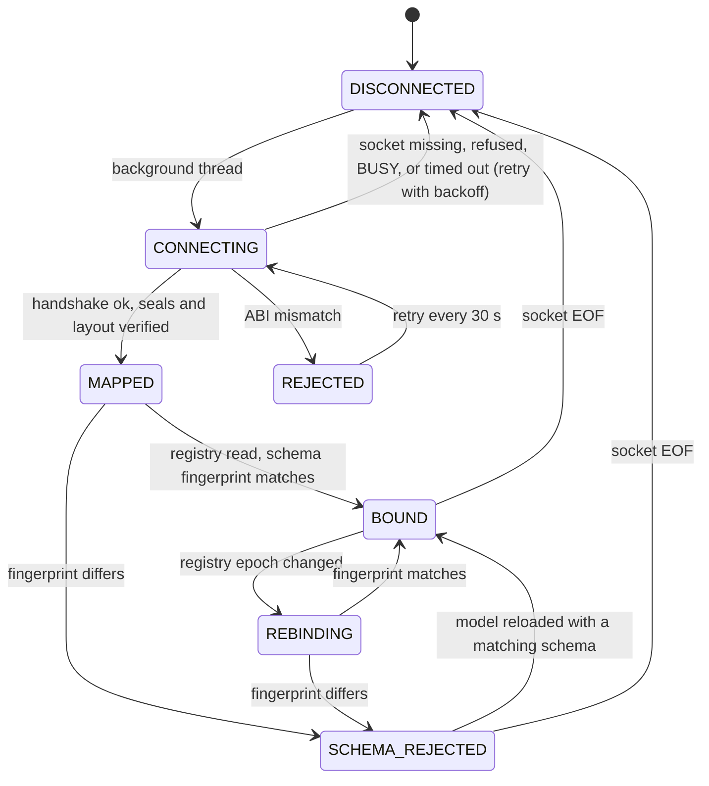

# 06 — SDK Contract (shared by all five SDKs)

[← High-level design](../high-level-design.md) · depends on [01 — SHM ABI](01-shm-abi.md), [02 — Signaling](02-signaling.md), [03 — Arrow data plane](03-arrow-data-plane.md)

Every SidecarZero SDK ([Java FFM](07-sdk-java-ffm.md), [C++20](08-sdk-cpp20.md), [Go](09-sdk-go.md), [Rust](10-sdk-rust.md), [Python](11-sdk-python.md)) implements the exact same behavioral contract specified in this document and verified by the 56-scenario [cross-language conformance suite](14-testing-verification.md#3-cross-language-conformance-suite).

---

## 1. The core guarantee

> `infer(input, budget)` **always returns a valid output.** It stops waiting for the model when the budget expires, and it never fails on its own account. The output comes either from the model or from the caller's mandatory fallback function, and the returned `Outcome` states which.

Three exact invariants back this guarantee:

1. **Bounded return time:** The SDK waits for the model until `deadline = start + min(budget, max_deadline_ns) − fallback_reserve` and then invokes the fallback immediately. The call returns no later than `deadline` plus the fallback's execution time (plus kernel timer slack if the thread parked in `futex`).
2. **Never throws or panics on sidecar faults:** Nothing the SDK or sidecar does can throw an exception or return an error. Codec failures, sidecar crashes, corrupt shared memory, and deadline expirations all resolve to the fallback. Only the caller's own fallback function throwing/panicking can propagate out of `infer` (after the SDK has already released any held slot).
3. **Budget clamping:** Any caller budget exceeding the arena's `max_deadline_ns` (100 ms default) is clamped to `max_deadline_ns` and counted in `scz_client_budget_clamped_total`.

---

## 2. Public surface

Across all five languages, the SDK exposes four core types:

```
Client<In, Out>
    construct(endpoint, codec, fallback, options)     // fallback is mandatory at construction
    infer(input: In, budget: Duration) -> Outcome<Out>
    await_bound(timeout: Duration) -> bool
    export_metrics(sink: MetricsSink)
    metrics_text() -> String                          // Prometheus text exposition format
    close()

Codec<In, Out>
    schema_fingerprint() -> u64                       // xxHash3-64 of declared columns
    encode(input: In, writer: SlotWriter)
    decode(reader: SlotReader) -> Out

FallbackPolicy<In, Out>
    apply(input: In, reason: FallbackReason) -> Out

Outcome<Out>
    value: Out
    source: MODEL | FALLBACK
    reason: FallbackReason      // populated when source == FALLBACK
    model_gen: u32              // populated when source == MODEL
```

Prebuilt codecs (`Float32VecToScore`, `Float32VecToEmbedding`, `BatchFloat32`) cover standard dense-vector workloads out of the box.

---

## 3. `FallbackPolicy` and `FallbackReason`

### 3.1 Mandatory by construction

A `Client` cannot be constructed without providing a fallback function:

| Language | Compile-time / construction enforcement |
|---|---|
| Rust | Typestate builder: `.build()` exists only on `ClientBuilder<..., WithFallback<F>>` |
| C++20 | Constructor template constrained by `FallbackFor<F, In, Out>` requiring `std::is_nothrow_invocable_r_v` |
| Java 22+ | Staged builder interfaces: `FinalStage.build()` is reachable only after `.fallback(fn)` (`Objects.requireNonNull`) |
| Go 1.24 | Required non-nil function parameter to `NewClient` / `Open`; panics at construction if `nil` |
| Python | Required keyword-only argument `fallback=...`; raises `TypeError` at construction if omitted or non-callable |

### 3.2 Requirements on the fallback function

| Requirement | Rationale |
|---|---|
| Deterministic and pure | Safe to invoke concurrently from any request thread |
| Zero blocking, allocation, locking, or I/O | Runs inline on request threads, potentially for 100% of traffic while a sidecar restarts |
| Non-throwing (`noexcept` in C++) | No lower layer remains if the fallback itself throws |
| Target execution time < 400 ns | Keeps total fallback latency (SDK admission check + fallback) under 500 ns |
| Accepts any `In` passed to `infer` | Also runs when `codec.encode` rejects an input (`CODEC_ERROR`) |

### 3.3 The 19 `FallbackReason` values

| Reason | Raised when | Call phase |
|---|---|---|
| `NOT_CONNECTED` | No arena mapped (initial startup, reconnecting, closed, or non-Linux OS) | Admission |
| `ABI_MISMATCH` | Handshake rejected the SDK's ABI version | Admission |
| `SCHEMA_MISMATCH` | Registry `schema_fingerprint` does not match the codec's | Admission |
| `REBINDING` | Registry changed (schema-changing reload) and background thread is re-reading it, or worker returned `STALE_REGISTRY` | Admission or Completion |
| `GATE_INIT` | Gate state is `INIT` (`0`) | Admission or post-enqueue check |
| `GATE_SHEDDING` | Gate state is `PSI_SHEDDING` (`2`) | Admission or post-enqueue check |
| `GATE_RELOADING` | Gate state is `RELOADING` (`3`) | Admission or post-enqueue check |
| `GATE_DEAD` | Gate state is `DEAD` (`4`) | Admission or post-enqueue check |
| `GATE_DRAINING` | Gate state is `DRAINING` (`5`) | Admission or post-enqueue check |
| `STALE_HEARTBEAT` | `supervisor_hb_mono_ns + hb_stale_ns < now` | Admission |
| `CLOCK_FAULT` | Fast monotonic clock drifted from kernel `CLOCK_MONOTONIC` (Java/Go clock verifier) | Admission |
| `OVERLOADED` | Per-caller overload circuit breaker is open ([§4.1](#41-shedding-under-overload)) | Admission |
| `TOO_LARGE` | Input row count exceeds the largest template's `max_rows` | Admission |
| `NO_SLOT` | No `FREE` slot found within the bounded probe limit (cached slot + 16 probes) | Slot claim |
| `CODEC_ERROR` | Codec failed or threw during `encode` or `decode` | Encode or Completion |
| `RING_FULL` | All rings full or enqueue CAS loop hit its 64-attempt bound | Enqueue |
| `DEADLINE` | Call deadline expired before completion, or worker shed with `DEADLINE_EXCEEDED` | Wait or Completion |
| `WORKER_FAILED` | Slot marked `FAILED` by supervisor sweep, worker returned `INTERNAL`/unknown status, response failed validation checks, or slot CAS loop hit its 64-attempt bound | Wait or Completion |
| `MODEL_ERROR` / `BAD_REQUEST` / `RESOURCE_EXHAUSTED` | Worker completed slot with `DONE` and that `status` code | Completion |

---

## 4. The normative call algorithm

```
infer(input, budget):
    snap = current_snapshot()                       // single atomic load of (arena, binding)
    if snap is none: return fallback(input, reason_for(client_state))

    t0         = monotonic_ns()
    deadline   = t0 + min(budget, snap.max_deadline_ns)
    wait_until = deadline − options.fallback_reserve

    // ── Admission ────────────────────────────────────────────────────────────
    g = snap.gate.load(Acquire)                     // gate and supervisor_hb share cache line 0x040
    if state(g) != HEALTHY:                         return fallback(input, reason_of(g))
    if snap.supervisor_hb.load() + hb_stale < t0:   return fallback(input, STALE_HEARTBEAT)
    if worker_gen(g) != snap.binding.confirmed_gen:
        if !confirm_binding(snap, g):               return fallback(input, REBINDING)
    if breaker.is_open(t0):                         return fallback(input, OVERLOADED)

    // ── Claim a slot ─────────────────────────────────────────────────────────
    class = smallest slot class that holds rows(input)
    if none:                                        return fallback(input, TOO_LARGE)
    slot, epoch = claim_slot(class, cached_index[class])   // CAS (e, FREE) → (e+1, CLAIMED); bounded probe
    if none:                                        return fallback(input, NO_SLOT)
    // Scope guard ensures every exit path below either releases the slot or hands it to the worker.

    // ── Encode ───────────────────────────────────────────────────────────────
    if codec.encode(input, writer(slot.request, template)) fails:
        slot.word.store((epoch, FREE));             return fallback(input, CODEC_ERROR)
    slot.request_id, slot.req_len, slot.t_enqueue_ns = …
    slot.word.store((epoch, READY), Release)        // client ownership of request region ends here

    // ── Enqueue ──────────────────────────────────────────────────────────────
    if !enqueue(next_ring(caller), descriptor{slot, epoch, wait_until, …}):   // publish is SeqCst
        if !cas_loop(slot, (epoch, READY) → (epoch, FREE)):
            release(slot)
        return fallback(input, RING_FULL)
    wake_worker_if_parked()

    // ── Wait ─────────────────────────────────────────────────────────────────
    // Immediately re-loads gate (SeqCst). If not HEALTHY and slot is still READY,
    // cancels (READY → FREE) and returns CANCELLED. Otherwise spins then parks on futex.
    w = wait(slot, wait_until)

    // ── Resolve ──────────────────────────────────────────────────────────────
    switch state(w):
      CANCELLED:
          return fallback(input, reason_of(w.gate))
      DONE:
          status, model_gen, resp_stamp, resp_len = slot.…          // atomic/volatile loads into locals
          if status != OK:              release(slot); return fallback(input, reason_of(status))
          if response fails its checks: release(slot); return fallback(input, WORKER_FAILED)
          decoded = codec.decode(reader(slot.response, template))    // decoded before releasing slot
          release(slot)
          if decode failed:                            return fallback(input, CODEC_ERROR)
          return Outcome(decoded, MODEL, model_gen)
      FAILED:
          release(slot);                               return fallback(input, WORKER_FAILED)
      timeout:
          return abandon_then_fallback(slot, epoch, input)
```

```
abandon_then_fallback(slot, epoch, input):
    loop (bounded to 64 attempts):
        w = slot.word.load()
        switch state(w):
          READY:       if cas(w → (epoch, FREE)):                 return fallback(input, DEADLINE)
          PROCESSING:  if cas(w → (epoch, ABANDONED, owner(w))):  forget cached slot index
                                                                  return fallback(input, DEADLINE)
          DONE:        resolve as DONE above (worker won the completion race)
          FAILED:      release(slot);                             return fallback(input, WORKER_FAILED)
```

### 4.1 Shedding under overload

To prevent callers from waiting out their full deadline when a worker is saturated, two mechanisms cooperate:
1. **Worker deadline-feasibility check:** The worker sheds requests at dequeue whose remaining budget is less than `expected_run` ([worker §4](05-worker.md#4-the-consume-loop)).
2. **Per-caller overload circuit breaker:** Each caller entry tracks consecutive calls ending in `DEADLINE` or `RING_FULL`:
   - **Closed:** Normal operation.
   - **Open (after 8 consecutive misses):** Fails fast at admission with `OVERLOADED` in **~40 ns** (without touching shared rings or slots) for a jittered interval starting at `2 × budget` and doubling up to `100 ms`.
   - **Half-open (probing):** When the interval expires, lets one probe call through; a `MODEL` response closes the breaker, while another miss doubles the open interval.

---

## 5. Zero-allocation invariants

On the steady-state path from `infer` entry to return (on both the `MODEL` and `FALLBACK` paths):
1. **Zero heap allocations** (verified in CI across all SDKs).
2. **Zero mutex locks and zero blocking syscalls** other than the bounded `futex` wait.
3. **No logging, string formatting, or exception construction.**
4. **Metrics updates** are relaxed increments of pre-allocated per-caller counters.

---

## 6. Connection lifecycle and safe arena retirement

All connection and handshake operations execute on a single **background thread**. Request threads read only a single atomic pointer/reference to the immutable `Snapshot` (`arena + binding`).



### Safe arena retirement via in-call markers

When the session socket hits EOF (either because the supervisor restarted or because the supervisor called `shutdown(SHUT_WR)` to request a session reset), the background thread immediately clears the active `Snapshot` reference so new calls fall back with `NOT_CONNECTED`. However, threads already inside `infer` may still be accessing the old `mmap` regions or sleeping in `futex` on a slot word inside the old arena.

To guarantee that an arena is **never unmapped while a thread can touch it** and **always unmapped promptly once drained**, every SDK uses a single-word **in-call marker** in each `Caller` entry:

```
caller, on infer entry:
    entry.in_call.store(pack(snap.id, kernel_tid), SeqCst)
    if current_snapshot().id != snap.id:
        entry.in_call.store(0, Release)   // lost race with retirement; retry

caller, on infer exit (via RAII / finally / defer guard):
    entry.in_call.store(0, Release)

background thread, after clearing or replacing a snapshot:
    scan all Caller entries; wait until no entry carries snap.id
    (in C++, Rust, and Python, ignore entries whose kernel_tid no longer exists in /proc/self/task)
    munmap(old_data_seg); munmap(old_ctl_seg)
    close(old_session_socket)             // closed LAST, proving to supervisor that arena is unmapped
```

Closing `old_session_socket` *after* `munmap` is what proves to the supervisor that no host thread still maps the arena before the supervisor re-initializes the rings and slots.

---

## 7. Unified metrics and hooks

Every SDK implements the exact same metric names, label sets, 16-bucket histogram bounds, sampling discipline (`sample_every = 64` calls per caller by default), `MetricsSink` visitor interface, and zero-dependency `PrometheusText` serializer:

| Metric | Type & Labels | Description |
|---|---|---|
| `scz_client_calls_total` | Counter `{source="model"\|"fallback", reason="..."}` | Total `infer` calls across all outcomes (emits all 19 fallback reasons, including zeros) |
| `scz_client_latency_seconds` | Histogram `{source="model"\|"fallback"}` | Sampled end-to-end `infer` duration |
| `scz_client_fallback_seconds` | Histogram | Sampled duration of the user's fallback function |
| `scz_client_budget_clamped_total` | Counter | Calls whose budget exceeded `max_deadline_ns` |
| `scz_client_breaker_open` | Gauge | Number of caller entries whose overload breaker is currently open |
| `scz_client_late_wakes_total` | Counter | Timed-out waits that found `DONE` completed > 1 ms earlier |
| `scz_client_reconnects_total` | Counter | Successful reconnections after the initial connection |
| `scz_client_state` | Gauge | `0` Disconnected, `1` Connecting, `2` Bound, `3` Rejected, `4` SchemaRejected |
| `scz_client_model_gen` | Gauge | Highest `model_gen` observed on a `MODEL` response |

Histogram upper bounds (in seconds): `1e-6`, `2e-6`, `5e-6`, `1e-5`, `2e-5`, `5e-5`, `1e-4`, `2e-4`, `5e-4`, `1e-3`, `2e-3`, `5e-3`, `1e-2`, `2e-2`, `5e-2`, `0.1`, `+Inf`.
