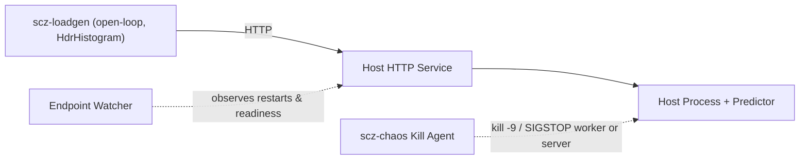

# 13 — Chaos Benchmark (`bench/`)

[← High-level design](../high-level-design.md) · [Canonical benchmark results →](../benchmarks.md)

`bench/` is the self-contained chaos and performance benchmark suite that builds SidecarZero and four baseline architectures, subjects them to steady-state load and fault injection (`SIGKILL`, `SIGSTOP`, overload, and live reload), and generates an empirical comparison report.

```bash
make -C bench chaos-bench
```

For the full 70-run campaign results and analysis, see [docs/benchmarks.md](../benchmarks.md) and [`bench/results/20261113-204426/report.md`](../../bench/results/20261113-204426/report.md).

---

## 1. Claims and Metrics Under Test

Every architecture in the comparison (except the raw in-process floor without a sidecar) is wrapped with the identical linear fallback function. Consequently, the benchmark evaluates not merely whether requests return a response, but **how long the ML model is out of service during failures**, **what tail-latency penalty callers pay**, and **whether Kubernetes observes pod/container restarts or `EndpointSlice` flaps**.

### Service Continuity and Kubernetes Isolation

| Claim | Measured Metric | Target | Scenario |
|---|---|---|---|
| **Model stays in service across worker kills** | Model availability (`model` responses / total requests), time spent in fallback per kill, fallback count per kill | Headline comparative metric across Systems A–E | `kill-loop`, `cold-recovery` |
| **Kubernetes is completely unaware of worker failures** | `EndpointSlice` `ready`/`serving` condition changes; container restarts | `0` flaps, `0` container restarts | `kill-loop`, `freeze`, `leak` |
| **Memory spike isolation** | PID 1 survival, standby survival, and `EndpointSlice` transitions | Zero flaps under `singleProcess`, `nestedCgroup`, and `oomScoreAdj` ([12 — Kubernetes Deploy §5](12-kubernetes-deploy.md#5-oom-shielding)) | `spike` |

### Failure Cost to Callers

| Claim | Measured Metric | Target | Scenario |
|---|---|---|---|
| **Zero lost requests during kills** | Host HTTP/RPC error or timeout count under kill loop vs steady-state control | `0` errors / timeouts | `kill-loop` |
| **Sub-microsecond fallback when gate is closed** | Call entry to fallback completion once gate is non-`HEALTHY` | p99.9 < 1 µs (measured: 0.21 µs p50, 0.38 µs p99.9) | `kill-loop` (in-process) |
| **Bounded latency for calls in flight at kill** | Extra latency of queued (`READY`) and active (`PROCESSING`) calls at the instant of `SIGKILL` | Never exceeds call deadline + fallback execution time | `kill-loop` |
| **Sub-5 ms warm standby promotion** | Four intervals on `CLOCK_MONOTONIC`: kill → death lock, death lock → gate flip + sweep, gate flip → `HEALTHY`, and kill → `pidfd` exit | Kill → `HEALTHY` < 5 ms at p99 with warm standby (measured: 218 µs median, 267 µs max) | `kill-loop` |

### Steady-State Overhead and Efficiency

| Claim | Measured Metric | Target | Scenario |
|---|---|---|---|
| **Low transport overhead (spinning regime)** | End-to-end call latency minus model inference time at 50,000 RPS | p50 < 1 µs, p99 < 10 µs on dedicated cores | `steady` (in-process) |
| **Queue wait separation** | Time spent queued in ring vs inference execution time | Reported separately for uniform and Poisson arrivals | `steady` |
| **Waking regime transport overhead** | End-to-end call latency minus inference time at 2,000 RPS | Reported alongside futex wake-up counts | `steady` (in-process) |
| **CPU cost of low latency** | Host and sidecar CPU seconds per million requests | Reported alongside every latency table | All |
| **Low idle footprint** | Sidecar CPU utilization with zero traffic | < 2% of one core (measured: 0.14%–0.15%) | `idle` |
| **Zero heap allocations on hot path** | Client heap bytes allocated per call | `0 B/op` in Rust, C++, Go, and Java FFM | `steady` (in-process) |

### Overload and Live Reload

| Claim | Measured Metric | Target | Scenario |
|---|---|---|---|
| **Overload fails fast** | Latency of calls shed with `OVERLOADED` | Shed calls < 1 µs at p99 | `overload` |
| **Zero-downtime same-schema reload** | Fallbacks attributable to reload; gap between old worker's last request and new worker's first | `0` fallbacks; handoff gap < 1 ms at p99 (measured: 158 µs median, 169 µs max) | `reload` |

---

## 2. Workload

### Model (`bench/model/gen_model.py`)

A deterministic 256-feature fraud-scoring model generated with a fixed PRNG seed (`bench/model/fraud.onnx`, SHA-256 pinned in `bench/model/fraud.onnx.sha256`):

- Input: `float32[N, 256]` (`features`). Output: `float32[N, 1]` (`score`).
- Two model architectures are generated: the primary gradient-boosted decision tree ensemble (`fraud.onnx`) and a multi-layer perceptron (`fraud_mlp.onnx`) to confirm transport behavior is independent of model operator mix.
- The identical `.onnx` file is executed by ONNX Runtime (`intra_op_num_threads = 1`, `inter_op_num_threads = 1`) across every system under test so that all observed differences reflect IPC transport and fault recovery rather than inference engine differences.

### Mandatory Fallback

Every host application and baseline wrapper implements the identical deterministic linear fallback rule over the first 8 input features:

```
score = sigmoid(0.35·x[0] - 0.25·x[1] + 0.15·x[2] + 0.10·x[3] - 0.20·x[4] + 0.05·x[5] + 0.12·x[6] - 0.08·x[7] - 0.10)
```

### Load Generation (`bench/loadgen`)

- **Open-loop scheduling:** Requests are scheduled against `CLOCK_MONOTONIC` according to the target arrival schedule rather than waiting for previous completions, eliminating coordinated omission.
- **Arrival patterns:** Supports both uniform (evenly spaced) arrivals—used to isolate pure transport overhead from queueing—and memoryless Poisson arrivals.
- **Multi-threaded caller schedule:** In-process mode drives 8 concurrent caller threads with staggered schedules across three traffic regimes: `50,000 RPS` (spinning regime), `2,000 RPS` (futex waking regime), and `10 RPS` (near-idle regime).
- **Per-call deadline:** `2 ms` (`2,000 µs`). Load generator HTTP timeout: `1 s`.

---

## 3. Systems Compared

| System | Server Architecture | Client & Transport | Behavior on Worker / Server Crash |
|---|---|---|---|
| **A — SidecarZero** | `sidecarzero-supervisor` + `sidecarzero-worker` (ORT) + warm standby | SidecarZero SDK over sealed `memfd` shared memory (`futex` + adaptive spin) | Gate flips in ≈ 0.05 ms via robust death lock; warm standby promotes in ≈ 0.22 ms; zero container restarts |
| **A-nospin** | SidecarZero with `--spin-micros=0` and client `spin_budget=0` | SidecarZero SDK using pure `futex` wait/wake without spinning | Same sub-millisecond standby promotion without spinning CPU cost |
| **A-nostandby** | SidecarZero with `--standby=none` | SidecarZero SDK over shared memory | Gate flips in ≈ 0.05 ms; cold worker respawn in ≈ 17 ms; zero container restarts |
| **B — Triton gRPC + SHM** | Triton Inference Server (ONNX Runtime backend) with system shared memory enabled | gRPC control plane (`ModelInfer` over HTTP/2) + POSIX `shm_open` tensor payloads + fallback wrapper | Server crash kills PID 1 (restarting container) unless wrapped in `supervised-init`; gRPC calls fail/time out and invoke fallback wrapper |
| **C — Localhost HTTP/JSON** | Native HTTP/1.1 keep-alive server wrapping ONNX Runtime (`bench/baselines/http-json`) | Pooled HTTP/1.1 keep-alive client with JSON tensor serialization + fallback wrapper | Server crash drops TCP sockets; client catches connection reset/refused and runs fallback while server restarts |
| **D — Unix Socket Binary** | Native UDS server wrapping ONNX Runtime (`bench/baselines/uds-binary`) | Pooled `AF_UNIX` stream client sending length-prefixed little-endian binary `f32` frames + fallback wrapper | Cheapest non-SHM IPC baseline; server crash closes UDS sockets and client runs fallback until server restarts |
| **E — In-Process ORT** | None; ONNX Runtime C API linked directly into the host process (`bench/baselines/in-process`) | Direct native function call in the host address space | **No fault isolation:** a `SIGKILL`, `SIGSEGV`, or native abort in the model runtime immediately terminates the host service process |

For Systems B, C, and D, the suite also supports a **supervised baseline variant** (`*-supervised`, via [`bench/server`](../../bench/server/src/main.rs) `--supervise` and [`bench/baselines/triton/run.sh`](../../bench/baselines/triton/run.sh) `--supervised`) where a lightweight init loop respawns the server inside the container so PID 1 does not exit, isolating the benefit of process supervision from the benefit of shared-memory gate admission and warm standby promotion.

---

## 4. Benchmark Topologies and Scenarios



1. **Service Mode:** `scz-loadgen` sends open-loop HTTP traffic to the host application (`bench/apps/host-{rust,java,go,cpp}`), which invokes the configured predictor (`A`–`E`) and returns the score with an `X-SCZ-Source: model|fallback` header. Simultaneously, `scz-chaos` injects faults and records precise `CLOCK_MONOTONIC` kill timestamps.
2. **In-Process Mode:** The open-loop load generator runs directly inside the host process (`host-{rust,java,go,cpp} --mode=inproc`), bypassing HTTP entirely to measure microsecond-level transport overhead, gate-closed fallback latency, overload shedding latency, and heap allocation counts.

### Scenario Matrix

| Scenario | Fault / Load Injection | Purpose |
|---|---|---|
| `steady` | Fault-free steady traffic | Baseline p50/p90/p99/p99.9 latency, throughput, and CPU efficiency |
| `kill-loop` | Repeated `kill -9` of the active worker / server process (spaced so warm standby reloads between kills) | Measures recovery breakdown, fallback window per kill, and host tail latency under crash chaos |
| `cold-recovery` | High-frequency `kill -9` every 500 ms | Exercises cold worker respawn when kills arrive faster than standby warm-up |
| `freeze` | `SIGSTOP` of active worker / server for `2 s`, followed by `SIGCONT` | Verifies supervisor heartbeat watchdog detection (`≤ 15 ms`) and standby promotion vs baseline 2 s stall |
| `overload` | Request rate at `1.5×` worker capacity | Verifies client-side `OVERLOADED` circuit breaker (`< 1 µs`) and worker deadline-exceeded queue drop |
| `reload` | Atomic model file rename every `2 s` under continuous load | Verifies zero-fallback dual-worker handover and `< 1 ms` handoff gap |
| `idle` | Zero traffic for `15 s`–`60 s` | Verifies idle sidecar CPU budget (`< 2%` of one core) |

---

## 5. Summary of Measured Results

From the 70-run benchmark campaign (5 Systems × 7 Scenarios × 2 Repetitions; full data in [docs/benchmarks.md](../benchmarks.md)):

| System | Kill-Loop Model Share | Fallback Window per Kill (Median) | Host p99 Latency (`kill-loop`) | Freeze (`SIGSTOP` 2 s) Fallback Window | Freeze Host p99.9 Latency | Container Restarts |
|---|---|---|---|---|---|---|
| **A — SidecarZero (warm standby)** | **99.98%** | **0.88 ms** (≈ 1.6 reqs) | **568 µs** | **13.28 ms** | **736 µs** | **0** |
| **A-nospin (futex only)** | **99.96%** | **1.00 ms** (≈ 1.9 reqs) | **572 µs** | **13.10 ms** | **740 µs** | **0** |
| **A-nostandby (cold restart)** | **99.13%** | **17.34 ms** (≈ 34.4 reqs) | **495 µs** | **29.74 ms** | **642 µs** | **0** |
| **B — Triton gRPC + SHM** | 99.10% | 17.87 ms (≈ 35.4 reqs) | 895 µs | 2,000.62 ms | 2,211 µs | 1 per kill (unsupervised) |
| **C — Localhost HTTP/JSON** | 99.04% | 19.29 ms (≈ 37.9 reqs) | 718 µs | 2,000.51 ms | 2,163 µs | 1 per kill (unsupervised) |
| **D — Unix Socket Binary** | 99.08% | 18.23 ms (≈ 36.2 reqs) | 562 µs | 2,000.38 ms | 2,132 µs | 1 per kill (unsupervised) |
| **E — In-Process ORT** | N/A (host dies) | Host process killed | Host dies | Stalls host for 2,000 ms | 2,000,000+ µs | **10 (host crashes)** |

- **20× shorter outage window per kill** (`0.88 ms` vs `17.87–19.29 ms`) than Triton gRPC+SHM, HTTP/JSON, and Unix socket baselines.
- **150× faster freeze recovery** (`13.28 ms` vs `2,000+ ms`) when a worker stalls (`SIGSTOP`).
- **0.21 µs p50 / 0.38 µs p99.9** fallback execution latency when the gate is closed, and **0.23 µs p50 / 0.42 µs p99** when shedding via the `OVERLOADED` breaker.
- **0 fallbacks** across live model reloads with a **158 µs median** (`169 µs` max) inter-worker handoff gap.

---

## 6. Directory Layout and Execution

```
bench/
├── Makefile                 chaos-bench, chaos-bench-quick, chaos-bench-docker, report
├── run-docker.py            orchestrator for multi-system, multi-scenario campaigns
├── kind/                    Kind cluster config (cgroup v2, static CPU manager)
├── model/                   gen_model.py, fraud.onnx, fraud.onnx.sha256
├── apps/
│   ├── host-rust/           Rust host service + in-process benchmark loop
│   ├── host-java/           Java 25 FFM host service + in-process loop
│   ├── host-go/             Go 1.24 host service + in-process loop
│   └── host-cpp/            C++20 host service + in-process loop
├── baselines/
│   ├── triton/              Triton manifests, model repo, SHM + gRPC client
│   ├── http-json/           HTTP/1.1 keep-alive ONNX Runtime server
│   ├── uds-binary/          Unix domain socket binary ONNX Runtime server
│   ├── in-process/          In-process ONNX Runtime C API baseline
│   └── supervised-init.sh   Supervisor wrapper for *-supervised baseline variants
├── loadgen/                 scz-loadgen (open-loop load generator + HdrHistogram)
├── chaos/                   scz-chaos (CLOCK_MONOTONIC kill/freeze agent + watcher)
├── report/                  report.py (aggregates raw JSONL/HdrHistogram into report.md)
└── results/<timestamp>/     Raw run artifacts and generated Markdown report
```

| Make Target | Description |
|---|---|
| `make -C bench chaos-bench` | Full multi-system, multi-repetition benchmark campaign |
| `make -C bench chaos-bench-quick` | Fast campaign across Systems A–E and all 7 scenarios for smoke testing and local validation |
| `make -C bench chaos-bench-docker` | Runs the campaign in isolated containers without requiring a Kind cluster |
| `make -C bench report` | Regenerates `report.md` from existing raw run artifacts in `bench/results/<timestamp>/` |
