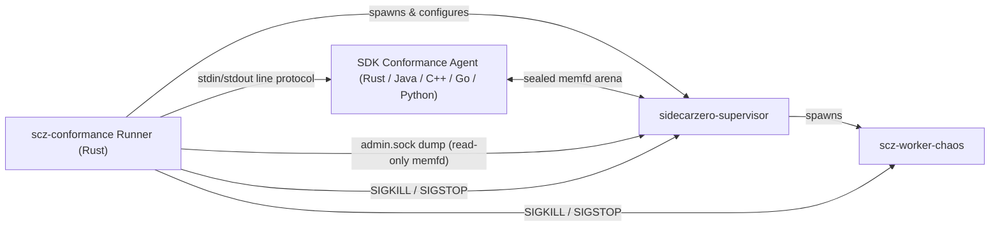

# 14 — Testing and Verification

[← High-level design](../high-level-design.md)

SidecarZero's correctness rests on a lock-free shared-memory protocol spanning a host process, a supervisor, and one or two worker processes, any of which can fail independently. Because the client side of that protocol is implemented across five languages (Rust, Java FFM, C++20, Go, and Python via `abi3` bindings), standard unit tests are insufficient. This document specifies the formal verification, model checking, crash-point injection, fuzzing, virtual-time simulation, cross-language conformance, and performance gates that verify the system.

---

## 1. Fault Classes and Verification Layers

| Fault Class | Example | Primary Verification Layer |
|---|---|---|
| Thread interleaving | Worker completes a slot at the exact instant the client abandons it | TLA+ formal specification (§2.1), Loom exhaustive model checking (§2.2), per-SDK concurrency stress harnesses (§2.3) |
| Crash timing | Worker dies between the two stores of a ring dequeue or between `DONE` and `futex(WAKE)` | Tagged atomic crash-point injection (`SCZ_CRASH_AT`, §2.4), continuous kill-loop soak (§5) |
| ABI layout or ordering drift | An SDK reads a shared word at the wrong byte offset or with weaker memory ordering than required | Code generation (`scz-abi-gen --check`), generated ordered accessors, independent golden arena dumps, raw-pointer lint (§4) |
| Lost wake-up | A parked thread is never woken (masked in naive tests by the call deadline) | TLA+ safety invariant (`NoStrandedSleeper`), Loom park/wake models, late-wake counters asserted zero (§3) |
| Hostile or corrupt arena bytes | A buggy worker writes corrupt ring sequence numbers or out-of-bounds slot lengths | Bounded loops on all shared reads, 7 `cargo-fuzz` targets (§2.5), cross-language scribbler conformance scenarios (§3) |
| Misdelivered or stale response | A stale response from an earlier call in a reused slot is returned to a later caller | Per-call epoch stamps and keyed request nonces verified on every conformance call (§3) |
| Resource leak | Slots stranded in `ABANDONED`, file descriptors leaked, or retired arenas left mapped | Universal post-scenario arena invariant check and process FD/mapping/thread accounting (§3, §5) |
| Kernel / runtime environment mismatch | Container seccomp profile blocks a required syscall or cgroup v2 files are absent | Kind multi-version E2E suite ([12 — Kubernetes Deploy §10](12-kubernetes-deploy.md#10-kind-end-to-end-verification-suite-deploykinde2epy)) and environment matrix (§6) |
| Latency or allocation regression | A change introduces heap allocations on the hot path or degrades tail latency | Zero-allocation and latency gates (§7) |

---

## 2. Protocol Verification

### 2.1 Formal Specification in PlusCal / TLA+ (`spec/`)

Two PlusCal/TLA+ specifications in [`spec/`](../../spec/README.md) model the shared-memory protocol and are checked by TLC via `scripts/tla-check` and mutation-tested via `scripts/tla-mutants`:

1. **`SlotsRing.tla` (Spec A — Slots, MPSC Ring, and Supervisor Sweep):** Models two client threads in one host process, a two-cell MPSC ring, two slots, one worker, and the supervisor (gate, sweep, ring repair, and session reset). The worker may crash at any step, the host process may exit at any step, any client thread may stall indefinitely at any step, and the supervisor may initiate a session reset.
2. **`Consumers.tla` (Spec B — Consumer Lifecycle and Handover):** Models the active worker, its warm standby or reload successor, and the supervisor across crash recovery, cooperative handover (`HANDOVER` → `RELEASED`), schema-changing reload, and ranked gate holds, with either worker crashing or stalling at any step.

| Spec | Verified Invariant / Property | Kind |
|---|---|---|
| `SlotsRing` | `SingleOwner` — A slot's request/response data regions have at most one owner at any step | Safety |
| `SlotsRing` | `EpochIsolation` — A ring descriptor from epoch `e` never causes processing of a slot at epoch `e′ ≠ e` | Safety |
| `SlotsRing` | `SingleOutcome` — No call resolves to more than one outcome (`MODEL` vs `FALLBACK`) | Safety |
| `SlotsRing` | `CallsResolve` — Every call resolves provided its own calling thread continues stepping | Liveness |
| `SlotsRing` | `NoStrandedSleeper` — Whenever a waiter is parked and its wake condition holds, a wake-up is pending (crucially requiring the supervisor sweep to wake parked callers on `DONE` slots as well as `READY`/`PROCESSING` slots) | Safety |
| `SlotsRing` | `RingUsableAfterCrash` — After a worker crash at any step, ring repair and slot sweep leave the ring and slot table in a valid state where no ring appears simultaneously empty to consumers and full to producers | Safety |
| `SlotsRing` | `SweepComplete` — After worker exit and sweep, no slot owned by that worker remains `PROCESSING` or `ABANDONED` | Safety |
| `SlotsRing` | `DeathBoundaryCovered` — A request published across a worker death is resolved by the client's post-enqueue gate re-check or by the supervisor sweep, never missed by both | Safety |
| `SlotsRing` | `SessionResetClean` — After host exit and session reset, every slot is `FREE` and every ring is empty | Safety |
| `SlotsRing` | `NoResetWhileClientInArena` — A session reset never executes while any client thread is still inside the arena | Safety |
| `SlotsRing` | `StalledProducerRecovered` — A producer that halts after claiming a ring cell either publishes a void cell via its unwind guard or triggers a supervisor session reset | Liveness |
| `SlotsRing` | `SlotsReturnToFree` — Every slot returns to `FREE` once its call resolves and any owning worker makes progress or is swept | Liveness |
| `Consumers` | `SingleConsumer` — At most one worker consumes from a ring or holds slots at any instant across crash, promotion, handover, and reload | Safety |
| `Consumers` | `SafeRepairAndSweep` — A ring is repaired and handed over only after its consume thread's death lock or process exit is observed; `PROCESSING` slots are swept only after process exit | Safety |
| `Consumers` | `CleanHandover` — A cooperative handover loses no queued request and serves none twice | Safety |
| `Consumers` | `GateHoldsRanked` — The gate reads `HEALTHY` only when no active recovery path holds a gate lock, regardless of completion order | Safety |
| `Consumers` | `HandoverTerminates` — A handover in which either worker dies or stalls at any step terminates in either a completed handover or crash recovery | Liveness |

Thirteen seeded protocol mutants (`scripts/tla-mutants`) verify that TLC catches every corresponding protocol bug (detailed state counts and runtimes in [`spec/README.md`](../../spec/README.md)).

### 2.2 Exhaustive Rust Concurrency Model Checking (`loom`)

`scz-shm`'s ring, slot, caller-table, and wait primitives are written against a swappable atomics layer (`crates/scz-shm/src/sync.rs`) and checked exhaustively under `loom` via `scripts/dev loom` (and verified against 10 seeded concurrency mutants via `scripts/loom-mutants`):

| Loom Model (`crates/scz-shm/tests/loom.rs`) | Verified Interleaving |
|---|---|
| `ring_mpsc_and_crash_repair` | Two producers, one consumer, capacity 2; consumer crash between `head` store and cell sequence store (`seq == head`), followed by supervisor repair |
| `ring_void_cell` | Producer unwind guard publishing a claimed cell with `SLOT_VOID` while a second producer and consumer operate concurrently |
| `slot_claim_complete_abandon_sweep` | Client (`FREE → CLAIMED → READY → ABANDONED`) vs worker (`READY → PROCESSING → DONE`) vs supervisor sweep |
| `worker_park_and_wake` | Producer publish + `SeqCst` fence + `RingWakeWord` check vs worker announce `SLEEPING` + `SeqCst` fence + ring re-check, including stalled-`WAKING` recovery |
| `client_park_and_wake` | Worker `DONE` transition + `SeqCst` fence + `WAITER` bit check vs client set `WAITER` + `SeqCst` fence + state re-check |
| `standby_wait_and_activate` | Supervisor `worker_gen` update + wake vs standby worker poll + futex wait |
| `arena_swap_and_retire` | Client thread setting its in-call `CallerEntry` marker vs background thread retiring an old arena mapping |
| `gate_recheck_vs_sweep` | Client enqueue + `SeqCst` fence + gate re-check vs supervisor gate close + `SeqCst` fence + ring/slot sweep |
| `consumer_handoff` | Producers enqueuing while old consumer releases at loop boundary and new consumer resumes from `head_mirror` |
| `control_wake` | Supervisor setting `ctl_req` bit + wake vs worker checking `ctl_req` before sleeping |

Notice that because `loom` treats `Ordering::SeqCst` loads/stores as `Acquire`/`Release` unless paired with `atomic::fence(Ordering::SeqCst)`, every store-then-load synchronization pair in SidecarZero uses an explicit `fence(Ordering::SeqCst)` ([empirical validation S7](../../spikes/FINDINGS.md#s7--platform-and-runtime-facts)), which also generates optimal barrier instructions on both x86-64 and aarch64.

### 2.3 Concurrency Verification Across All SDKs

| SDK | Verification Mechanism |
|---|---|
| **Rust** | `loom` exhaustive models (§2.2), `check-raw-shm-access` lint forbidding direct pointer dereferences outside generated accessors |
| **Java FFM** | Multi-threaded stress suite (`sdks/java-ffm/src/test/java/io/sidecarzero/StressTest.java`) exercising concurrent slot claim/abandon/complete, MPSC enqueue, caller-table claim, and virtual-thread pinning; only generated `Abi` `VarHandle` accessors touch shared memory |
| **C++20** | Multi-threaded concurrency stress harness (`sdks/cpp20/tests/test_stress.cpp`) running under ThreadSanitizer (TSan), AddressSanitizer (ASan), and UndefinedBehaviorSanitizer (UBSan) |
| **Go** | Race-detector test suite (`go test -race ./...`) plus AST/source verification in `scripts/check` ensuring all shared-memory reads and writes go through generated `internal/abi` atomic accessors |
| **Python** | Delegates the entire shared-memory protocol to the Rust `scz-sdk` client with the GIL released; verified via multi-threaded Python stress tests and buffer-protocol lifetime tests |

### 2.4 Crash-Point Injection (`SCZ_CRASH_AT`)

Every shared-memory store and compare-and-swap in `scz-shm`, `scz-supervisor`, `scz-worker-core`, and all five SDK conformance agents is instrumented with named crash points (`crates/scz-shm/src/crash.rs`, enabled under `--features crash-points`). Setting `SCZ_CRASH_AT=<tag>:<hit_count>` causes the process to execute `_exit(137)` at that exact instruction boundary:

- **Worker & Supervisor crash points:** Ring dequeue (`ring_dequeue_after_head`, `ring_dequeue_after_seq`), slot transitions (`worker_after_claim`, `worker_after_write_resp`, `worker_after_done_before_wake`), handover (`worker_after_released_report`), and promotion.
- **Client / SDK crash points:** `client_after_slot_claim`, `client_after_slot_ready`, `client_after_ring_claim`, `client_after_ring_write_desc`, `client_after_ring_publish`, `client_after_abandon_cas`—implemented identically across the Rust, Java, C++20, Go, and Python conformance agents (`conformance/scenarios/crash/`).

### 2.5 Fuzzing (`fuzz/`)

Seven `libFuzzer` targets in [`fuzz/fuzz_targets/`](../../fuzz/) test every parser and shared-memory reader that consumes untrusted bytes from a peer process:

| Fuzz Target | Untrusted Input | Verified Invariant |
|---|---|---|
| `handshake_and_http.rs` | Arbitrary UDS handshake frames, admin-socket commands, and HTTP requests | Never panics, never allocates unboundedly, rejects malformed frames cleanly |
| `registry_parse.rs` | Arbitrary staged `RegistryHeader`, `TemplateDesc`, `ColumnDesc`, and `PatchDesc` bytes | Client parser and supervisor `verify-registry` helper reject all out-of-bounds offsets, overlaps, and unaligned patches |
| `worker_validate.rs` | Arbitrary ring descriptor and `SlotRecord` bytes | Worker core validates all indices, epochs, and offsets without out-of-bounds memory access |
| `supervisor_sweep.rs` | Arbitrary corrupted data-segment bytes | Supervisor slot sweep, ring repair, and session reset terminate in bounded steps and restore arena invariants |
| `arrow_reader.rs` | Arbitrary Arrow IPC frame bytes in a slot region | Generic Arrow IPC reader validates metadata and buffer bounds without panicking |
| `client_response.rs` | Arbitrary worker-written `SlotRecord` and response payload bytes | SDK response validation rejects out-of-range lengths and increments `reject_count` |
| `ring_enqueue.rs` | Arbitrary corrupted MPSC ring header and cell sequence words | Producer enqueue terminates within `MAX_ENQUEUE_ATTEMPTS` (`64`) and never loops infinitely |

### 2.6 Virtual-Time Supervisor Simulation

The supervisor's core state machine (`crates/scz-supervisor/src/core.rs`) abstracts time (`MonoNs`) and external events (`Event`) behind a deterministic interface. Unit tests drive thousands of worker crashes, death-lock notifications, heartbeat stalls, memory-pressure ladders (`85%` → `75%` hysteresis → `shed_max` recycle → `95%` hard kill), dual-worker and single-worker reloads, and automatic model rollbacks in milliseconds of wall-clock time with deterministic replay.

---

## 3. Cross-Language Conformance Suite (`conformance/`)

`conformance/` runs the 56-scenario declarative conformance suite (`conformance/scenarios/` and `conformance/scenarios/crash/`) against all five SDKs:

### Universal Post-Scenario Assertions

After every scenario, `scz-conformance` automatically verifies:

1. **Every call returned** within its deadline + fallback execution time + runner scheduling tolerance.
2. **Keyed response integrity:** Every call carries a unique `(agent, thread, seq)` nonce; `scz-worker-chaos` computes a deterministic hash over all request bytes, and the runner verifies that every `MODEL` response matches that exact call's expected digest at a valid `model_gen`.
3. **Full arena invariant check:** Using read-only `memfd` descriptors obtained via the admin socket's `dump` command, the runner verifies that every slot is `FREE` with `WAITER == 0` and `OWNER == 0`, every MPSC ring is empty with consistent sequence numbers, and every wake word is at rest.
4. **Zero resource leaks:** The agent's open file descriptor count, mapped `/memfd:scz-*` regions, and thread count match their initial baseline (`PROC` command).
5. **Counter agreement:** The SDK's exported metrics (`STATS`) match the call outcomes observed by the runner, and late-wake counters are zero on fault-free scenarios.

### Coverage Enforcement

`scz-conformance` enforces at startup that the scenario suite covers:

- **All 19 `FallbackReason` variants** defined in `abi/scz_abi.toml`.
- **All 40 FMEA rows** in [15 — Failure Modes §1](15-failure-modes.md#1-summary-matrix) (either directly in `conformance/scenarios/` or mapped to their corresponding Kind E2E test in `deploy/kind/e2e.py`).
- **All chaos opcodes and script directives** supported by `scz-worker-chaos`.

---

## 4. ABI Drift Prevention

| Mechanism | What It Verifies |
|---|---|
| `cargo run -p scz-abi-gen -- --check` | Verifies that generated Rust, Java, C++20, and Go ABI constants and ordered atomic accessors match `abi/scz_abi.toml` byte-for-byte |
| `python3 abi/golden/generate.py --check` | An independent Python generator (sharing zero code with `scz-shm`) writes golden control and data segment binary images (`abi/golden/control.bin`, `abi/golden/data.bin`), which are parsed and asserted by the test suites of all 5 SDKs |
| Sidecar-internal status field lint (`scripts/check`) | Enforces [01 — Shared-Memory ABI §8.2](01-shm-abi.md#82-forward-compatibility-for-sidecar-internal-fields): no SDK source file may read or write `beats[]` or `worker_stats[]` |
| Raw shared-memory access lint | Forbids raw pointer dereferences of shared-memory structures outside the generated ordered accessors |
| Forward/backward compatibility upgrade test (`scripts/upgrade-test`) | Builds an `ABI 1.1` sidecar with shifted internal offsets and larger `SlotRecord` / `TemplateDesc` strides and runs the full conformance suite both ways (`1.0` SDK ↔ `1.1` sidecar and `1.1` SDK ↔ `1.0` sidecar) |

---

## 5. System, Soak, and Performance Gates

`scripts/check` runs the complete fast, protocol, SDK build/test, and cross-language conformance pipeline inside the deterministic development container (`scripts/dev`):

1. `scz-abi-gen --check` and `abi/golden/generate.py --check`
2. Sidecar-internal status field isolation check
3. `cargo fmt --all --check` and `cargo clippy --workspace --all-targets -- -D warnings`
4. Fuzz target compilation check (`fuzz/Cargo.toml`)
5. Helm library chart linting and multi-profile template rendering (`deploy/helm-kep753`) plus `deploy/kind/e2e.py` syntax check
6. Prometheus alert rule and Grafana dashboard metric-export verification
7. Debug and release workspace unit, integration, crash-point, and virtual-time supervisor tests
8. Per-SDK build, unit/stress/allocation-gate tests (`sdks/{java-ffm,cpp20,go,python}/test.sh`), and full 56-scenario conformance + crash-point runs for every SDK
9. Exhaustive `loom` concurrency model checking (`scripts/dev loom`)
10. Optional `--tla` and `--mutants` flags running TLC over `SlotsRing.tla` and `Consumers.tla` plus all 10 Loom mutants and 13 TLA+ mutants
