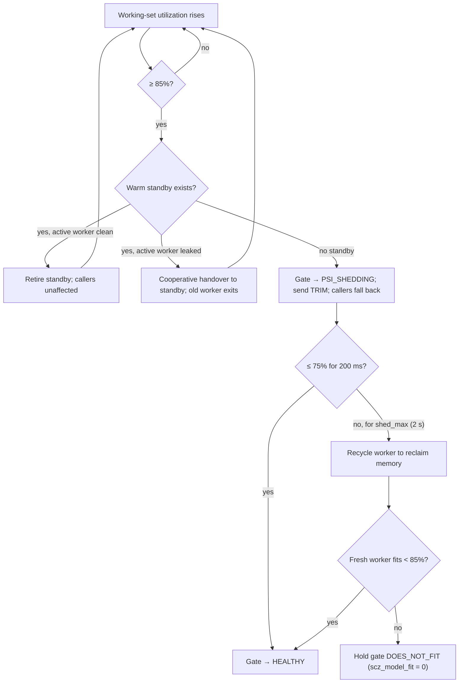

# 15 — Failure Modes and Recovery

[← High-level design](../high-level-design.md) · draws on [01 — Shared-Memory ABI](01-shm-abi.md) through [14 — Testing and Verification](14-testing-verification.md)

SidecarZero is defined by its behavior under failure. This document catalogs every failure mode across the worker, memory subsystem, supervisor, host client, model lifecycle, and arena capacity, specifying how each failure is detected, what calling threads experience, how the system recovers, and what Kubernetes observes.

Two invariants hold across every failure mode:

1. **The caller always receives a valid answer within its deadline bound.** Every call returns either the model's prediction or the caller's mandatory local fallback no later than `deadline + fallback_execution_time` ([06 — SDK Contract §1](06-sdk-contract.md#1-the-promise-to-the-caller)). The only exception is when the user-supplied fallback function itself throws an unhandled exception (row 40).
2. **Inference is at-most-once.** Failed or timed-out requests are never retried on another worker.

---

## 1. Failure Mode and Effects Analysis (FMEA) Matrix

Row numbers (`#1`–`#40`) are stable identifiers referenced directly by the [cross-language conformance suite](14-testing-verification.md#coverage-enforcement).

Only five failure modes (`#9`, `#10`, `#28`, `#29`, and `#31`, highlighted in **bold**) are visible to Kubernetes. Every other failure mode is handled transparently inside the pod with zero container restarts and zero `EndpointSlice` transitions.

### 1.1 Worker Failures

| # | Failure | Detected By | Detection Time | Calls Already in Flight | New Calls | Recovery | Kubernetes Sees |
|---|---|---|---|---|---|---|---|
| 1 | Worker crash or `kill -9` | Per-consume-thread robust death lock; then supervisor `pidfd` | Death lock: ≈ 0.05 ms (independent of worker RSS). `pidfd`: after kernel reclaims worker pages (≈ 15 ms/GiB of private RSS) | Queued (`READY`): swept to `FAILED` immediately and woken. In-flight (`PROCESSING`): swept to `FAILED` at `pidfd` readable, or fall back at call deadline if sooner | Fall back at admission (`GATE_DEAD` / `GATE_PROMOTING`) from the first death lock (≈ 0.05 ms) | Promote warm standby once all consume threads report (≈ 0.22 ms total), or cold restart | Nothing |
| 2 | Worker process frozen (`SIGSTOP`) | Stale worker heartbeat (`worker_hb_mono_ns`) | ≤ `hb_stale_ns` + 1 ms (`≤ 15 ms`) | Fall back at call deadline or on supervisor sweep | Enter model path until supervisor flips gate, then fall back at admission | Supervisor sends `SIGKILL`, then recovers as #1 | Nothing |
| 3 | Inference thread hung while heartbeat thread stays alive | Ring `head` not advancing with a published request waiting, or a slot held in `PROCESSING` / `ABANDONED` past `2 × max_deadline_ns` | `2 × max_deadline_ns` (plus up to 50 ms for held-slot scan) | Fall back at call deadline | Queue behind hung thread and fall back at deadline until detected, then fall back at admission | Supervisor sends `SIGKILL`, then recovers as #1 | Nothing |
| 4 | Worker slow / saturated | Per-call deadline | Per call | Client CASes slot to `ABANDONED` (or `FREE` if still `READY`) and runs fallback | After 8 consecutive deadline misses, client breaker sheds with `OVERLOADED` in `< 1 µs` for 10 ms; worker drops requests whose `deadline_mono_ns` has already passed | Queue drains automatically as callers shed and worker skips expired slots | Nothing |
| 5 | Worker returns an application/runtime error | `SlotRecord.status` (`MODEL_ERROR`, `BAD_REQUEST`, `RESOURCE_EXHAUSTED`) | Immediate upon slot `DONE` | Client frees slot and runs fallback with the corresponding `FallbackReason` | Unaffected | None required | Nothing |
| 6 | Worker writes corrupt values in `SlotRecord` or ring words | SDK bounds checks on every shared read and bounded retry limit (`64`) on every loop; `reject_count` and `ring_fault_count` exported on `Caller` entry | Immediate for caller. Supervisor condemns worker once `reject_count` reaches `≥ 8` in 1 s and `≥ 1%` of completions; `ring_fault_count` triggers a ring check within 2 ms | Fall back (`WORKER_FAILED` on bad response; `RING_FULL` on corrupt ring sequence numbers) | Same while corruption persists | Refused responses: supervisor condemns worker and recovers as #1. Corrupt ring: session reset (#33) | Nothing |
| 27 | Warm standby worker dies or freezes | Standby `pidfd` or stale standby heartbeat | Same as #1 or #2 | Unaffected | Unaffected | Supervisor spawns replacement standby in background; if active worker fails before replacement is `WARM`, recovery is a cold start | Nothing |
| 37 | Poison input repeatedly crashes the model | Each arrival triggers #1; restart counter and `scz_worker_crashloop` rise | Same as #1 | Call carrying poison input falls back with `WORKER_FAILED` | Fall back (`GATE_DEAD`) during exponential backoff window | Supervisor logs `request_id`s held in `PROCESSING` at crash; host logs inputs that returned `WORKER_FAILED` | Nothing |

### 1.2 Memory Failures

| # | Failure | Detected By | Detection Time | Calls Already in Flight | New Calls | Recovery | Kubernetes Sees |
|---|---|---|---|---|---|---|---|
| 7 | Gradual worker memory growth / leak | Supervisor cgroup monitor (`10 ms` tick) + per-worker `/proc/<pid>/statm` | ≤ 10 ms past 85% threshold | Complete normally | Unaffected if standby is retired or handed over to; fall back (`GATE_SHEDDING`) if no standby | Retire standby (if active worker is clean) or hand over to standby (if active leaked); without standby, send `TRIM` and recycle worker after `shed_max` (`2 s`) | Nothing |
| 8 | Sudden memory spike with OOM shield active (`singleProcess`, `nestedCgroup`, or `oomScoreAdj`) | Kernel OOM killer terminates worker; death lock and `pidfd` notify supervisor | Same as #1 | Same as #1 | Same as #1 | Same as #1 (under `oomScoreAdj`, standby also dies so recovery is a cold start) | Nothing |
| 9 | Sudden memory spike with no OOM shield (`oomShield.mode: none`) | Kernel group-OOM kills entire sidecar container (`memory.oom.group = 1`) | Immediate | Fall back at call deadline | Fall back at admission (`STALE_HEARTBEAT` / `NOT_CONNECTED`) | Kubelet restarts sidecar container; SDK reconnects to new arena without restarting host | **Sidecar container restart; pod briefly un-ready until new supervisor passes `/readyz`** |
| 26 | Model exceeds container memory limit (`DOES_NOT_FIT`) | Freshly warmed worker already exceeds 85% working-set threshold | Immediately after warm-up | — | Fall back (`GATE_SHEDDING`, `/modelz` reports `DOES_NOT_FIT`) | Supervisor holds gate closed (`scz_model_fit = 0`) and retries with backoff until limit is raised or smaller model is deployed | Nothing on `/readyz`; `/modelz` returns `503` |

### 1.3 Supervisor and Sidecar Container Failures

| # | Failure | Detected By | Detection Time | Calls Already in Flight | New Calls | Recovery | Kubernetes Sees |
|---|---|---|---|---|---|---|---|
| 10 | Supervisor crash (`SIGKILL` PID 1) | SDK sees session UDS EOF and stale `supervisor_hb_mono_ns` | ≤ `hb_stale_ns` (`15 ms`) | Fall back at call deadline | Fall back (`STALE_HEARTBEAT` / `NOT_CONNECTED`) | Kubelet restarts sidecar container; SDK maps new arena and retires old arena once callers drain | **Sidecar container restart; pod briefly un-ready** |
| 28 | Supervisor event loop wedged while process stays alive | Clients: stale `supervisor_hb_mono_ns`. Kubelet: `/readyz` and `/livez` time out | Clients: ≤ `15 ms`. Kubelet: ≈ 6 s to un-ready, ≈ 15 s to liveness restart | Complete normally while worker continues running | Fall back (`STALE_HEARTBEAT`) | Kubelet restarts sidecar via `livenessProbe`; then recovers as #10 | **Pod un-ready after ≈ 6 s, then sidecar container restart after ≈ 15 s** |
| 29 | Supervisor crashes repeatedly at startup | Kubelet `CrashLoopBackOff` | Immediate | — | Fall back (`NOT_CONNECTED`) | Operator fixes image/node issue; host continues serving fallbacks | **Pod stays un-ready during `CrashLoopBackOff`** |
| 30 | Sidecar starts on a node missing required facilities (old kernel, no cgroup v2 files, missing model file) | Supervisor startup checks | At startup | — | Fall back (`NOT_CONNECTED` or gate reason) | With `startup.failOpen: true` (default), supervisor starts **degraded** (`scz_degraded = 1`) so host container starts and serves fallbacks; retries recoverable causes automatically | Nothing on `/readyz` (`/modelz` returns `503`). With `startup.failOpen: false`, behaves as #31 |
| 31 | Sidecar cannot run or pod specification is invalid (bad CLI flag, memory limit smaller than arena) | Supervisor validation or kubelet image pull | At startup | — | — | Operator fixes pod spec. Halts a bad rolling update at the first canary pod while existing pods keep serving | **Pod never starts (`Init:Error` / `Init:CrashLoopBackOff`)** |
| 19 | Sidecar CPU throttling | Supervisor monitors `cpu.stat` (`nr_throttled`, `throttled_usec`) and own tick gap | Immediate per tick | Some calls fall back at deadline | Fall back (`STALE_HEARTBEAT`) during severe freeze | Supervisor lowers `worker_spin_ceil_ns` and subtracts its own scheduling stall from worker heartbeat age so healthy workers are not falsely killed | Nothing |
| 20 | Sidecar not up yet or socket missing at host startup | SDK non-blocking connect | Immediate (`Client::builder().build()` never blocks) | — | Fall back (`NOT_CONNECTED`) | Background reconnect thread connects with jittered backoff (`10 ms` → `1 s`) | Nothing |
| 21 | Pod termination (`SIGTERM`) | Supervisor signal handler | Immediate | Complete normally | Model serves while host remains connected (up to `shutdown.sessionGraceSeconds`, default `20 s`), then falls back (`GATE_DRAINING`) | Clean pod shutdown | Normal pod termination |
| 39 | Helper process crashes or times out (`hash-model` or `verify-registry`) | Supervisor monitors helper pipe and exit status | Immediate or helper timeout (`1 s` for registry verifier) | Unaffected | Unaffected if a model is already serving | Treated as a failed model load (#15 at startup, #16 on reload) | Nothing |

### 1.4 Host and SDK Client Failures

| # | Failure | Detected By | Detection Time | Calls Already in Flight | New Calls | Recovery | Kubernetes Sees |
|---|---|---|---|---|---|---|---|
| 11 | Host process crash or exit | Supervisor detects EOF on session UDS | Immediate | — | — | Supervisor runs session reset (gate → `RELOADING`, drains worker, zeroes rings and slots, bumps `session_epoch`, restores gate) | Host container restart |
| 12 | Host thread dies mid-call (after publishing descriptor) | Not tracked per-thread unless holding an unpublished ring cell (#32) | — | Call dies with its thread | Unaffected | Worker completes or fails the slot normally; stale `in_call` marker is ignored by arena retirement via `(snapshot_id, kernel_tid)` check | Nothing |
| 32 | Host thread unwinds or is killed between claiming a ring cell (`tail.fetch_add`) and publishing it | SDK unwind scope guard (on panic/exception); otherwise supervisor detects head cell claimed and unpublished for `2 × max_deadline_ns` | Immediate with scope guard; `2 × max_deadline_ns` if thread was killed outright (`pthread_cancel` / `SIGKILL`) | Calls queued behind the cell on that ring fall back at deadline | Same until detected, then `GATE_RELOADING` during session reset | Scope guard publishes cell with `SLOT_VOID` and worker skips it; if thread died without unwinding, supervisor triggers a live session reset (§2.7) | Nothing |
| 33 | Ring or slot words corrupted by stray write | Client increments `ring_fault_count`; supervisor runs consistency check | ≤ 2 ms when clients report ring faults; otherwise `2 × max_deadline_ns` | Fall back at deadline or with `RING_FULL` | Same until detected, then `GATE_RELOADING` during session reset | Supervisor initiates a live session reset (§2.7) without condemning the worker | Nothing |
| 38 | Second host process attempts to connect (or child inherited socket) | Supervisor handshake checks active session | At connect | — | Second process receives `BUSY` and falls back (`NOT_CONNECTED`) | All SDK file descriptors use `FD_CLOEXEC` / `O_CLOEXEC` and `pthread_atfork` hooks clear inherited client state | Nothing |
| 22 | Monotonic clock skew in Java/Go calibrated clock | SDK background calibration against `CLOCK_MONOTONIC` | Calibration interval | — | Fall back (`CLOCK_FAULT`) until recalibrated | SDK recalibrates `(base_mono, base_raw)` seqlock and resumes automatically | Nothing |
| 40 | Caller-side fault: batch larger than largest slot class, codec error, or user fallback throws | SDK | Immediate | — | `TOO_LARGE` or `CODEC_ERROR` fallback; if user fallback throws, exception propagates to caller | Caller fixes input or fallback implementation | Nothing |
| 17 | Schema fingerprint mismatch between host codec and model | SDK verifies `schema_hash_lo/hi` at bind | At connect | — | Fall back (`SCHEMA_MISMATCH`) | Redeploy matching host or model | Nothing |
| 18 | ABI major version mismatch | Handshake version check | At connect | — | Fall back (`ABI_MISMATCH`); SDK retries every 30 s | Upgrade sidecar or SDK | Nothing |
| 24 | Model reload changes schema under a running client | Client checks `registry_epoch` at admission; worker checks `SlotRecord.registry_epoch` | Next call after reload | Any request encoded under the old epoch is rejected (`REBINDING`) | Fall back (`REBINDING`) for microseconds while background thread re-reads registry, then serve model or `SCHEMA_MISMATCH` | Automatic rebind | Nothing |

### 1.5 Model Lifecycle and Reload Failures

| # | Failure | Detected By | Detection Time | Calls Already in Flight | New Calls | Recovery | Kubernetes Sees |
|---|---|---|---|---|---|---|---|
| 15 | Bad model at startup (load fails or crashes during warm-up) | Worker exits before reporting `WARM` | Immediate | — | Fall back (`GATE_INIT` on first attempt, `GATE_DEAD` thereafter) | Exponential backoff (`50 ms` → `5 s`); recovers automatically when valid model file is placed | Nothing on `/readyz`; `/modelz` returns `503`. With `startup.waitForModel: true`, holds pod startup |
| 36 | Model load or warm-up hangs indefinitely | Supervisor load timer (`worker.loadTimeoutSeconds`, default `300 s`) | At load timeout | Unaffected | Same as #15 at startup; unaffected during dual-worker reload | Supervisor kills hung loading worker and increments `scz_load_timeouts_total` | Same as #15 |
| 16 | New model fails to load during live reload | New worker exits during load, or #36, or #39 | Immediate or load timeout | Unaffected | Unaffected when memory fits two workers (old model continues serving with gate `HEALTHY`); otherwise see #35 | Supervisor retains old worker (or reloads previous model under single-worker mode) | Nothing |
| 35 | Live reload when memory fits only one worker | Supervisor memory check before spawning reload worker | At reload start | Complete during drain | Fall back (`GATE_RELOADING`) for the new model's load duration | Old worker drains and exits first; if new model fails to load, supervisor reloads the previous model file descriptor | Nothing |
| 34 | Newly reloaded model passes warm-up but crashes on real traffic | New generation's worker dies as ring consumer 3 times within `reload.rollbackWindowSeconds` (`60 s`) | After 3 crashes | Same as #1 on each crash | Fall back between attempts | **Automatic rollback:** supervisor re-verifies and loads the retained file descriptor of the previous working model, increments `scz_model_rollbacks_total`, and refuses the bad model hash until a new file is published or forced | Nothing on `/readyz`; `/modelz` and metrics report rollback |
| 23 | Old worker dies or stalls during cooperative reload handover | Old worker `pidfd` or `handover_timeout` (`100 ms`) | Immediate or `100 ms` | Same as #1 | Brief fallback until new worker activates | Supervisor sweeps rings/slots and activates the already-warm new worker | Nothing |
| 25 | Model file modified in place instead of atomically replaced | Supervisor checks `(dev, ino, size, mtime)` and SHA-256 | At spawn or reload | Unaffected | Unaffected (active worker keeps serving) | Supervisor refuses the modified file (`MODEL_MODIFIED`, `scz_model_modified_total`); use atomic rename or `model.copy: memfd` | Nothing |

### 1.6 Capacity Exhaustion

| # | Failure | Detected By | Detection Time | Calls Already in Flight | New Calls | Recovery | Kubernetes Sees |
|---|---|---|---|---|---|---|---|
| 13 | MPSC ring full | Producer sees `seq < tail` or hits `MAX_ENQUEUE_ATTEMPTS` (`64`) | Immediate | Unaffected | Call frees its claimed slot and falls back (`RING_FULL`) | Ring drains as worker consumes descriptors | Nothing |
| 14 | Slot table exhausted | Client probe of up to `8` slots finds none `FREE` | Immediate | Unaffected | Call falls back (`NO_SLOT`) | Slots return to `FREE` as in-flight calls complete or are swept | Nothing |

---

## 2. Recovery Walkthroughs

### 2.1 Worker Killed Under Load (`#1`)

Timeline for `kill -9 <worker_pid>` at `t = 0` with a warm standby ([empirical measurements](../benchmarks.md#2-recovery-timeline-anatomy-kill--healthy)):

| Time (`CLOCK_MONOTONIC`) | Event |
|---|---|
| `t = 0` | Active worker receives `SIGKILL`. Some slots are `PROCESSING`, some `READY`; client threads are spinning or parked. |
| `t + 42 µs` (median) | As each worker consume thread exits, the kernel releases its `flock` death lock (`LOCK_EX`). The supervisor's watcher wakes and **immediately flips the gate word from `HEALTHY` to `PROMOTING`**. Every new call arriving after this instant takes the fallback path in `≈ 0.21 µs`. |
| `t + 57 µs` (median) | Supervisor sweeps all `READY` slots to `FAILED` (waking any parked callers) and repairs each MPSC ring once its consume thread's death lock is released. Queued callers fall back immediately without waiting for their deadline or process memory teardown. |
| `t + 218 µs` (median) | Supervisor increments `worker_gen`, wakes the warm standby via `futex`, receives `ACTIVE` on the status pipe, drops its gate hold, and restores the gate to `HEALTHY`. Model serving resumes. |
| `t + ~15 ms/GiB` | Kernel finishes unmapping the dead worker's private pages and signals the supervisor's `pidfd`. Supervisor sweeps the slots that were in `PROCESSING` at `t = 0` to `FAILED` and wakes their callers (if they have not already fallen back at their `2 ms` deadline). |
| Background | Supervisor spawns and warms a fresh replacement standby worker. |

### 2.2 Deadline Miss on a Healthy Worker (`#4`)

1. A client thread waiting on a `PROCESSING` slot reaches `deadline_mono_ns`.
2. The client executes `CAS(state, PROCESSING → ABANDONED)`, clears its thread-local slot hint, and runs its local fallback.
3. When the worker finishes inference, its `CAS(state, PROCESSING → DONE)` fails because the state word is now `ABANDONED`. The worker sees `ABANDONED`, increments `skipped_abandoned`, and transitions the slot to `(FREE, epoch + 1)`.
4. If the slot was still `READY` (never dequeued by the worker) when the deadline arrived, the client transitions `CAS(state, READY → FREE, epoch + 1)` directly; when the worker eventually dequeues the stale ring descriptor, its epoch check fails and it discards the descriptor in nanoseconds without running inference.

### 2.3 Memory Pressure Relief Ladder (`#7`–`#9`)

### 2.4 Live Session Reset on a Stalled or Corrupt Ring (`#32` and `#33`)

If a host thread is killed outright (`SIGKILL` / `pthread_cancel`) between `tail.fetch_add(1)` and storing `cell.seq = pos + 1`, or if a stray write corrupts ring sequence numbers, replacing the worker cannot repair the ring while other host threads are still attached and publishing to it. SidecarZero recovers without restarting either container:

1. **Detection:** The supervisor observes a head cell claimed and unpublished for `2 × max_deadline_ns`, or inconsistent ring words (checked within `2 ms` whenever clients increment `ring_fault_count`).
2. **Gate hold and socket half-close:** The supervisor places a `GATE_RELOADING` hold on the gate, fails all `READY` slots, and calls `shutdown(SHUT_WR)` on the session Unix socket.
3. **Client drain and unmap:** The SDK's background thread reads EOF on the session socket, clears its active `ArenaSnapshot`, waits for all in-flight calls in the host process to exit their `CallerEntry` markers, `munmap`s the arena segments, and closes its side of the session socket.
4. **Arena re-initialization:** Observing the client's socket close (which proves zero host threads still map the arena), the supervisor drains the worker, zeroes and re-initializes all rings and slots, increments `session_epoch`, and drops its gate hold.
5. **Re-attachment:** The SDK reconnects, maps the clean arena, and resumes model predictions with zero process restarts.

---

## 3. Architectural Non-Goals (Behaviors Deliberately Avoided)

| Rejected Behavior | Why SidecarZero Never Does It |
|---|---|
| Retry a failed inference on the next worker | Violates the strict per-call latency bound and allows a single poison input (`#37`) to crash every worker in sequence |
| Block the caller until a crashed worker recovers | Callers have a strict deadline and a mandatory local fallback |
| Fail `/readyz` when the model or worker is down | Removes a healthy host pod from Kubernetes `EndpointSlice` rotation, cascading load onto surviving pods |
| Allow the SDK to write the gate word | Multiple client threads would race on health decisions; the control segment is `F_SEAL_WRITE`-sealed read-only for everyone except the supervisor |
| Reclaim a `PROCESSING` slot before the dying worker process has fully exited | Surviving threads in a dying multi-threaded worker could still write into the response buffer until the kernel completes address-space teardown (`pidfd` readable) |
| Carry queued requests across an unexpected worker crash | A descriptor already dequeued by the dead worker would force its caller to wait out its entire deadline; failing all `READY` slots at the death lock resolves every queued caller in microseconds (whereas a planned cooperative reload drains queued requests cleanly) |
| Reconnect the session when `supervisor_hb_mono_ns` is transiently stale | A CPU-throttled sidecar is still alive; closing the session socket would trigger a disruptive session reset. Callers simply fall back with `STALE_HEARTBEAT` until the next beat lands |
| Spin in an unbounded loop on shared-memory ring or slot operations | The data segment is writable by the worker; every loop is capped (`64` enqueue attempts, `8` slot probes) so corrupt bytes can never hang a host thread |

---

## 4. Residual Risks

| Residual Risk | Consequence | Mitigation |
|---|---|---|
| Sudden sub-10 ms memory spike on a stock cluster with `oomShield.mode: none` (`#9`) | Sidecar container group-OOM kill and brief pod readiness flap | Enable `singleProcessOOMKill: true` on the kubelet (`singleProcess`) or delegated writable cgroups (`nestedCgroup`) ([12 — Kubernetes Deploy §5](12-kubernetes-deploy.md#5-oom-shielding)) |
| Supervisor PID 1 crash or wedged event loop (`#10`, `#28`) | Sidecar container restart and brief pod readiness flap | Supervisor is a minimal, static Rust state machine that offloads hashing and registry parsing to isolated helper processes |
| Bad model file published to shared storage (`#15`, `#34`) | Already-running pods automatically roll back (`#34`), but newly scheduled pods have no previous model to roll back to and serve fallbacks | Gate progressive rollouts on `/modelz` and alert on `scz_model_rollbacks_total` |
| Host thread killed via `pthread_cancel` mid-enqueue (`#32`) | Affected ring stalls for `2 × max_deadline_ns` before automatic session reset | Normal panics/exceptions are caught immediately by the SDK's RAII unwind scope guard (`SLOT_VOID`) |
| Fallback quality drift | Decisions degrade toward heuristic quality while model is down | Monitor and alert on `SidecarZeroModelServingDegraded` (fallback ratio > 5%) |

---

## 5. Operator Runbook

### Troubleshooting by `FallbackReason`

| `FallbackReason` | Primary Telemetry to Inspect | Root Cause & Remediation |
|---|---|---|
| `GATE_DEAD` | `/modelz`, `scz_worker_restarts_total{cause}`, `scz_worker_crashloop` | Worker crash loop due to a corrupt model file or poison input (`#37`). Check supervisor logs for `request_id`s held at crash |
| `GATE_INIT` (sustained) | `/modelz`, `scz_degraded`, `scz_load_timeouts_total` | Model file missing, still warming up, or hung during load (`#36`) |
| `GATE_SHEDDING` | `scz_memory_utilization_ratio`, `scz_model_fit` | Container memory limit too low (`scz_model_fit == 0`) or worker memory leak (`#7`) |
| `GATE_RELOADING` | `scz_handoffs_total{result}`, `scz_session_resets_total{cause}`, `scz_model_rollbacks_total` | Single-worker reload (`#35`), live session reset (`#32`, `#33`), or model rollback (`#34`) |
| `GATE_DRAINING` | Pod status | Pod has received `SIGTERM` and is shutting down (`#21`) |
| `STALE_HEARTBEAT` | Sidecar `cpu.stat` (`nr_throttled`), sidecar restart count | Sidecar CPU throttling (`#19`) or supervisor crash/hang (`#10`, `#28`). Remove fractional CPU limits or disable spinning |
| `NOT_CONNECTED` | Sidecar container status, `scz_degraded`, SDK connect logs | Sidecar starting/restarting, socket path mismatch, or second process rejected with `BUSY` (`#38`) |
| `ABI_MISMATCH` / `SCHEMA_MISMATCH` | `scz_model_info`, SDK and sidecar versions | Incompatible model schema or major ABI version |
| `REBINDING` | `scz_model_info` | Transient schema rebind after live model reload (`#24`) |
| `DEADLINE` | `scz_queue_wait_seconds`, `scz_inference_seconds`, `scz_client_late_wakes_total` | Worker saturated or slow inference; increase `worker.threads` or CPU allocation |
| `OVERLOADED` | `scz_client_breaker_open` | Sustained deadline misses tripped the caller-side circuit breaker (`#4`); scale up worker threads or pods |
| `RING_FULL` / `NO_SLOT` | `scz_ring_depth`, `scz_slots_in_state`, `scz_client_ring_faults_total` | Arena undersized for concurrency, or stalled/corrupt ring (`#32`, `#33`) |
| `WORKER_FAILED` | `scz_worker_restarts_total{cause}`, `scz_client_rejects_total` | Call was in flight during worker crash (`#1`) or worker wrote an invalid response (`#6`) |
| `MODEL_ERROR` / `BAD_REQUEST` / `RESOURCE_EXHAUSTED` | Worker status counters and logs | Inference runtime rejected the input tensor or hit its per-request memory cap (`#5`) |
| `CODEC_ERROR` / `TOO_LARGE` | Host application input validation | Input batch exceeds largest configured slot class or codec failed (`#40`) |
| `CLOCK_FAULT` | Node clocksource (`clocksource0/current_clocksource`) | Monotonic clock calibration anomaly on node (`#22`) |

Use `kubectl exec <pod> -c sidecarzero -- sczctl status` to inspect live gate state, active holds, worker generation, ring depth, and slot-state counts, and `sczctl dump` to capture both shared-memory segments for offline analysis.
